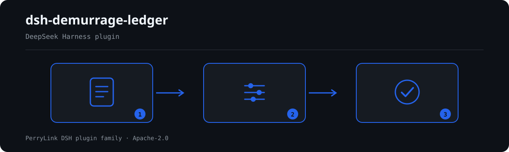

# dsh-demurrage-ledger — कंटेनर विलंब शुल्क बही की पूर्णता और अंकगणित की जाँच

[English](README.md) · [简体中文](README-zh.md) · [Español](README-es.md) · [Português](README-pt.md) · [हिन्दी](README-hi.md)

[](https://dsh.market/)

`dsh-demurrage-ledger` एक कंटेनर विलंब शुल्क बही (滞箱费台账) पढ़ता है — हेडर और प्रत्येक कंटेनर की एक पंक्ति — और उसी बही की पूर्णता तथा अंकगणित की जाँच करता है: क्या हर पंक्ति में कम से कम कंटेनर क्रमांक या बिल ऑफ़ लेडिंग दर्ज है, क्या मुफ़्त अवधि का प्रारंभ दिनांक और वापसी दिनांक पढ़े जा सकते हैं और क्रम में हैं, क्या विलंब दिवस उन दोनों दिनांकों के अंतर में से मुफ़्त दिन घटाकर आते हैं, क्या शुल्क विलंब दिवस × दर के बराबर है, क्या मुद्रा तीन अक्षरों के कोड में लिखी है, क्या कोई कंटेनर क्रमांक दोहराया नहीं गया, और क्या टिप्पणी में कोई अप्रतिस्थापित टेम्पलेट प्लेसहोल्डर शेष नहीं है। मुफ़्त दिन और दर स्वयं बही से लिए जाते हैं, जिसके कॉलम चीनी या अंग्रेज़ी नामों में हो सकते हैं।

## Install

```sh
dsh plugin --profile <name> add dsh-demurrage-ledger
dsh --profile <name> --dump-config | grep 'dsh-demurrage-ledger'
```

## आउटपुट कैसा दिखता है



*कार्यप्रवाह: कॉल → प्लगइन → परिणाम। नीचे के उदाहरण वास्तविक कमांड सतह का उपयोग करते हैं।*


इस प्लगइन का अपने ही `DL-002` टेस्ट फ़िक्स्चर पर वास्तविक आउटपुट — कोई नकली चित्र नहीं। नियम-पैक उद्धरण नहीं गढ़ता, इसलिए हर निष्कर्ष लागू किए गए खंड का नाम और यह भी बताता है कि उसका मूल पाठ इस बार प्राप्त नहीं हुआ।

## यह किन सवालों का जवाब देता है

### उदाहरण

नीचे दी गई तालिका उदाहरण-समुच्चय है: पहली पंक्ति विस्तृत केस है, बाकी संक्षिप्त केस हैं।

| आपका सवाल | इसका जवाब |
|---|---|
| एक पंक्ति में कंटेनर क्रमांक और बिल ऑफ़ लेडिंग दोनों खाली हैं। क्या कुछ बताया जाएगा? | हाँ। `DL-001` उन हर पंक्ति में, जिसे बही इन दो कॉलमों में से कम से कम एक देती है, `containerNo` या `blNo` में से एक भरा होने की अपेक्षा करता है, और दोनों खाली होने पर उस पंक्ति को दर्ज करता है। यह केवल देखता है कि इनमें से एक भरा है, यह नहीं कि शुल्क बनना ही चाहिए था। बही में ये दोनों कॉलम ही न हों तो नियम चुपचाप पास होने के बजाय `skipped` में स्वयं को दर्ज करता है। |
| प्रारंभ दिनांक `15/03/2026` लिखा गया है और वापसी दिनांक उससे पहले का है। नियम क्या करता है? | `DL-002` `startAt` को पढ़ता है और `returnAt` से तुलना करता है: जिस मान को वह दिनांक के रूप में नहीं पढ़ सकता वह उस पंक्ति में दर्ज होता है, छोड़ा नहीं जाता; और वापसी दिनांक से बाद का प्रारंभ दिनांक भी दर्ज होता है — वही दिन बाद का नहीं माना जाता। यह केवल उन दोनों दिनांकों की तुलना करता है: कौन-सी प्रारंभ परिपाटी लागू है (बिल ऑफ़ लेडिंग, रिलीज़ या आगमन) यह वाहक की दर-सूची और अनुबंध का विषय है। |
| विलंब दिवस कॉलम में 10 लिखा है, पर दोनों दिनांक और मुफ़्त अवधि मिलाकर 7 बनते हैं। क्या यह पकड़ में आता है? | हाँ। `DL-003` `returnAt` − `startAt` − `freeDays` से पुनर्गणना करता है और दर्ज `overdueDays` में तय `tolerance` (डिफ़ॉल्ट 0) से अधिक अंतर होने पर उस पंक्ति को दर्ज करता है। यह केवल उन पंक्तियों पर चलता है जिनमें चारों मान मौजूद और पढ़ने योग्य हों; ऐसी कोई पंक्ति न हो तो नियम `skipped` में स्वयं को दर्ज करता है। प्रारंभ परिपाटी और मुफ़्त अवधि में अवकाश-दिवस गिने जाएँ या नहीं, यह अनुबंध पर रहता है — कार्यदिवस या घंटे के आधार पर tolerance बढ़ाएँ या नियम बंद करें। |
| शुल्क विलंब दिवस × दर के बराबर नहीं है, और मेरी दर सीढ़ीनुमा है। क्या यह दर्ज होता है? | `DL-004` `overdueDays` × `rate` की गणना करता है और `amount` में `tolerance` (डिफ़ॉल्ट 0.01) से अधिक अंतर होने पर उस पंक्ति को दर्ज करता है। यह नहीं आँकता कि दर उचित है या वाहक की दर-सूची से मेल खाती है। सीढ़ीनुमा दर एक ही `rate` कॉलम में नहीं समाती, इसलिए ऐसी बही अंतर दर्ज कराएगी: नियम बंद करें, या औसत दर लिखें और टिप्पणी में यह बताएँ। |
| मुद्रा कॉलम में `美元` लिखा है, या `usd`। क्या यह दर्ज होता है? | हाँ। `DL-005` `currency` के हर उस मान को दर्ज करता है जो पैक के पैटर्न `^[A-Z]{3}$` (डिफ़ॉल्ट) से मेल नहीं खाता — `USD` जैसे तीन बड़े अक्षर। यह केवल रूप की जाँच है और यह नहीं आँकती कि निपटान के लिए यही मुद्रा सही है। इसका आधार पैक का एकमात्र उद्धृत सार्वजनिक मानक है, और उसका excerpt दर्ज करता है कि अनुच्छेद का पाठ प्राप्त नहीं हुआ, इसलिए नियम warn पर रहता है। मुद्रा कॉलम न हो तो नियम `skipped` में स्वयं को दर्ज करता है। |
| एक ही कंटेनर क्रमांक दो पंक्तियों में आया है। क्या यह दोहरा दर्ज है? | `DL-006` `containerNo` का मान दोहराने पर उस पंक्ति को दर्ज करता है, तुलना में रिक्त स्थान छोड़ देता है, और बताता है कि वह किस पिछली पंक्ति से मेल खाती है। यह केवल अद्वितीयता देखता है, और परिणाम की पुष्टि मनुष्य को करनी होती है: चरणों में लौटाया गया, या रिलीज़ के बाद फिर रोका गया कंटेनर वैध रूप से दो पंक्तियाँ ले सकता है — पंक्ति हटाने के बजाय टिप्पणी में यह लिखें। `containerNo` कॉलम न हो तो नियम चुपचाप पास होने के बजाय बताता है कि वह चल नहीं सका। |

## यह किन मानकों पर आधारित है

| दस्तावेज़ | संख्यांक | इन्हें उद्धृत करने वाले नियम |
|---|---|---|
| 承运人运价本与运输合同（无国家标准） | 无统一标准（本条依据为台账可追溯性） | DL-001 |
| 承运人运价本与运输合同（无国家标准） | 无统一标准（本条依据为日期自洽） | DL-002 |
| 承运人运价本与运输合同（无国家标准） | 无统一标准（本条依据为算术自洽） | DL-003, DL-004 |
| 《表示货币的代码》 | GB/T 12406—2022（表示货币的代码；2022-12-30 发布并实施；全部代替 GB/T 12406—2008（该版名称为「表示货币和资金的代码」）——注意旧版名称含"资金"；修改采用 ISO 4217:2015，非等同采用；条号本次未取得） | DL-005 |
| 承运人运价本与运输合同（无国家标准） | 无统一标准（本条依据为台账唯一性） | DL-006 |
| 承运人运价本与运输合同（无国家标准） | 无统一标准（本条依据为台账真实性） | DL-007 |

**Boundary:** this plugin checks a **滞箱费台账** for arithmetic and completeness — that a container or bill of
lading is recorded, that the free-period start and the return date parse and follow each other, that the
overdue days equal the gap between those dates less the free days, that the charge equals days × rate, that
the currency follows its format, and that container numbers do not repeat. It does **not** decide who bears
the charge, whether a rate is reasonable, whether a waiver is available, or whether the amount is
recoverable. **Those depend on the contract, the allocation of responsibility and commercial negotiation.**

> ### ⚠️ There is no national standard for this, and the pack does not pretend otherwise
>
> Demurrage and detention are set by **each carrier's tariff and the contract of carriage** — free periods and
> rates differ between carriers, trades and container types, and **no unified national standard exists**. So
> this pack does **not** fabricate a standard number: every rule's `excerpt` states plainly that its basis is
> arithmetic self-consistency or ledger traceability and that **no citable clause exists**. The one exception
> is the currency format, whose home is GB/T 12406 (modified adoption of ISO 4217:2015, not identical), and that excerpt says the clause
> text was not obtained. A test asserts that every excerpt carries one of those admissions.
>
> **The plugin ships no carrier's free period and no rate.** Both come from the ledger. Two consequences are
> worth knowing before trusting a finding:
>
> - **Segmented rates break `DL-004`.** Tariffs commonly step up (one rate for days 1–7, a higher one from
>   day 8). A single `rate` column cannot express that, so a ledger priced in segments will report a
>   difference. Disable the rule, or record an average rate with a note that says so.
> - **`DL-003` does not choose the start convention.** Whether the clock starts at the bill of lading, at
>   release, or at arrival — and whether the free period includes holidays — is the contract's business. The
>   ledger's `起算日期` and `免箱期` are assumed to already follow it.

## Compatibility

| सतह | स्थिति |
|---|---|
| Harness | peer रेंज `>=0.1.2-rc.1 <0.2.0 \|\| >=0.2.0-0 <0.3.0` — `0.2.0-rc.2` और `0.2.1-rc.2` दोनों को स्वीकार करने के लिए सत्यापित। **`engines.dsh` `>=0.2.1-0 <0.3.0` के रूप में घोषित है** और 0.2.1 से होस्ट इसे लागू करता है |
| Node | `^22.19.0 || >=24.0.0` |
| प्लेटफ़ॉर्म | सभी (शुद्ध ESM; कोई नेटिव कोड नहीं, कोई नेटवर्क नहीं, कोई मॉडल कॉल नहीं) |
| टूल मोड | `native` और `ptc` में काम करता है; पूरे फ़ोल्डर के लिए `ptc` चुनें |

## What it does

नियम-सूची, फ़ील्ड और विस्तृत व्यवहार [README.md](README.md#what-it-does) (अंग्रेज़ी मुख्य संस्करण) में हैं। यह प्लगइन केवल उद्धृत धाराओं के सामने शाब्दिक अंतर सूचीबद्ध करता है और हर न चल पाई जाँच को `skipped` में बताता है।

## Configuration

सभी समायोज्य पैरामीटर `src/config.ts` की Schemastery स्कीमा में हैं, इसलिए कोड बदले बिना `cordis.yml` से बदले जा सकते हैं; प्रति-नियम सीमाएँ `rules/` के नियम-पैक में हैं।

| कुंजी | प्रकार | डिफ़ॉल्ट | विवरण |
|---|---|---|---|
| `rulesFile` | string | `rules/demurrage-ledger.yaml` | नियम-पैक का पथ, पैकेज रूट के सापेक्ष |
| `disabledRules` | string[] | `[]` | बंद करने वाले नियम id; प्रत्येक `skipped` में दिखता है |
| `onlyRules` | string[] | `[]` | केवल ये नियम चलाएँ; खाली होने पर सभी नियम चलते हैं |
| `skipNotes` | string | `""` | हर `skipped` कारण के आगे जोड़ी जाने वाली टिप्पणी |
| `timeoutMs` | number | `120000` | उपकरण का सहकारी समय-सीमा बजट |

## Material format

JSON या YAML स्वीकार्य है। पूरा फ़ील्ड उदाहरण [README.md](README.md#material-format) (अंग्रेज़ी मुख्य संस्करण) में है। पढ़ने की परत में फ़ील्ड वैकल्पिक हैं और जाँच इंजन उन्हें सत्यापित करता है, इसलिए आंशिक निर्यात पर क्रैश के बजाय "अनुपस्थित" श्रेणी के निष्कर्ष मिलते हैं।

## Rule sources

नियम-डेटा कोड से अलग है: प्रत्येक नियम में दस्तावेज़, संख्या, स्रोत की अपनी क्रमांकन-प्रणाली के अनुसार धारा, शब्दशः उद्धरण और स्रोत URL होता है। लोडर लागू करता है कि उद्धरण कम से कम आठ अक्षरों का वास्तविक उद्धरण हो, और जिस जाँच का आधार केवल सामान्य सिद्धांत (`kind: derived-from-principle`, अधिकतम `warn`) या स्थानीय नीति (`kind: institutional-configuration`, अधिकतम `info`) हो, उसे कभी `error` घोषित न किया जाए।

सत्यापित सीमाएँ और जान-बूझकर **न** कहे गए निष्कर्ष [README.md](README.md#rule-sources) (अंग्रेज़ी मुख्य संस्करण) और `rules/evidence/` में हैं।

## Troubleshooting

- **प्लगइन इंस्टॉल हो गया पर टूल दिखता नहीं**: जाँचें कि `main` `lib/index.mjs` पर जाता है और `pnpm run build` ने उसे बनाया है।
- **`dsh plugin add` असंगत बताकर मना करता है**: peer range `0.1.x` और `0.2.x` दोनों को कवर करती है; बाहर होने पर स्पष्ट छूट दें: `dsh plugin --profile <name> allow-version <pkg@ver> --dsh-version <runtime> --accept-risk`।
- **कोई नियम नहीं चला**: `skipped` सरणी देखें।
- **`check` में `manifest-peers` विफल दिखता है**: यह `dsh-plugin-dev` की ज्ञात अपस्ट्रीम समस्या है; रनटाइम इंस्टॉल के समय अनुकूलता लागू करता है।
- **समय खिसका हुआ लगता है**: सारी गणना दिए गए स्ट्रिंग पर वॉल-क्लॉक है।

## Development

```sh
pnpm install
pnpm run typecheck
pnpm test
pnpm run build
node ../scripts/sync-shared.mjs dsh-demurrage-ledger
```

अंतिम कमांड `../_shared` का साझा किट `src/shared/` में कॉपी करता है; हर साझा बदलाव के बाद इसे दोबारा चलाएँ।

## PerryLink DSH Plugin Family

यह प्रोजेक्ट [PerryLink](https://github.com/PerryLink) के DeepSeek Harness प्लगइन परिवार का हिस्सा है। पूरी सूची नीचे संक्षिप्त रखी गई है ताकि हर README की पहली स्क्रीन छोटी रहे; हर पंक्ति और उसकी स्थिति देखने के लिए इसे खोलें।

<details>
<summary>सभी प्लगइन खोलें</summary>

| प्लगइन | स्थिति |
|---|---|
| **[dsh-aqua-input-check](https://github.com/PerryLink/dsh-aqua-input-check)** |  |
| **[dsh-archive-check](https://github.com/PerryLink/dsh-archive-check)** |  |
| **[dsh-auto-review](https://github.com/PerryLink/dsh-auto-review)** |  |
| **[dsh-autotier](https://github.com/PerryLink/dsh-autotier)** |  |
| **[dsh-bid-ca-precheck](https://github.com/PerryLink/dsh-bid-ca-precheck)** |  |
| **[dsh-bid-qual-check](https://github.com/PerryLink/dsh-bid-qual-check)** |  |
| **[dsh-cert-mcp](https://github.com/PerryLink/dsh-cert-mcp)** |  |
| **[dsh-checkpoint-rewind](https://github.com/PerryLink/dsh-checkpoint-rewind)** |  |
| **[dsh-click](https://github.com/PerryLink/dsh-click)** |  |
| **[dsh-composer-history](https://github.com/PerryLink/dsh-composer-history)** |  |
| **[dsh-contract-stance](https://github.com/PerryLink/dsh-contract-stance)** |  |
| **[dsh-customs-doc-check](https://github.com/PerryLink/dsh-customs-doc-check)** |  |
| **[dsh-data-quality](https://github.com/PerryLink/dsh-data-quality)** |  |
| **[dsh-demurrage-ledger](https://github.com/PerryLink/dsh-demurrage-ledger)** |  |
| **[dsh-doublecheck](https://github.com/PerryLink/dsh-doublecheck)** |  |
| **[dsh-drill-script-check](https://github.com/PerryLink/dsh-drill-script-check)** |  |
| **[dsh-eia-guide-check](https://github.com/PerryLink/dsh-eia-guide-check)** |  |
| **[dsh-emergency-plan](https://github.com/PerryLink/dsh-emergency-plan)** |  |
| **[dsh-essay-rubric-check](https://github.com/PerryLink/dsh-essay-rubric-check)** |  |
| **[dsh-evidence-check](https://github.com/PerryLink/dsh-evidence-check)** |  |
| **[dsh-export-ctl-check](https://github.com/PerryLink/dsh-export-ctl-check)** |  |
| **[dsh-fast](https://github.com/PerryLink/dsh-fast)** |  |
| **[dsh-fmea-table-check](https://github.com/PerryLink/dsh-fmea-table-check)** |  |
| **[dsh-forecast-penalty](https://github.com/PerryLink/dsh-forecast-penalty)** |  |
| **[dsh-fund-research](https://github.com/PerryLink/dsh-fund-research)** |  |
| **[dsh-github](https://github.com/PerryLink/dsh-github)** |  |
| **[dsh-gongwen-flow-check](https://github.com/PerryLink/dsh-gongwen-flow-check)** |  |
| **[dsh-gongwen-word-check](https://github.com/PerryLink/dsh-gongwen-word-check)** |  |
| **[dsh-guard-plan-qc](https://github.com/PerryLink/dsh-guard-plan-qc)** |  |
| **[dsh-hazchem-check](https://github.com/PerryLink/dsh-hazchem-check)** |  |
| **[dsh-hazplan-check](https://github.com/PerryLink/dsh-hazplan-check)** |  |
| **[dsh-hidden-risk-map](https://github.com/PerryLink/dsh-hidden-risk-map)** |  |
| **[dsh-hs-classify](https://github.com/PerryLink/dsh-hs-classify)** |  |
| **[dsh-icd-rule-check](https://github.com/PerryLink/dsh-icd-rule-check)** |  |
| **[dsh-industry-research](https://github.com/PerryLink/dsh-industry-research)** |  |
| **[dsh-lawcite-adapter](https://github.com/PerryLink/dsh-lawcite-adapter)** |  |
| **[dsh-laya](https://github.com/PerryLink/dsh-laya)** |  |
| **[dsh-lc-doc-check](https://github.com/PerryLink/dsh-lc-doc-check)** |  |
| **[dsh-learning-gap-check](https://github.com/PerryLink/dsh-learning-gap-check)** |  |
| **[dsh-library](https://github.com/PerryLink/dsh-library)** |  |
| **[dsh-local-ai](https://github.com/PerryLink/dsh-local-ai)** |  |
| **[dsh-lsp-actions](https://github.com/PerryLink/dsh-lsp-actions)** |  |
| **[dsh-mask](https://github.com/PerryLink/dsh-mask)** |  |
| **[dsh-mcp-panel](https://github.com/PerryLink/dsh-mcp-panel)** |  |
| **[dsh-medrec-qc](https://github.com/PerryLink/dsh-medrec-qc)** |  |
| **[dsh-memento](https://github.com/PerryLink/dsh-memento)** |  |
| **[dsh-nsfc-form-check](https://github.com/PerryLink/dsh-nsfc-form-check)** |  |
| **[dsh-nurse-record-check](https://github.com/PerryLink/dsh-nurse-record-check)** |  |
| **[dsh-observe](https://github.com/PerryLink/dsh-observe)** |  |
| **[dsh-origin-rvc-check](https://github.com/PerryLink/dsh-origin-rvc-check)** |  |
| **[dsh-ota-review-check](https://github.com/PerryLink/dsh-ota-review-check)** |  |
| **[dsh-output-styles](https://github.com/PerryLink/dsh-output-styles)** |  |
| **[dsh-paper-doc-adapter](https://github.com/PerryLink/dsh-paper-doc-adapter)** |  |
| **[dsh-permission-rules](https://github.com/PerryLink/dsh-permission-rules)** |  |
| **[dsh-permit-report-check](https://github.com/PerryLink/dsh-permit-report-check)** |  |
| **[dsh-pipeline-check](https://github.com/PerryLink/dsh-pipeline-check)** |  |
| **[dsh-pleading-draft](https://github.com/PerryLink/dsh-pleading-draft)** |  |
| **[dsh-plugin-doctor](https://github.com/PerryLink/dsh-plugin-doctor)** |  |
| **[dsh-plugin-guide](https://github.com/PerryLink/dsh-plugin-guide)** |  |
| **[dsh-plugin-kit](https://github.com/PerryLink/dsh-plugin-kit)** |  |
| **[dsh-plugin-upgrade](https://github.com/PerryLink/dsh-plugin-upgrade)** |  |
| **[dsh-policy-brief-draft](https://github.com/PerryLink/dsh-policy-brief-draft)** |  |
| **[dsh-power-loss-split](https://github.com/PerryLink/dsh-power-loss-split)** |  |
| **[dsh-power-ticket-check](https://github.com/PerryLink/dsh-power-ticket-check)** |  |
| **[dsh-ppap-check](https://github.com/PerryLink/dsh-ppap-check)** |  |
| **[dsh-protest-deadline](https://github.com/PerryLink/dsh-protest-deadline)** |  |
| **[dsh-railway-window](https://github.com/PerryLink/dsh-railway-window)** |  |
| **[dsh-repair-order-qc](https://github.com/PerryLink/dsh-repair-order-qc)** |  |
| **[dsh-research-report](https://github.com/PerryLink/dsh-research-report)** |  |
| **[dsh-review-reply-check](https://github.com/PerryLink/dsh-review-reply-check)** |  |
| **[dsh-rulefile-check](https://github.com/PerryLink/dsh-rulefile-check)** |  |
| **[dsh-safety-brief-check](https://github.com/PerryLink/dsh-safety-brief-check)** |  |
| **[dsh-score](https://github.com/PerryLink/dsh-score)** |  |
| **[dsh-session-sync](https://github.com/PerryLink/dsh-session-sync)** |  |
| **[dsh-site-log-check](https://github.com/PerryLink/dsh-site-log-check)** |  |
| **[dsh-skill-pack-security](https://github.com/PerryLink/dsh-skill-pack-security)** |  |
| **[dsh-soe-decision-check](https://github.com/PerryLink/dsh-soe-decision-check)** |  |
| **[dsh-soilwater-check](https://github.com/PerryLink/dsh-soilwater-check)** |  |
| **[dsh-sop-sync-check](https://github.com/PerryLink/dsh-sop-sync-check)** |  |
| **[dsh-spc-gbt-adapter](https://github.com/PerryLink/dsh-spc-gbt-adapter)** |  |
| **[dsh-talk](https://github.com/PerryLink/dsh-talk)** |  |
| **[dsh-tender-extract](https://github.com/PerryLink/dsh-tender-extract)** |  |
| **[dsh-tender-matrix](https://github.com/PerryLink/dsh-tender-matrix)** |  |
| **[dsh-test-drive](https://github.com/PerryLink/dsh-test-drive)** |  |
| **[dsh-ticktick](https://github.com/PerryLink/dsh-ticktick)** |  |
| **[dsh-translate](https://github.com/PerryLink/dsh-translate)** |  |
| **[dsh-warranty-calc](https://github.com/PerryLink/dsh-warranty-calc)** |  |
| **[dsh-budget](https://github.com/PerryLink/dsh-budget)** | 🧊 फ़्रोज़न — रिपॉज़िटरी README देखें |
| **[dsh-claude-move](https://github.com/PerryLink/dsh-claude-move)** | 🧊 फ़्रोज़न — रिपॉज़िटरी README देखें |
| **[dsh-defend](https://github.com/PerryLink/dsh-defend)** | 🧊 फ़्रोज़न — रिपॉज़िटरी README देखें |
| **[dsh-draw](https://github.com/PerryLink/dsh-draw)** | 🧊 फ़्रोज़न — रिपॉज़िटरी README देखें |
| **[dsh-reach](https://github.com/PerryLink/dsh-reach)** | 🧊 फ़्रोज़न — रिपॉज़िटरी README देखें |
| **[dsh-background-agents](https://github.com/PerryLink/dsh-background-agents)** | 🚫 सेवानिवृत्त — रिपॉज़िटरी README देखें |
| **[dsh-session-pin](https://github.com/PerryLink/dsh-session-pin)** | 🚫 सेवानिवृत्त — रिपॉज़िटरी README देखें |
| **[dsh-team-rooms](https://github.com/PerryLink/dsh-team-rooms)** | 🚫 सेवानिवृत्त — रिपॉज़िटरी README देखें |

</details>

## License

[Apache License 2.0](LICENSE) © 2026 dsh-demurrage-ledger contributors.
