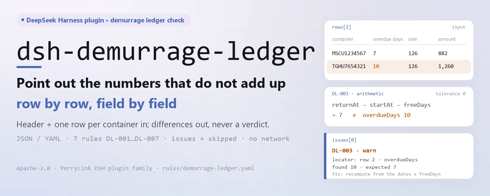
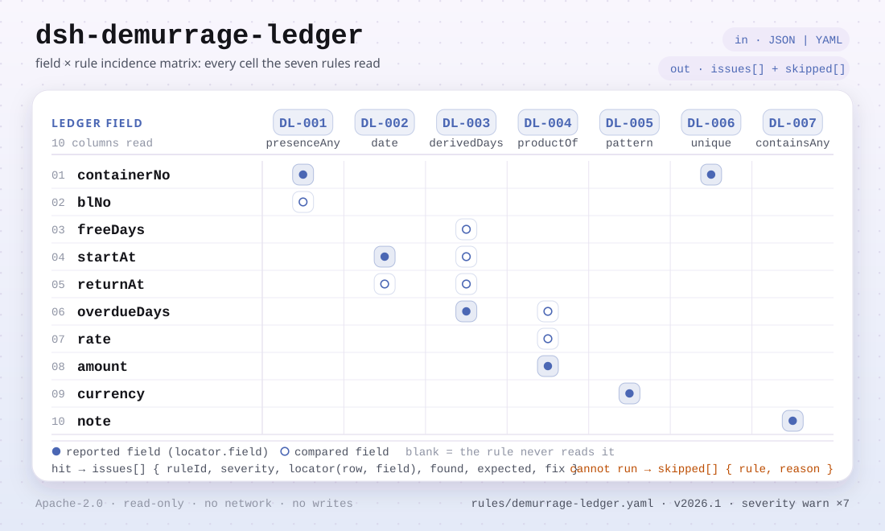

<div align="center">

<picture>
  <source media="(prefers-color-scheme: dark)" srcset="docs/assets/dsh-demurrage-ledger-hero-en-dark.webp">
  
</picture>

# dsh-demurrage-ledger

**Point out the numbers in a demurrage and detention ledger that do not add up — row by row, without pronouncing a verdict.**

A DeepSeek Harness checker for shipping, customs and settlement desks: it reads a ledger made of a header plus one row per container, checks completeness and arithmetic, and returns a list of what is inconsistent, where, and what to fix.

[Install](#three-step-setup) · [Configuration](#configuration) · [FAQ](#faq) · [简体中文](README.md) · [English](README.en.md)

[](LICENSE)
[](#compatibility)
[](https://www.npmjs.com/package/dsh-demurrage-ledger)
[](https://github.com/PerryLink/dsh-demurrage-ledger/actions/workflows/ci.yml)
[](#compatibility)

[](https://github.com/PerryLink/dsh-demurrage-ledger/stargazers)
[](https://www.npmjs.com/package/dsh-demurrage-ledger)
[](https://dshfind.com/plugins/PerryLink/dsh-demurrage-ledger?ref=badge)
[](https://securityscorecards.dev/viewer/?uri=github.com/PerryLink/dsh-demurrage-ledger)
[](https://dsh.market/)

```sh
dsh plugin --profile <name> add dsh-demurrage-ledger
```

</div>

<sub>Community plugin, not affiliated with DeepSeek. Canonical repository: <https://github.com/PerryLink/dsh-demurrage-ledger>.</sub>

## What it is

`dsh-demurrage-ledger` reads one demurrage and detention ledger — the header plus one row per container — and checks that ledger's own completeness and arithmetic: that each row records at least a container number or a bill of lading, that the free-period start and the return date parse and follow each other, that the overdue days equal the gap between those two dates less the free days, that the charge equals the overdue days × the rate, that the currency is written as a three-letter code, that no container number is repeated, and that no unreplaced template placeholder survives in the remark. The free days and the rate are read from the ledger itself, whose columns may be named in Chinese or in English.

It lists only the differences the material itself can evidence: it does not decide who bears the charge, whether a rate is reasonable, whether a waiver is available, or whether the amount is recoverable — those depend on the carrier's tariff, the contract of carriage and commercial negotiation. Everything runs in memory: no network, no model call, and the file you hand in is never modified.

<picture>
  <source media="(prefers-color-scheme: dark)" srcset="docs/assets/dsh-demurrage-ledger-flow-v5-dark.svg">
  
</picture>

## Three-step setup

1. **Install** (pick one channel):

   ```sh
   # git channel (latest main; the prepare script builds lib/ on install)
   dsh plugin --profile web add github:PerryLink/dsh-demurrage-ledger
   # npm channel (published releases)
   dsh plugin --profile web add dsh-demurrage-ledger
   # tarball channel: pnpm pack in this repo, then
   dsh plugin --profile web add ./dsh-demurrage-ledger-<version>.tgz
   ```

2. **Minimal config** (the defaults work; `cordis.patch.yml` only inserts its own row):

   ```yaml
   - insert:
       - id: dsh-demurrage-ledger
         name: dsh-demurrage-ledger
   ```

   Add a `config` block only when you need to disable rules, run a subset, or point at another rule pack — see Configuration.

3. **Verify it mounts**:

   ```sh
   dsh --profile web --dump-config | grep 'dsh-demurrage-ledger'
   ```

   An offline quickstart also ships in the repo (build first):

   ```sh
   pnpm install && pnpm run build
   node samples/quickstart/run.mjs
   ```

   ```text
   $ node samples/quickstart/run.mjs
   demurrage_ledger: 1 issue(s) — error 0, warn 1, info 0
   skipped: 1
   ```

**Uninstall**: `dsh plugin --profile web remove dsh-demurrage-ledger` (or remove the row from the profile patch).

## Core capabilities

`dsh-demurrage-ledger` registers exactly one tool, `demurrage_ledger`: it reads a ledger, applies a versioned rule pack, and returns a located report.

- **Chinese and English columns both work** — aliases for container number / `containerNo`, bill of lading / `blNo`, free days / `freeDays`, start date / `startAt`, return date / `returnAt`, overdue days / `overdueDays`, rate / `rate`, amount / `amount`, currency / `currency`, remark / `note` are declared once; matching ignores case, spaces, underscores and hyphens, and a finding names the column it read from your ledger.
- **All seven rules live in data** — `rules/demurrage-ledger.yaml` declares every check, threshold and source; swapping that file swaps the rule set with no TypeScript change. The pack is validated on load, never trusted.
- **Every finding is reviewable** — the report gives `ruleId`, `severity`, `locator` (row + field), `found`, `expected` and `fix`, and always carries the disclaimer; a wording guard blocks verdicts on compliance, liability or correctness.
- **Skipped is never silent** — a check that cannot run (missing column, disabled rule, four values not all present) is listed in `skipped` with its reason; an empty `issues` list can never be read as "nothing is wrong".
- **Read-only and hot-reloadable** — tool registration is a Cordis effect, undone on stop or hot reload; nothing is written to disk, no network call, no model call.

| Rule | Checks | Severity | Basis |
|---|---|---|---|
| `DL-001` | a container or bill of lading is recorded | warn | ledger traceability |
| `DL-002` | the start and return dates parse and follow each other | warn | date consistency |
| `DL-003` | overdue days match the dates and the free period | warn | arithmetic |
| `DL-004` | the charge equals overdue days × rate | warn | arithmetic |
| `DL-005` | the currency is a three-letter code | warn | GB/T 12406 |
| `DL-006` | container numbers are unique in the ledger | warn | ledger uniqueness |
| `DL-007` | the remark column holds no unreplaced placeholder | warn | ledger integrity |

### Material format

The tool accepts JSON or YAML; the material can arrive through `file` or inline through `material`:

```yaml
carrier: 某某船务
blNo: MSCUAA123456
rows:
  - { 箱号: MSCU1234567, 提单号: MSCUAA123456, 免箱期: '7', 起算日期: 2026-03-01,
      还箱日期: 2026-03-15, 超期天数: '7', 费率: '120', 滞箱费金额: '840', 币制: USD,
      备注: 按运价本分段计费，此为平均费率 }
```

Dates may be `2026-03-01` or `2026-03-01 14:00`, and numeric cells may carry units and thousands separators. Fields are optional at the reader layer and validated by the check engine, so a partial export produces "missing value" findings instead of a crash. Excel can be converted to JSON/YAML first — in a chat that supports file input, the conversion can be done for you.

### Real output (example)

For the `DL-001` test fixture, **input**:

~~~json
{"rows":[{"箱号":"","提单号":"","箱型":"40HQ", ...}]}
~~~

**Output**:

~~~json
{
  "id": "dsh-demurrage-ledger.DL-001.de09b5a6",
  "ruleId": "DL-001",
  "severity": "warn",
  "locator": {
    "row": 1,
    "field": "containerNo"
  },
  "found": "第 1 行 containerNo、blNo 都为空",
  "expected": "containerNo、blNo 至少应填写一项",
  "fix": "补填箱号与提单号；本条只核对是否填写，不判断费用是否应当发生"
}
~~~

*Observed from `dsh-demurrage-ledger/tests/fixtures/DL-001/DL-001-unsafe.json; dsh-demurrage-ledger/tests/fixtures/DL-001/cases.json; dsh-demurrage-ledger/rules/demurrage-ledger.yaml; dsh-demurrage-ledger/tests/index.test.ts`*

### Rule Q&A

| You ask | What it answers |
|---|---|
| A row has both the container number and the bill of lading blank. Will the check say anything? | Yes. `DL-001` requires `containerNo` or `blNo` to be filled on every row the ledger gives at least one of those two columns, and reports the row when both are empty. It checks only that one of them is filled, not whether the charge should have arisen. A ledger carrying neither column makes the rule list itself in `skipped` rather than passing silently. |
| The start date was typed as `15/03/2026` and the return date falls before it. What does the rule do? | `DL-002` parses `startAt` and compares it with `returnAt`: a value it cannot read as a date is reported on that row rather than passed over, and a start date later than the return date is reported too — the same day counts as not later. It compares those two dates only; which start convention applies (bill of lading, release or arrival) is left to the carrier's tariff and the contract. |
| The overdue days column says 10, but the two dates and the free period give 7. Is that caught? | Yes. `DL-003` recomputes the days as `returnAt` − `startAt` − `freeDays` and reports the row when the declared `overdueDays` differ by more than the configured `tolerance`, which is 0 by default. It runs only on rows where all four values are present and parse; when no row carries all four, the rule reports itself in `skipped`. The start convention and whether the free period counts holidays stay with the contract — for a working-day or hourly basis, raise the tolerance or disable the rule. |
| The charge does not equal the overdue days times the rate — and my tariff steps up after the first week. | `DL-004` multiplies `overdueDays` × `rate` and reports the row when `amount` differs by more than the `tolerance`, 0.01 by default. It does not judge whether the rate is reasonable or whether it matches the tariff. A stepped tariff cannot be expressed in one `rate` cell, so such a ledger will report a difference: disable the rule, or record an average rate and say so in the remark. |
| The currency cell spells the currency out as a word, or writes `usd` in lower case. Is that reported? | Yes. `DL-005` reports any `currency` value that does not match the pack's pattern, `^[A-Z]{3}$` by default — three upper-case letters such as `USD`. It is a form check only and does not judge whether that currency is the right one for the settlement. Its basis is the one public standard the pack cites, and its excerpt records that the clause text was not obtained, so the rule stays at warn. A ledger with no currency column makes the rule report itself in `skipped`. |
| The same container number appears on two rows. Is that a duplicate entry? | `DL-006` reports the row when a `containerNo` value repeats, comparing with whitespace ignored, and names the earlier row it matches. It checks uniqueness only, and a hit needs human confirmation: a box returned in stages, or released and then detained again, can legitimately take two rows — say so in the remark rather than deleting a row. With no `containerNo` column the rule reports that it could not run instead of passing silently. |

## Configuration

Every tunable lives in the Schemastery schema of `src/config.ts`, so it can be changed from `cordis.yml` without touching code; per-rule thresholds live in the rule pack under `rules/`.

| Key | Type | Default | Description |
|---|---|---|---|
| `rulesFile` | string | `rules/demurrage-ledger.yaml` | Rule-pack path, relative to the package root |
| `disabledRules` | string[] | `[]` | Rule ids to stop running; each appears in `skipped` |
| `onlyRules` | string[] | `[]` | Run only these rule ids; empty runs every rule |
| `skipNotes` | string | `""` | Note appended to every `skipped` reason |
| `timeoutMs` | number | `120000` | Cooperative tool timeout budget |

Rule-level parameters (edit the rule pack, not the code):

- `DL-003` `daysField` / `fromField` / `toField` / `subtractField` / `tolerance` — the day arithmetic. Raise `tolerance` if the ledger rounds, or disable the rule for a working-day or hourly basis.
- `DL-004` `resultField` / `factorFields` / `tolerance` — the charge arithmetic, tolerance `0.01` by default.
- `DL-005` `pattern` — the currency shape; three upper-case letters by default.
- `DL-007` `terms` — the placeholders to look for.

Profile patch override example:

```yaml
- insert:
    - id: dsh-demurrage-ledger
      name: dsh-demurrage-ledger
      config:
        onlyRules: [DL-001, DL-002, DL-003, DL-004]
        skipNotes: reviewed against our internal procedure
```

## FAQ

<details>
<summary>Where does the ledger data go? Is it sent anywhere?</summary>

No. The plugin reads only the file you pass through `file`, or the inline text in `material`; it makes no network request, calls no model, writes nothing to disk, and keeps no database or cache. The report is returned in the session; the plugin itself persists nothing. `package.json#dsh.demo` declares exactly that surface as `network: false` and `writes: []`.

</details>

<details>
<summary>A rule did not run — does that mean the ledger is clean?</summary>

No. A check that cannot run (missing column, rule disabled through `disabledRules`, four values not all present) is listed in `skipped` with its rule id and reason; the `skipNotes` remark is appended to every reason. An empty `issues` list means only that the checks which could run found no difference, never that the ledger is sound.

</details>

<details>
<summary>Does it fight other plugins over tool names, service keys or slots?</summary>

No. The plugin registers exactly one tool, `demurrage_ledger`, through `ctx.tools.register`; it registers no command, provides no service key, registers no client slot, registers no `webServer` route, and mutates no global. Its bundle patch only `insert`s its own row and never overwrites a built-in row's `config`. The evidence is spelled out under Interoperability with other DSH plugins.

</details>

<details>
<summary>How big is the performance overhead?</summary>

Pure in-memory table parsing plus rule evaluation: no network request, no model call, no native dependency. `timeoutMs` is a cooperative timeout budget, `120000` ms by default; for a whole month of ledgers use `ptc` tool mode so the schema cost is paid once.

</details>

## Security boundaries

- **Read-only material.** The tool reads the file behind `file` or the inline text in `material`; it does not modify the original, does not write to disk, and keeps no hidden store.
- **Differences only, no verdict.** The report does not decide compliance, liability or correctness, nor whether a charge should have arisen; every finding carries the disclaimer, and a wording guard blocks adjudicating phrasing at render time.
- **An empty result is not a pass.** A check that cannot run is always listed in `skipped` with its rule id and reason; when the columns a rule needs are absent, the rule reports itself instead of passing silently.
- **Citation guard.** Every rule must carry `document` / `number` / `clause` / `excerpt` / `kind` / `source`, and the excerpt must be a real quotation of at least eight characters; `derived-from-principle` is capped at `warn`, `institutional-configuration` at `info`, and a pack that overstates its basis fails at load.
- **Registration is an effect.** Tool registration returns a disposer, so stopping or hot-reloading removes it and leaves no background listener.

## Known limitations

- **No national standard can be cited.** Demurrage and detention are set by each carrier's tariff and the contract of carriage — free periods and rates differ between carriers, trades and container types; the pack's `excerpt` says plainly that its basis is arithmetic self-consistency or ledger traceability and does not fabricate a standard number. The one exception is the currency format (GB/T 12406), whose excerpt also records that the clause text was not obtained, so it stays capped at `warn`.
- **Segmented rates break `DL-004`.** Tariffs commonly step up (one rate for days 1–7, a higher one from day 8). A single `rate` column cannot express that, so a ledger priced in segments will report a difference; disable the rule, or record an average rate with a note that says so.
- **`DL-003` does not choose the start convention.** Whether the clock starts at the bill of lading, at release or at arrival — and whether the free period includes holidays — is the contract's business. The ledger's `start date` and `free days` columns are assumed to already follow it.
- **Form only, not reasonableness.** `DL-005` checks only that the currency is three upper-case letters, not whether that currency is the right one for the settlement; `DL-004` does not judge whether the rate is reasonable or matches the tariff.
- **Wall-clock arithmetic.** Every date and number is computed on the input strings themselves, with no time-zone conversion; align the source system first for a ledger entered across time zones.
- **The plugin ships no carrier's free period and no rate.** Both come from the ledger; when absent, the corresponding rule goes to `skipped` instead of guessing a default.

## Interoperability with other DSH plugins

This plugin shares no mutable state with other DSH plugins. Evidence is a static reading of this repo's manifest and source:

- **One tool only.** The only registration surface in `src/index.ts` is `ctx.tools.register(defineTool({ name: 'demurrage_ledger', … }))`; no command and no session-event listener.
- **No service-key conflict.** `package.json#dsh.capabilities` is just `tools:register`, `inject` is just `['tools']`, and the plugin provides no service key.
- **No slot conflict.** The repo has no `client/` directory, registers no client slot, and does not compete for UI seats.
- **No HTTP route conflict.** It registers no `webServer` prefix.
- **No patch-layer conflict.** The bundle patch only `insert`s its own row and never overwrites a built-in row's `config`.
- **No global mutation.** It does not patch prototypes, read or write `process.env`, or replace a global; material enters only through `file` / `material`, and nothing is exchanged with other plugins.

## Compatibility

| Surface | Status |
|---|---|
| Harness | Peer range `>=0.1.2-rc.1 <0.2.0 \|\| >=0.2.0-0 <0.3.0` — verified to accept both `0.2.0-rc.2` and `0.2.1-rc.2`. `engines.dsh` is declared as `>=0.2.1-0 <0.3.0` and is enforced by the host since 0.2.1 |
| Node | `^22.19.0 \|\| >=24.0.0` |
| Platforms | All (plain ESM; no native code, no network, no model call) |
| Tool mode | Works in `native` and `ptc`; use `ptc` for a whole month of ledgers, so the schema cost is paid once |

## Ecosystem & quality

- [dshfind plugin page](https://dshfind.com/plugins/PerryLink/dsh-demurrage-ledger) (installs and ranking)
- [OpenSSF Scorecard report](https://securityscorecards.dev/viewer/?uri=github.com/PerryLink/dsh-demurrage-ledger) (driven by [.github/workflows/scorecard.yml](.github/workflows/scorecard.yml))
- [DSH Market](https://dsh.market/) (listed)
- [Choose a checker by material](https://perrylink.github.io/zh/checkers/choose/) (family index: 62 checkers plus general-purpose plugins)
- [Rule verification records](rules/evidence/) (the per-citation verification notes kept in-repo)

## Rule sources & verification

Rule data is separate from code and lives in `rules/demurrage-ledger.yaml`. Demurrage has no national standard to cite, so the pack's `basis` entries say exactly that instead of inventing a number; the only external reference is the currency-code standard, whose excerpt admits the clause text was not obtained. The load-time guard still requires every rule to carry a document, a clause, an excerpt and a source, and still forbids a `derived-from-principle` or locally configured check from being `error`.

| Document | Number | Cited by rules |
|---|---|---|
| Carrier's tariff and contract of carriage (no national standard) | No unified standard (this rule rests on ledger traceability) | DL-001 |
| Carrier's tariff and contract of carriage (no national standard) | No unified standard (this rule rests on date consistency) | DL-002 |
| Carrier's tariff and contract of carriage (no national standard) | No unified standard (this rule rests on arithmetic) | DL-003, DL-004 |
| Codes for the representation of currencies | GB/T 12406—2022 (2022-12-30 published and implemented; fully replaces GB/T 12406—2008, whose title was "Codes for the representation of currencies and funds"; modified adoption of ISO 4217:2015, not identical; clause number not obtained) | DL-005 |
| Carrier's tariff and contract of carriage (no national standard) | No unified standard (this rule rests on ledger uniqueness) | DL-006 |
| Carrier's tariff and contract of carriage (no national standard) | No unified standard (this rule rests on ledger integrity) | DL-007 |

**Boundary:** this plugin checks a **demurrage and detention ledger** for arithmetic and completeness — that a container or bill of lading is recorded, that the free-period start and the return date parse and follow each other, that the overdue days equal the gap between those dates less the free days, that the charge equals days × rate, that the currency follows its format, and that container numbers do not repeat. It does **not** decide who bears the charge, whether a rate is reasonable, whether a waiver is available, or whether the amount is recoverable. **Those depend on the contract, the allocation of responsibility and commercial negotiation.**

> ### ⚠️ There is no national standard for this, and the pack does not pretend otherwise
>
> Demurrage and detention are set by **each carrier's tariff and the contract of carriage** — free periods and rates differ between carriers, trades and container types, and **no unified national standard exists**. So this pack does **not** fabricate a standard number: every rule's `excerpt` states plainly that its basis is arithmetic self-consistency or ledger traceability and that **no citable clause exists**. The one exception is the currency format, whose home is GB/T 12406 (modified adoption of ISO 4217:2015, not identical), and that excerpt says the clause text was not obtained. A test asserts that every excerpt carries one of those admissions.
>
> **The plugin ships no carrier's free period and no rate.** Both come from the ledger. Two consequences are worth knowing before trusting a finding:
>
> - **Segmented rates break `DL-004`.** Tariffs commonly step up (one rate for days 1–7, a higher one from day 8). A single `rate` column cannot express that, so a ledger priced in segments will report a difference. Disable the rule, or record an average rate with a note that says so.
> - **`DL-003` does not choose the start convention.** Whether the clock starts at the bill of lading, at release or at arrival — and whether the free period includes holidays — is the contract's business. The ledger's `start date` and `free days` columns are assumed to already follow it.

## Troubleshooting

- **The plugin installs but the tool never appears.** Check that `main` resolves to `lib/index.mjs` and that `pnpm run build` produced it; a wrong `main` makes the loader skip the entry silently.
- **`dsh plugin add` refuses the package as incompatible.** The peer range covers `0.1.x` and `0.2.x`; if your runtime sits outside it, grant an explicit exemption: `dsh plugin --profile <name> allow-version <pkg@ver> --dsh-version <runtime> --accept-risk`.
- **A rule did not run.** Read the `skipped` array; it names the rule id and the reason.
- **`check` reports `manifest-peers` as failed.** The static checker compares against a hard-coded peer range that predates the 0.2 line; the runtime enforces peer compatibility at install time. This is a known upstream issue in `dsh-plugin-dev`.
- **Timestamps look shifted.** All arithmetic is wall-clock over the strings as supplied, with no time-zone conversion.
- **`DL-003` fires on a ledger I computed by hand.** Check the start convention and whether the free period includes holidays; the finding shows the two dates and the free days it used, so the sum can be redone.
- **`DL-004` fires on a segmented tariff.** A single rate cannot express a stepped tariff. Disable the rule, or record an average rate and say so in the remark.
- **`DL-005` fires on `USD `.** The default pattern accepts exactly three upper-case letters; a trailing space or a lower-case code fails. Normalise the export.
- **`DL-006` fires twice on one container.** That can be legitimate — a container returned in stages, or re-detained after release. Say so in the remark rather than deleting a row.

## Development

```sh
pnpm install
pnpm run typecheck   # tsc --noEmit
pnpm test            # vitest, the shared table-plugin suite plus paired fixtures
pnpm run build       # tsdown -> lib/index.mjs + lib/index.d.mts
pnpm run check:readmes   # five-language README consistency
node ../scripts/sync-shared.mjs dsh-demurrage-ledger   # refresh src/shared
```

The plugin is **data-only**: `src/model.ts` declares the table shape, the shared kit supplies the reader and the check engine, and the rule pack declares every check. `prepublishOnly` re-runs the gate, so a release cannot ship an unbuilt or drifted tree.

Images are generated by [`scripts/gen-readme-assets.py`](scripts/gen-readme-assets.py) (Pillow draws the four zh/en light/dark hero banners; the field × rule matrix is a hand-written light/dark SVG); re-run it with `python scripts/gen-readme-assets.py`.

Topics: `dsh`, `dsh-plugin`, `deepseek-harness`, `deepseek`, `cordis`, `demurrage`, `ledger`

## Family & thanks

This project is a member of the DeepSeek Harness plugin family maintained by [PerryLink](https://github.com/PerryLink) (all Apache-2.0). If this plugin helps you, **give it a star** — it unlocks nothing, but it helps the next person find it.

- [@PerryLink](https://github.com/PerryLink) — creator and maintainer: the rule pack, the shared check engine and the five-language docs.

<details>
<summary>Expand all plugins</summary>

| Plugin | Status |
|---|---|
| **[dsh-aqua-input-check](https://github.com/PerryLink/dsh-aqua-input-check)** |  |
| **[dsh-archive-check](https://github.com/PerryLink/dsh-archive-check)** |  |
| **[dsh-auto-review](https://github.com/PerryLink/dsh-auto-review)** |  |
| **[dsh-autotier](https://github.com/PerryLink/dsh-autotier)** | 🧊 FROZEN — see the repo README |
| **[dsh-bid-ca-precheck](https://github.com/PerryLink/dsh-bid-ca-precheck)** |  |
| **[dsh-bid-qual-check](https://github.com/PerryLink/dsh-bid-qual-check)** |  |
| **[dsh-cert-mcp](https://github.com/PerryLink/dsh-cert-mcp)** | 🧊 FROZEN — see the repo README |
| **[dsh-checkpoint-rewind](https://github.com/PerryLink/dsh-checkpoint-rewind)** |  |
| **[dsh-click](https://github.com/PerryLink/dsh-click)** |  |
| **[dsh-composer-history](https://github.com/PerryLink/dsh-composer-history)** |  |
| **[dsh-contract-stance](https://github.com/PerryLink/dsh-contract-stance)** |  |
| **[dsh-customs-doc-check](https://github.com/PerryLink/dsh-customs-doc-check)** |  |
| **[dsh-data-quality](https://github.com/PerryLink/dsh-data-quality)** |  |
| **[dsh-demurrage-ledger](https://github.com/PerryLink/dsh-demurrage-ledger)** |  |
| **[dsh-doublecheck](https://github.com/PerryLink/dsh-doublecheck)** |  |
| **[dsh-drill-script-check](https://github.com/PerryLink/dsh-drill-script-check)** |  |
| **[dsh-eia-guide-check](https://github.com/PerryLink/dsh-eia-guide-check)** |  |
| **[dsh-emergency-plan](https://github.com/PerryLink/dsh-emergency-plan)** |  |
| **[dsh-essay-rubric-check](https://github.com/PerryLink/dsh-essay-rubric-check)** |  |
| **[dsh-evidence-check](https://github.com/PerryLink/dsh-evidence-check)** |  |
| **[dsh-export-ctl-check](https://github.com/PerryLink/dsh-export-ctl-check)** |  |
| **[dsh-fast](https://github.com/PerryLink/dsh-fast)** |  |
| **[dsh-fmea-table-check](https://github.com/PerryLink/dsh-fmea-table-check)** |  |
| **[dsh-forecast-penalty](https://github.com/PerryLink/dsh-forecast-penalty)** |  |
| **[dsh-fund-research](https://github.com/PerryLink/dsh-fund-research)** |  |
| **[dsh-github](https://github.com/PerryLink/dsh-github)** |  |
| **[dsh-gongwen-flow-check](https://github.com/PerryLink/dsh-gongwen-flow-check)** |  |
| **[dsh-gongwen-word-check](https://github.com/PerryLink/dsh-gongwen-word-check)** |  |
| **[dsh-guard-plan-qc](https://github.com/PerryLink/dsh-guard-plan-qc)** |  |
| **[dsh-hazchem-check](https://github.com/PerryLink/dsh-hazchem-check)** |  |
| **[dsh-hazplan-check](https://github.com/PerryLink/dsh-hazplan-check)** |  |
| **[dsh-hidden-risk-map](https://github.com/PerryLink/dsh-hidden-risk-map)** |  |
| **[dsh-hs-classify](https://github.com/PerryLink/dsh-hs-classify)** |  |
| **[dsh-icd-rule-check](https://github.com/PerryLink/dsh-icd-rule-check)** |  |
| **[dsh-industry-research](https://github.com/PerryLink/dsh-industry-research)** |  |
| **[dsh-lawcite-adapter](https://github.com/PerryLink/dsh-lawcite-adapter)** |  |
| **[dsh-laya](https://github.com/PerryLink/dsh-laya)** |  |
| **[dsh-lc-doc-check](https://github.com/PerryLink/dsh-lc-doc-check)** |  |
| **[dsh-learning-gap-check](https://github.com/PerryLink/dsh-learning-gap-check)** |  |
| **[dsh-library](https://github.com/PerryLink/dsh-library)** |  |
| **[dsh-local-ai](https://github.com/PerryLink/dsh-local-ai)** |  |
| **[dsh-lsp-actions](https://github.com/PerryLink/dsh-lsp-actions)** |  |
| **[dsh-mask](https://github.com/PerryLink/dsh-mask)** |  |
| **[dsh-mcp-panel](https://github.com/PerryLink/dsh-mcp-panel)** |  |
| **[dsh-medrec-qc](https://github.com/PerryLink/dsh-medrec-qc)** |  |
| **[dsh-memento](https://github.com/PerryLink/dsh-memento)** |  |
| **[dsh-nsfc-form-check](https://github.com/PerryLink/dsh-nsfc-form-check)** |  |
| **[dsh-nurse-record-check](https://github.com/PerryLink/dsh-nurse-record-check)** |  |
| **[dsh-observe](https://github.com/PerryLink/dsh-observe)** |  |
| **[dsh-origin-rvc-check](https://github.com/PerryLink/dsh-origin-rvc-check)** |  |
| **[dsh-ota-review-check](https://github.com/PerryLink/dsh-ota-review-check)** |  |
| **[dsh-output-styles](https://github.com/PerryLink/dsh-output-styles)** |  |
| **[dsh-paper-doc-adapter](https://github.com/PerryLink/dsh-paper-doc-adapter)** |  |
| **[dsh-permission-rules](https://github.com/PerryLink/dsh-permission-rules)** |  |
| **[dsh-permit-report-check](https://github.com/PerryLink/dsh-permit-report-check)** |  |
| **[dsh-pipeline-check](https://github.com/PerryLink/dsh-pipeline-check)** |  |
| **[dsh-pleading-draft](https://github.com/PerryLink/dsh-pleading-draft)** |  |
| **[dsh-plugin-doctor](https://github.com/PerryLink/dsh-plugin-doctor)** | 🚫 RETIRED (repo archived) |
| **[dsh-plugin-guide](https://github.com/PerryLink/dsh-plugin-guide)** |  |
| **[dsh-plugin-kit](https://github.com/PerryLink/dsh-plugin-kit)** | 🚫 RETIRED (repo archived) |
| **[dsh-plugin-upgrade](https://github.com/PerryLink/dsh-plugin-upgrade)** | 🚫 RETIRED (repo archived) |
| **[dsh-policy-brief-draft](https://github.com/PerryLink/dsh-policy-brief-draft)** |  |
| **[dsh-power-loss-split](https://github.com/PerryLink/dsh-power-loss-split)** |  |
| **[dsh-power-ticket-check](https://github.com/PerryLink/dsh-power-ticket-check)** |  |
| **[dsh-ppap-check](https://github.com/PerryLink/dsh-ppap-check)** |  |
| **[dsh-protest-deadline](https://github.com/PerryLink/dsh-protest-deadline)** |  |
| **[dsh-railway-window](https://github.com/PerryLink/dsh-railway-window)** |  |
| **[dsh-repair-order-qc](https://github.com/PerryLink/dsh-repair-order-qc)** |  |
| **[dsh-research-report](https://github.com/PerryLink/dsh-research-report)** |  |
| **[dsh-review-reply-check](https://github.com/PerryLink/dsh-review-reply-check)** |  |
| **[dsh-rulefile-check](https://github.com/PerryLink/dsh-rulefile-check)** |  |
| **[dsh-safety-brief-check](https://github.com/PerryLink/dsh-safety-brief-check)** |  |
| **[dsh-score](https://github.com/PerryLink/dsh-score)** |  |
| **[dsh-session-sync](https://github.com/PerryLink/dsh-session-sync)** |  |
| **[dsh-site-log-check](https://github.com/PerryLink/dsh-site-log-check)** |  |
| **[dsh-skill-pack-security](https://github.com/PerryLink/dsh-skill-pack-security)** |  |
| **[dsh-soe-decision-check](https://github.com/PerryLink/dsh-soe-decision-check)** |  |
| **[dsh-soilwater-check](https://github.com/PerryLink/dsh-soilwater-check)** |  |
| **[dsh-sop-sync-check](https://github.com/PerryLink/dsh-sop-sync-check)** |  |
| **[dsh-spc-gbt-adapter](https://github.com/PerryLink/dsh-spc-gbt-adapter)** |  |
| **[dsh-talk](https://github.com/PerryLink/dsh-talk)** |  |
| **[dsh-tender-extract](https://github.com/PerryLink/dsh-tender-extract)** |  |
| **[dsh-tender-matrix](https://github.com/PerryLink/dsh-tender-matrix)** |  |
| **[dsh-test-drive](https://github.com/PerryLink/dsh-test-drive)** |  |
| **[dsh-ticktick](https://github.com/PerryLink/dsh-ticktick)** | 🚫 RETIRED (repo archived) |
| **[dsh-translate](https://github.com/PerryLink/dsh-translate)** |  |
| **[dsh-warranty-calc](https://github.com/PerryLink/dsh-warranty-calc)** |  |
| **[dsh-budget](https://github.com/PerryLink/dsh-budget)** | 🧊 FROZEN — see the repo README |
| **[dsh-claude-move](https://github.com/PerryLink/dsh-claude-move)** | 🧊 FROZEN — see the repo README |
| **[dsh-defend](https://github.com/PerryLink/dsh-defend)** | 🧊 FROZEN — see the repo README |
| **[dsh-draw](https://github.com/PerryLink/dsh-draw)** | 🧊 FROZEN — see the repo README |
| **[dsh-reach](https://github.com/PerryLink/dsh-reach)** | 🧊 FROZEN — see the repo README |
| **[dsh-background-agents](https://github.com/PerryLink/dsh-background-agents)** | 🚫 RETIRED (repo archived) |
| **[dsh-session-pin](https://github.com/PerryLink/dsh-session-pin)** | 🚫 RETIRED (repo archived) |
| **[dsh-team-rooms](https://github.com/PerryLink/dsh-team-rooms)** | 🚫 RETIRED (repo archived) |

</details>

## License

[LICENSE](LICENSE) (Apache License 2.0) © 2026 dsh-demurrage-ledger contributors

<p align="center"><sub>Apache-2.0 · Community plugin, not affiliated with DeepSeek.</sub></p>
