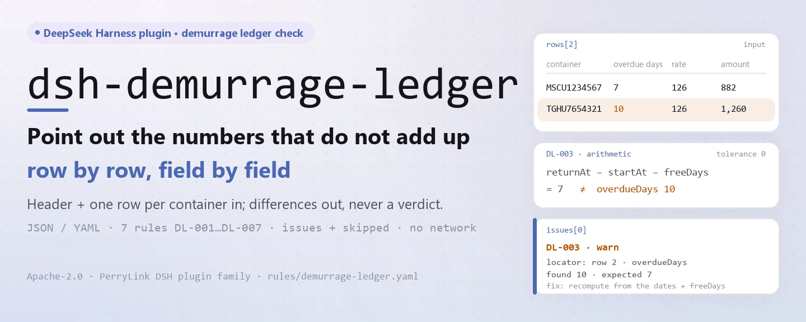
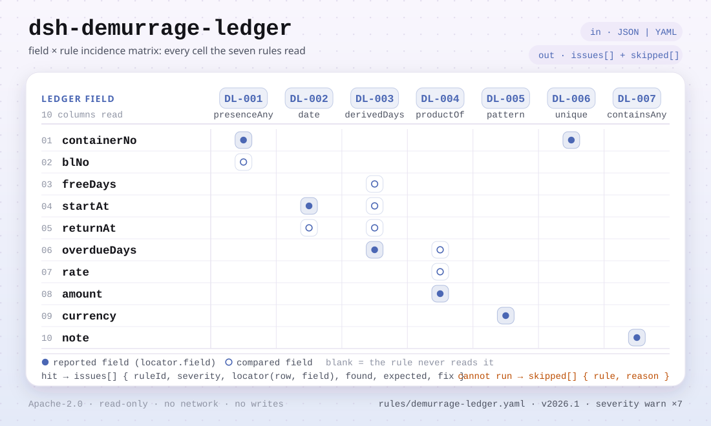

<div align="center">

<picture>
  <source media="(prefers-color-scheme: dark)" srcset="docs/assets/dsh-demurrage-ledger-hero-en-dark.webp">
  
</picture>

# dsh-demurrage-ledger

**Señala fila por fila los números de un libro de demoras y detenciones que no cuadran, sin pronunciar un veredicto.**

Un verificador de DeepSeek Harness para los puestos de tráfico marítimo, aduanas y liquidación: lee un libro formado por una cabecera y una fila por contenedor, comprueba integridad y aritmética, y devuelve una lista de qué es incoherente, dónde y qué corregir.

[Instalar](#instalación-en-tres-pasos) · [Configuración](#configuración) · [FAQ](#faq) · [简体中文](README.md) · [English](README.en.md) · [Español](README.es.md) · [Português](README.pt.md) · [हिन्दी](README.hi.md)

[](LICENSE)
[](#compatibilidad)
[](https://www.npmjs.com/package/dsh-demurrage-ledger)
[](https://github.com/PerryLink/dsh-demurrage-ledger/actions/workflows/ci.yml)
[](#compatibilidad)

[](https://github.com/PerryLink/dsh-demurrage-ledger/stargazers)
[](https://www.npmjs.com/package/dsh-demurrage-ledger)
[](https://dshfind.com/plugins/PerryLink/dsh-demurrage-ledger?ref=badge)
[](https://securityscorecards.dev/viewer/?uri=github.com/PerryLink/dsh-demurrage-ledger)
[](https://dsh.market/)

```sh
dsh plugin --profile <name> add dsh-demurrage-ledger
```

</div>

<sub>Plugin de la comunidad, no afiliado a DeepSeek. Repositorio canónico: <https://github.com/PerryLink/dsh-demurrage-ledger>.</sub>

## Qué es

`dsh-demurrage-ledger` lee un libro de demoras y detenciones de contenedores (la cabecera más una fila por contenedor) y comprueba la integridad y la aritmética de ese mismo libro: que cada fila registre al menos un número de contenedor o un conocimiento de embarque, que la fecha de inicio del periodo libre y la fecha de devolución se puedan analizar y sean coherentes entre sí, que los días de exceso sean iguales a la diferencia entre esas dos fechas menos los días libres, que el importe sea igual a los días de exceso × la tarifa, que la moneda se escriba como código de tres letras, que no se repita ningún número de contenedor y que no quede ningún marcador de plantilla sin sustituir en la observación. Los días libres y la tarifa se toman del propio libro, cuyas columnas pueden estar en chino o en inglés.

Solo enumera las diferencias que el propio material puede probar: no decide quién soporta el cargo, si la tarifa es razonable, si cabe una exención ni si el importe es recuperable — eso depende de la tarifa del transportista, del contrato de transporte y de la negociación comercial. Todo se ejecuta en memoria: sin red, sin llamada al modelo y sin modificar el archivo que entregas.

<picture>
  <source media="(prefers-color-scheme: dark)" srcset="docs/assets/dsh-demurrage-ledger-flow-v5-dark.svg">
  
</picture>

## Instalación en tres pasos

1. **Instalar** (elige un canal):

   ```sh
   # canal git (última main; el script prepare construye lib/ al instalar)
   dsh plugin --profile web add github:PerryLink/dsh-demurrage-ledger
   # canal npm (versiones publicadas)
   dsh plugin --profile web add dsh-demurrage-ledger
   # canal tarball: tras pnpm pack en este repositorio
   dsh plugin --profile web add ./dsh-demurrage-ledger-<version>.tgz
   ```

2. **Configuración mínima** (los valores por defecto ya sirven; `cordis.patch.yml` solo inserta su propia fila):

   ```yaml
   - insert:
       - id: dsh-demurrage-ledger
         name: dsh-demurrage-ledger
   ```

   Añade un bloque `config` solo cuando necesites desactivar reglas, ejecutar un subconjunto o apuntar a otro paquete de reglas — véase Configuración.

3. **Verificar que se monta**:

   ```sh
   dsh --profile web --dump-config | grep 'dsh-demurrage-ledger'
   ```

   El repositorio incluye además un arranque rápido sin conexión (compila antes):

   ```sh
   pnpm install && pnpm run build
   node samples/quickstart/run.mjs
   ```

   ```text
   $ node samples/quickstart/run.mjs
   demurrage_ledger: 1 issue(s) — error 0, warn 1, info 0
   skipped: 1
   ```

**Desinstalar**: `dsh plugin --profile web remove dsh-demurrage-ledger` (o borra la fila del profile patch).

## Capacidades clave

`dsh-demurrage-ledger` registra exactamente una herramienta, `demurrage_ledger`: lee un libro, aplica un paquete de reglas versionado y devuelve un informe con localización y corrección.

- **Columnas en chino y en inglés** — los alias de número de contenedor / `containerNo`, conocimiento de embarque / `blNo`, días libres / `freeDays`, fecha de inicio / `startAt`, fecha de devolución / `returnAt`, días de exceso / `overdueDays`, tarifa / `rate`, importe / `amount`, moneda / `currency`, observación / `note` se declaran una vez; la coincidencia ignora mayúsculas, espacios, guiones bajos y guiones, y cada hallazgo nombra la columna que leyó del libro.
- **Las siete reglas viven en los datos** — `rules/demurrage-ledger.yaml` declara cada comprobación, umbral y fuente; cambiar ese archivo cambia el conjunto de reglas sin tocar TypeScript. El paquete se valida al cargar, nunca se da por bueno.
- **Cada hallazgo es revisable** — el informe da `ruleId`, `severity`, `locator` (fila + campo), `found`, `expected` y `fix`, y siempre lleva el aviso legal; un guardián de redacción impide veredictos sobre cumplimiento, responsabilidad o corrección.
- **Lo omitido nunca es silencioso** — una comprobación que no puede ejecutarse (columna ausente, regla desactivada, cuatro valores incompletos) se lista en `skipped` con su motivo; una lista `issues` vacía nunca puede leerse como «no hay nada mal».
- **Solo lectura y recargable en caliente** — el registro de la herramienta es un efecto de Cordis que se deshace al parar o recargar; no escribe en disco, no hace peticiones de red ni llamadas al modelo.

| Regla | Comprueba | Gravedad | Base |
|---|---|---|---|
| `DL-001` | se registra un contenedor o un conocimiento de embarque | warn | trazabilidad del libro |
| `DL-002` | las fechas de inicio y devolución se analizan y son coherentes | warn | coherencia de fechas |
| `DL-003` | los días de exceso cuadran con las fechas y el periodo libre | warn | aritmética |
| `DL-004` | el importe es igual a días de exceso × tarifa | warn | aritmética |
| `DL-005` | la moneda es un código de tres letras | warn | GB/T 12406 |
| `DL-006` | los números de contenedor son únicos en el libro | warn | unicidad del libro |
| `DL-007` | la columna de observación no conserva marcadores sin sustituir | warn | integridad del libro |

### Formato del material

La herramienta acepta JSON o YAML; el material puede llegar por el parámetro `file` o en línea por `material`:

```yaml
carrier: 某某船务
blNo: MSCUAA123456
rows:
  - { 箱号: MSCU1234567, 提单号: MSCUAA123456, 免箱期: '7', 起算日期: 2026-03-01,
      还箱日期: 2026-03-15, 超期天数: '7', 费率: '120', 滞箱费金额: '840', 币制: USD,
      备注: 按运价本分段计费，此为平均费率 }
```

Las fechas pueden ser `2026-03-01` o `2026-03-01 14:00`, y las celdas numéricas pueden llevar unidades y separadores de miles. Los campos son opcionales en la capa de lectura y los valida el motor, de modo que una exportación parcial produce hallazgos de «valor ausente» en lugar de un fallo. Excel puede convertirse antes a JSON/YAML; en un chat con entrada de archivos, la conversión puede hacerse por ti.

### Salida real (ejemplo)

Con el fixture de prueba `DL-001`, **entrada**:

~~~json
{"rows":[{"箱号":"","提单号":"","箱型":"40HQ", ...}]}
~~~

**Salida**:

~~~json
{
  "id": "dsh-demurrage-ledger.DL-001.de09b5a6",
  "ruleId": "DL-001",
  "severity": "warn",
  "locator": {
    "row": 1,
    "field": "containerNo"
  },
  "found": "第 1 行 containerNo、blNo 都为空",
  "expected": "containerNo、blNo 至少应填写一项",
  "fix": "补填箱号与提单号；本条只核对是否填写，不判断费用是否应当发生"
}
~~~

*Observado en `dsh-demurrage-ledger/tests/fixtures/DL-001/DL-001-unsafe.json; dsh-demurrage-ledger/tests/fixtures/DL-001/cases.json; dsh-demurrage-ledger/rules/demurrage-ledger.yaml; dsh-demurrage-ledger/tests/index.test.ts`*

### Preguntas sobre reglas

| Usted pregunta | Qué responde |
|---|---|
| Una fila tiene vacíos tanto el número de contenedor como el conocimiento de embarque. ¿Se informa de algo? | Sí. `DL-001` exige que en cada fila a la que el libro da al menos una de esas dos columnas esté relleno `containerNo` o `blNo`, e informa de la fila cuando ambas están vacías. Solo comprueba que uno de los dos esté puesto, no si el cargo debió producirse. Si el libro no trae ninguna de las dos columnas, la regla se nombra a sí misma en `skipped` en lugar de pasar en silencio. |
| La fecha de inicio se escribió como `15/03/2026` y la fecha de devolución es anterior. ¿Qué hace la regla? | `DL-002` analiza `startAt` y lo compara con `returnAt`: un valor que no puede leer como fecha se informa en esa fila en lugar de omitirse, y una fecha de inicio posterior a la de devolución también se informa; el mismo día cuenta como no posterior. Solo compara esas dos fechas: qué convención de inicio se aplica (conocimiento de embarque, entrega o llegada) queda para la tarifa del transportista y el contrato. |
| La columna de días de exceso dice 10, pero las dos fechas y el periodo libre dan 7. ¿Se detecta? | Sí. `DL-003` recalcula los días como `returnAt` − `startAt` − `freeDays` e informa de la fila cuando el `overdueDays` declarado difiere en más de la `tolerance` configurada, 0 por defecto. Solo se ejecuta en filas con los cuatro valores presentes y analizables; cuando ninguna fila los reúne, la regla se informa en `skipped`. La convención de inicio y si el periodo libre cuenta festivos siguen siendo del contrato: para una base de días laborables o de horas, suba la tolerancia o desactive la regla. |
| El importe no es igual a los días de exceso por la tarifa, y mi tarifa se escalona. ¿Se informa? | `DL-004` multiplica `overdueDays` × `rate` e informa de la fila cuando `amount` difiere en más de la `tolerance`, 0.01 por defecto. No juzga si la tarifa es razonable ni si coincide con la del transportista. Una tarifa escalonada no cabe en una sola celda `rate`, así que ese libro informará de una diferencia: desactive la regla, o registre una tarifa media y dígalo en la observación. |
| La celda de moneda dice `美元`, o `usd`. ¿Se informa? | Sí. `DL-005` informa de todo valor de `currency` que no coincida con el patrón del paquete, `^[A-Z]{3}$` por defecto: tres letras mayúsculas como `USD`. Es solo una comprobación de forma y no juzga si esa moneda es la correcta para la liquidación. Su base es la única norma pública que cita el paquete, y su excerpt deja constancia de que el texto del artículo no se obtuvo, por lo que la regla se queda en warn. Sin columna de moneda, la regla se nombra en `skipped`. |
| El mismo número de contenedor aparece en dos filas. ¿Es un registro duplicado? | `DL-006` informa de la fila cuando un valor de `containerNo` se repite, comparando sin espacios, y señala la fila anterior con la que coincide. Solo comprueba la unicidad, y un hallazgo requiere confirmación humana: un contenedor devuelto por etapas, o liberado y vuelto a retener, puede ocupar legítimamente dos filas — dígalo en la observación en vez de borrar una fila. Sin columna `containerNo`, la regla informa de que no pudo ejecutarse en lugar de pasar en silencio. |

## Configuración

Todos los parámetros ajustables viven en el esquema Schemastery de `src/config.ts`, por lo que se cambian desde `cordis.yml` sin tocar el código; los umbrales por regla están en el paquete de reglas bajo `rules/`.

| Clave | Tipo | Predeterminado | Descripción |
|---|---|---|---|
| `rulesFile` | string | `rules/demurrage-ledger.yaml` | Ruta del paquete de reglas, relativa a la raíz del paquete |
| `disabledRules` | string[] | `[]` | Ids de reglas que se dejan de ejecutar; cada una aparece en `skipped` |
| `onlyRules` | string[] | `[]` | Ejecutar solo estas reglas; vacío ejecuta todas |
| `skipNotes` | string | `""` | Nota añadida a cada motivo de `skipped` |
| `timeoutMs` | number | `120000` | Presupuesto de tiempo de espera cooperativo de la herramienta |

Parámetros por regla (se editan en el paquete de reglas, no en el código):

- `DL-003` `daysField` / `fromField` / `toField` / `subtractField` / `tolerance` — la aritmética de días. Suba `tolerance` si el libro redondea, o desactive la regla para una base de días laborables o de horas.
- `DL-004` `resultField` / `factorFields` / `tolerance` — la aritmética del importe, tolerancia `0.01` por defecto.
- `DL-005` `pattern` — la forma de la moneda; tres letras mayúsculas por defecto.
- `DL-007` `terms` — los marcadores que se buscan.

Ejemplo de sobrescritura en el profile patch:

```yaml
- insert:
    - id: dsh-demurrage-ledger
      name: dsh-demurrage-ledger
      config:
        onlyRules: [DL-001, DL-002, DL-003, DL-004]
        skipNotes: revisado con nuestro procedimiento interno
```

## FAQ

<details>
<summary>¿A dónde van los datos del libro? ¿Se envían a algún sitio?</summary>

No. El plugin solo lee el archivo que pasas por `file`, o el texto en línea de `material`; no hace peticiones de red, no llama a un modelo, no escribe en disco y no mantiene base de datos ni caché. El informe se devuelve en la sesión; el plugin no persiste nada por su cuenta. `package.json#dsh.demo` declara exactamente esa superficie como `network: false` y `writes: []`.

</details>

<details>
<summary>Una regla no se ejecutó, ¿significa que el libro está limpio?</summary>

No. Una comprobación que no puede ejecutarse (columna ausente, regla desactivada por `disabledRules`, cuatro valores incompletos) se lista en `skipped` con su id y su motivo; la nota `skipNotes` se añade a cada motivo. Una lista `issues` vacía solo significa que las comprobaciones que pudieron ejecutarse no hallaron diferencias, nunca que el libro sea correcto.

</details>

<details>
<summary>¿Compite con otros plugins por nombres de herramienta, claves de servicio o slots?</summary>

No. El plugin registra una sola herramienta, `demurrage_ledger`, mediante `ctx.tools.register`; no registra comandos, no aporta ninguna clave de servicio, no registra slots de cliente, no registra rutas `webServer` y no modifica objetos globales. Su patch de bundle solo hace `insert` de su propia fila y nunca sobrescribe el `config` de una fila integrada. La evidencia está detallada en Interoperabilidad con otros plugins DSH.

</details>

<details>
<summary>¿Cuánto coste de rendimiento supone?</summary>

Análisis de tabla y evaluación de reglas puramente en memoria: sin peticiones de red, sin llamadas al modelo, sin dependencias nativas. `timeoutMs` es un presupuesto de tiempo de espera cooperativo, `120000` ms por defecto; para un mes entero de libros use el modo de herramienta `ptc`, así el coste del esquema se paga una vez.

</details>

## Límites de seguridad

- **Material de solo lectura.** La herramienta lee el archivo de `file` o el texto en línea de `material`; no modifica el original, no escribe en disco y no guarda nada de forma oculta.
- **Solo diferencias, sin veredicto.** El informe no decide cumplimiento, responsabilidad ni corrección, ni si el cargo debió producirse; cada hallazgo lleva el aviso legal y un guardián de redacción bloquea las fórmulas que dictaminan.
- **Un resultado vacío no es un aprobado.** Una comprobación que no puede ejecutarse se lista siempre en `skipped` con su id y motivo; si faltan las columnas que una regla necesita, la regla se informa a sí misma en lugar de pasar en silencio.
- **Guardián de citas.** Cada regla debe llevar `document` / `number` / `clause` / `excerpt` / `kind` / `source`, y el extracto debe ser una cita real de al menos ocho caracteres; `derived-from-principle` se limita a `warn`, `institutional-configuration` a `info`, y un paquete que exagera su base falla al cargar.
- **El registro es un efecto.** El registro de la herramienta devuelve un disposer, de modo que parar o recargar la elimina y no queda ningún listener en segundo plano.

## Limitaciones conocidas

- **No hay norma nacional que citar.** Las demoras y detenciones las fija la tarifa de cada transportista y el contrato de transporte — los periodos libres y las tarifas varían entre transportistas, rutas y tipos de contenedor; el `excerpt` del paquete dice con claridad que su base es la coherencia aritmética o la trazabilidad del libro, y no inventa un número de norma. La única excepción es el formato de moneda (GB/T 12406), cuyo excerpt también registra que el texto del artículo no se obtuvo, por lo que se queda en `warn`.
- **Las tarifas escalonadas rompen `DL-004`.** Las tarifas suelen escalonarse (una tarifa para los días 1–7 y otra mayor desde el día 8). Una sola columna `rate` no puede expresarlo, así que un libro con precio escalonado informará de una diferencia; desactive la regla, o registre una tarifa media con una nota que lo diga.
- **`DL-003` no elige la convención de inicio.** Si el reloj empieza en el conocimiento de embarque, en la entrega o en la llegada — y si el periodo libre incluye festivos — es asunto del contrato. Se asume que las columnas `start date` y `free days` del libro ya lo siguen.
- **Solo forma, no razonabilidad.** `DL-005` solo comprueba que la moneda sea tres letras mayúsculas, no si esa moneda es la adecuada para la liquidación; `DL-004` no juzga si la tarifa es razonable ni si coincide con la del transportista.
- **Aritmética de hora local.** Toda fecha y número se calcula sobre las cadenas de entrada, sin conversión de zona horaria; alinee antes el sistema de origen si el libro se introdujo entre zonas.
- **El plugin no incluye el periodo libre ni la tarifa de ningún transportista.** Ambos vienen del libro; si faltan, la regla correspondiente pasa a `skipped` en vez de suponer un valor por defecto.

## Interoperabilidad con otros plugins DSH

Este plugin no comparte estado mutable con otros plugins de DSH. La evidencia es una lectura estática del manifiesto y del código de este repositorio:

- **Una sola herramienta.** La única superficie de registro en `src/index.ts` es `ctx.tools.register(defineTool({ name: 'demurrage_ledger', … }))`; no hay comandos ni listeners de eventos de sesión.
- **Sin conflicto de claves de servicio.** `package.json#dsh.capabilities` es solo `tools:register`, `inject` es solo `['tools']` y el plugin no aporta ninguna clave de servicio.
- **Sin conflicto de slots.** El repositorio no tiene directorio `client/`, no registra slots de cliente y no compite por asientos de UI.
- **Sin conflicto de rutas HTTP.** No registra ningún prefijo `webServer`.
- **Sin conflicto de capas de patch.** El patch del bundle solo hace `insert` de su propia fila y nunca sobrescribe el `config` de una fila integrada.
- **Sin modificación global.** No parchea prototipos, no lee ni escribe `process.env` y no reemplaza objetos globales; el material entra solo por `file` / `material` y no se intercambia estado con otros plugins.

## Compatibilidad

| Superficie | Estado |
|---|---|
| Harness | Rango de peers `>=0.1.2-rc.1 <0.2.0 \|\| >=0.2.0-0 <0.3.0` — verificado para aceptar tanto `0.2.0-rc.2` como `0.2.1-rc.2`. `engines.dsh` se declara como `>=0.2.1-0 <0.3.0` y el host lo aplica desde 0.2.1 |
| Node | `^22.19.0 \|\| >=24.0.0` |
| Plataformas | Todas (ESM puro; sin código nativo, sin red, sin llamada al modelo) |
| Modo de herramienta | Funciona en `native` y `ptc`; para un mes entero de libros use `ptc`, así el coste del esquema se paga una vez |

## Ecosistema y calidad

- [Página del plugin en dshfind](https://dshfind.com/plugins/PerryLink/dsh-demurrage-ledger) (instalaciones y ranking)
- [Informe OpenSSF Scorecard](https://securityscorecards.dev/viewer/?uri=github.com/PerryLink/dsh-demurrage-ledger) (impulsado por [.github/workflows/scorecard.yml](.github/workflows/scorecard.yml))
- [DSH Market](https://dsh.market/) (publicado)
- [Elegir un verificador por material](https://perrylink.github.io/zh/checkers/choose/) (índice de la familia: 62 verificadores más plugins generales)
- [Registros de verificación de reglas](rules/evidence/) (notas de verificación por cita conservadas en el repositorio)

## Fuentes de las reglas y verificación

Los datos de las reglas están separados del código y viven en `rules/demurrage-ledger.yaml`. Las demoras no tienen una norma nacional que citar, así que las entradas `basis` del paquete lo dicen exactamente, en lugar de inventar un número; la única referencia externa es la norma de códigos de moneda, cuyo excerpt admite que el texto del artículo no se obtuvo. El guardián de carga sigue exigiendo que cada regla lleve documento, cláusula, extracto y fuente, y sigue prohibiendo que una comprobación `derived-from-principle` o configurada localmente sea `error`.

| Documento | Número | Reglas que lo citan |
|---|---|---|
| Tarifa del transportista y contrato de transporte (sin norma nacional) | Sin norma unificada (esta regla se basa en la trazabilidad del libro) | DL-001 |
| Tarifa del transportista y contrato de transporte (sin norma nacional) | Sin norma unificada (esta regla se basa en la coherencia de fechas) | DL-002 |
| Tarifa del transportista y contrato de transporte (sin norma nacional) | Sin norma unificada (esta regla se basa en la aritmética) | DL-003, DL-004 |
| Códigos para la representación de monedas | GB/T 12406—2022 (publicada y aplicada el 2022-12-30; sustituye por completo a GB/T 12406—2008, cuyo título era «Códigos para la representación de monedas y fondos»; adopción modificada de ISO 4217:2015, no idéntica; número de cláusula no obtenido) | DL-005 |
| Tarifa del transportista y contrato de transporte (sin norma nacional) | Sin norma unificada (esta regla se basa en la unicidad del libro) | DL-006 |
| Tarifa del transportista y contrato de transporte (sin norma nacional) | Sin norma unificada (esta regla se basa en la integridad del libro) | DL-007 |

**Frontera:** este plugin verifica un **libro de demoras y detenciones** en cuanto a aritmética e integridad — que se registre un contenedor o un conocimiento de embarque, que la fecha de inicio del periodo libre y la de devolución se analicen y sean coherentes, que los días de exceso sean la diferencia entre esas fechas menos los días libres, que el importe sea días × tarifa, que la moneda siga su formato y que los números de contenedor no se repitan. **No** decide quién soporta el cargo, si una tarifa es razonable, si cabe una exención ni si el importe es recuperable. **Eso depende del contrato, del reparto de responsabilidades y de la negociación comercial.**

> ### ⚠️ No existe una norma nacional para esto, y el paquete no finge lo contrario
>
> Las demoras y detenciones las fija **la tarifa de cada transportista y el contrato de transporte** — los periodos libres y las tarifas varían entre transportistas, rutas y tipos de contenedor, y **no existe una norma nacional unificada**. Por eso el paquete **no** fabrica un número de norma: el `excerpt` de cada regla dice con claridad que su base es la coherencia aritmética o la trazabilidad del libro y que **no existe cláusula citable**. La única excepción es el formato de moneda, cuya sede es GB/T 12406 (adopción modificada de ISO 4217:2015, no idéntica), y ese excerpt dice que el texto del artículo no se obtuvo. Una prueba comprueba que cada excerpt lleva una de esas admisiones.
>
> **El plugin no incluye el periodo libre ni la tarifa de ningún transportista.** Ambos vienen del libro. Antes de fiarse de un hallazgo conviene conocer dos consecuencias:
>
> - **Las tarifas escalonadas rompen `DL-004`.** Las tarifas suelen escalonarse (una tarifa para los días 1–7 y otra mayor desde el día 8). Una sola columna `rate` no puede expresarlo, así que un libro con precio escalonado informará de una diferencia. Desactive la regla, o registre una tarifa media con una nota que lo diga.
> - **`DL-003` no elige la convención de inicio.** Si el reloj empieza en el conocimiento de embarque, en la entrega o en la llegada — y si el periodo libre incluye festivos — es asunto del contrato. Se asume que las columnas `start date` y `free days` del libro ya lo siguen.

## Solución de problemas

- **El plugin se instala pero la herramienta no aparece.** Compruebe que `main` resuelve a `lib/index.mjs` y que `pnpm run build` lo generó; un `main` incorrecto hace que el cargador omita la entrada en silencio.
- **`dsh plugin add` rechaza el paquete como incompatible.** El rango de peers cubre `0.1.x` y `0.2.x`; si su runtime queda fuera, conceda una exención explícita: `dsh plugin --profile <name> allow-version <pkg@ver> --dsh-version <runtime> --accept-risk`.
- **Una regla no se ejecutó.** Lea el arreglo `skipped`; allí figuran el id y el motivo.
- **`check` informa `manifest-peers` como fallo.** El verificador estático compara con un rango de peers fijo anterior a la línea 0.2; el runtime aplica la compatibilidad al instalar. Es un problema conocido de `dsh-plugin-dev`.
- **Los horarios parecen desplazados.** Toda la aritmética es de hora local sobre las cadenas entregadas, sin conversión de zona horaria.
- **`DL-003` salta en un libro que calculé a mano.** Compruebe la convención de inicio y si el periodo libre incluye festivos; el hallazgo muestra las dos fechas y los días libres usados, así que la suma se puede rehacer.
- **`DL-004` informa de una diferencia en un libro con tarifa escalonada.** Una sola tarifa no puede expresar un precio escalonado. Desactive la regla, o registre una tarifa media y dígalo en la observación.
- **`DL-005` también informa de `USD `.** El patrón por defecto acepta exactamente tres letras mayúsculas; un espacio final o un código en minúsculas falla. Normalice la exportación.
- **`DL-006` informa dos veces del mismo contenedor.** Puede ser legítimo — un contenedor devuelto por etapas, o retenido de nuevo tras la entrega. Dígalo en la observación en vez de borrar una fila.

## Desarrollo

```sh
pnpm install
pnpm run typecheck   # tsc --noEmit
pnpm test            # vitest, la suite compartida de plugins de tabla más fixtures emparejados
pnpm run build       # tsdown -> lib/index.mjs + lib/index.d.mts
pnpm run check:readmes   # consistencia de los README en cinco idiomas
node ../scripts/sync-shared.mjs dsh-demurrage-ledger   # refrescar src/shared
```

El plugin es **solo datos**: `src/model.ts` declara la forma de la tabla, el kit compartido aporta el lector y el motor de comprobación, y el paquete de reglas declara cada comprobación. `prepublishOnly` vuelve a ejecutar la puerta, de modo que una publicación no puede salir con un árbol sin compilar o desviado.

Las imágenes las genera [`scripts/gen-readme-assets.py`](scripts/gen-readme-assets.py) (Pillow dibuja los cuatro banners hero zh/en claro/oscuro; la matriz de campos × reglas es un SVG claro/oscuro escrito a mano); vuelva a ejecutarlo con `python scripts/gen-readme-assets.py`.

Topics: `dsh`, `dsh-plugin`, `deepseek-harness`, `deepseek`, `cordis`, `demurrage`, `ledger`

## Familia y agradecimientos

Este proyecto es miembro de la familia de plugins de DeepSeek Harness mantenida por [PerryLink](https://github.com/PerryLink) (todos Apache-2.0). Si este plugin te ayuda, **dale una estrella**: no desbloquea nada, pero ayuda a que la siguiente persona lo encuentre.

- [@PerryLink](https://github.com/PerryLink) — creador y mantenedor: el paquete de reglas, el motor de comprobación compartido y la documentación en cinco idiomas.

<details>
<summary>Expandir todos los plugins</summary>

| Plugin | Estado |
|---|---|
| **[dsh-aqua-input-check](https://github.com/PerryLink/dsh-aqua-input-check)** |  |
| **[dsh-archive-check](https://github.com/PerryLink/dsh-archive-check)** |  |
| **[dsh-auto-review](https://github.com/PerryLink/dsh-auto-review)** |  |
| **[dsh-autotier](https://github.com/PerryLink/dsh-autotier)** | 🧊 CONGELADO — ver el README del repo |
| **[dsh-bid-ca-precheck](https://github.com/PerryLink/dsh-bid-ca-precheck)** |  |
| **[dsh-bid-qual-check](https://github.com/PerryLink/dsh-bid-qual-check)** |  |
| **[dsh-cert-mcp](https://github.com/PerryLink/dsh-cert-mcp)** | 🧊 CONGELADO — ver el README del repo |
| **[dsh-checkpoint-rewind](https://github.com/PerryLink/dsh-checkpoint-rewind)** |  |
| **[dsh-click](https://github.com/PerryLink/dsh-click)** |  |
| **[dsh-composer-history](https://github.com/PerryLink/dsh-composer-history)** |  |
| **[dsh-contract-stance](https://github.com/PerryLink/dsh-contract-stance)** |  |
| **[dsh-customs-doc-check](https://github.com/PerryLink/dsh-customs-doc-check)** |  |
| **[dsh-data-quality](https://github.com/PerryLink/dsh-data-quality)** |  |
| **[dsh-demurrage-ledger](https://github.com/PerryLink/dsh-demurrage-ledger)** |  |
| **[dsh-doublecheck](https://github.com/PerryLink/dsh-doublecheck)** |  |
| **[dsh-drill-script-check](https://github.com/PerryLink/dsh-drill-script-check)** |  |
| **[dsh-eia-guide-check](https://github.com/PerryLink/dsh-eia-guide-check)** |  |
| **[dsh-emergency-plan](https://github.com/PerryLink/dsh-emergency-plan)** |  |
| **[dsh-essay-rubric-check](https://github.com/PerryLink/dsh-essay-rubric-check)** |  |
| **[dsh-evidence-check](https://github.com/PerryLink/dsh-evidence-check)** |  |
| **[dsh-export-ctl-check](https://github.com/PerryLink/dsh-export-ctl-check)** |  |
| **[dsh-fast](https://github.com/PerryLink/dsh-fast)** |  |
| **[dsh-fmea-table-check](https://github.com/PerryLink/dsh-fmea-table-check)** |  |
| **[dsh-forecast-penalty](https://github.com/PerryLink/dsh-forecast-penalty)** |  |
| **[dsh-fund-research](https://github.com/PerryLink/dsh-fund-research)** |  |
| **[dsh-github](https://github.com/PerryLink/dsh-github)** |  |
| **[dsh-gongwen-flow-check](https://github.com/PerryLink/dsh-gongwen-flow-check)** |  |
| **[dsh-gongwen-word-check](https://github.com/PerryLink/dsh-gongwen-word-check)** |  |
| **[dsh-guard-plan-qc](https://github.com/PerryLink/dsh-guard-plan-qc)** |  |
| **[dsh-hazchem-check](https://github.com/PerryLink/dsh-hazchem-check)** |  |
| **[dsh-hazplan-check](https://github.com/PerryLink/dsh-hazplan-check)** |  |
| **[dsh-hidden-risk-map](https://github.com/PerryLink/dsh-hidden-risk-map)** |  |
| **[dsh-hs-classify](https://github.com/PerryLink/dsh-hs-classify)** |  |
| **[dsh-icd-rule-check](https://github.com/PerryLink/dsh-icd-rule-check)** |  |
| **[dsh-industry-research](https://github.com/PerryLink/dsh-industry-research)** |  |
| **[dsh-lawcite-adapter](https://github.com/PerryLink/dsh-lawcite-adapter)** |  |
| **[dsh-laya](https://github.com/PerryLink/dsh-laya)** |  |
| **[dsh-lc-doc-check](https://github.com/PerryLink/dsh-lc-doc-check)** |  |
| **[dsh-learning-gap-check](https://github.com/PerryLink/dsh-learning-gap-check)** |  |
| **[dsh-library](https://github.com/PerryLink/dsh-library)** |  |
| **[dsh-local-ai](https://github.com/PerryLink/dsh-local-ai)** |  |
| **[dsh-lsp-actions](https://github.com/PerryLink/dsh-lsp-actions)** |  |
| **[dsh-mask](https://github.com/PerryLink/dsh-mask)** |  |
| **[dsh-mcp-panel](https://github.com/PerryLink/dsh-mcp-panel)** |  |
| **[dsh-medrec-qc](https://github.com/PerryLink/dsh-medrec-qc)** |  |
| **[dsh-memento](https://github.com/PerryLink/dsh-memento)** |  |
| **[dsh-nsfc-form-check](https://github.com/PerryLink/dsh-nsfc-form-check)** |  |
| **[dsh-nurse-record-check](https://github.com/PerryLink/dsh-nurse-record-check)** |  |
| **[dsh-observe](https://github.com/PerryLink/dsh-observe)** |  |
| **[dsh-origin-rvc-check](https://github.com/PerryLink/dsh-origin-rvc-check)** |  |
| **[dsh-ota-review-check](https://github.com/PerryLink/dsh-ota-review-check)** |  |
| **[dsh-output-styles](https://github.com/PerryLink/dsh-output-styles)** |  |
| **[dsh-paper-doc-adapter](https://github.com/PerryLink/dsh-paper-doc-adapter)** |  |
| **[dsh-permission-rules](https://github.com/PerryLink/dsh-permission-rules)** |  |
| **[dsh-permit-report-check](https://github.com/PerryLink/dsh-permit-report-check)** |  |
| **[dsh-pipeline-check](https://github.com/PerryLink/dsh-pipeline-check)** |  |
| **[dsh-pleading-draft](https://github.com/PerryLink/dsh-pleading-draft)** |  |
| **[dsh-plugin-doctor](https://github.com/PerryLink/dsh-plugin-doctor)** | 🚫 RETIRADO (repo archivado) |
| **[dsh-plugin-guide](https://github.com/PerryLink/dsh-plugin-guide)** |  |
| **[dsh-plugin-kit](https://github.com/PerryLink/dsh-plugin-kit)** | 🚫 RETIRADO (repo archivado) |
| **[dsh-plugin-upgrade](https://github.com/PerryLink/dsh-plugin-upgrade)** | 🚫 RETIRADO (repo archivado) |
| **[dsh-policy-brief-draft](https://github.com/PerryLink/dsh-policy-brief-draft)** |  |
| **[dsh-power-loss-split](https://github.com/PerryLink/dsh-power-loss-split)** |  |
| **[dsh-power-ticket-check](https://github.com/PerryLink/dsh-power-ticket-check)** |  |
| **[dsh-ppap-check](https://github.com/PerryLink/dsh-ppap-check)** |  |
| **[dsh-protest-deadline](https://github.com/PerryLink/dsh-protest-deadline)** |  |
| **[dsh-railway-window](https://github.com/PerryLink/dsh-railway-window)** |  |
| **[dsh-repair-order-qc](https://github.com/PerryLink/dsh-repair-order-qc)** |  |
| **[dsh-research-report](https://github.com/PerryLink/dsh-research-report)** |  |
| **[dsh-review-reply-check](https://github.com/PerryLink/dsh-review-reply-check)** |  |
| **[dsh-rulefile-check](https://github.com/PerryLink/dsh-rulefile-check)** |  |
| **[dsh-safety-brief-check](https://github.com/PerryLink/dsh-safety-brief-check)** |  |
| **[dsh-score](https://github.com/PerryLink/dsh-score)** |  |
| **[dsh-session-sync](https://github.com/PerryLink/dsh-session-sync)** |  |
| **[dsh-site-log-check](https://github.com/PerryLink/dsh-site-log-check)** |  |
| **[dsh-skill-pack-security](https://github.com/PerryLink/dsh-skill-pack-security)** |  |
| **[dsh-soe-decision-check](https://github.com/PerryLink/dsh-soe-decision-check)** |  |
| **[dsh-soilwater-check](https://github.com/PerryLink/dsh-soilwater-check)** |  |
| **[dsh-sop-sync-check](https://github.com/PerryLink/dsh-sop-sync-check)** |  |
| **[dsh-spc-gbt-adapter](https://github.com/PerryLink/dsh-spc-gbt-adapter)** |  |
| **[dsh-talk](https://github.com/PerryLink/dsh-talk)** |  |
| **[dsh-tender-extract](https://github.com/PerryLink/dsh-tender-extract)** |  |
| **[dsh-tender-matrix](https://github.com/PerryLink/dsh-tender-matrix)** |  |
| **[dsh-test-drive](https://github.com/PerryLink/dsh-test-drive)** |  |
| **[dsh-ticktick](https://github.com/PerryLink/dsh-ticktick)** | 🚫 RETIRADO (repo archivado) |
| **[dsh-translate](https://github.com/PerryLink/dsh-translate)** |  |
| **[dsh-warranty-calc](https://github.com/PerryLink/dsh-warranty-calc)** |  |
| **[dsh-budget](https://github.com/PerryLink/dsh-budget)** | 🧊 CONGELADO — ver el README del repo |
| **[dsh-claude-move](https://github.com/PerryLink/dsh-claude-move)** | 🧊 CONGELADO — ver el README del repo |
| **[dsh-defend](https://github.com/PerryLink/dsh-defend)** | 🧊 CONGELADO — ver el README del repo |
| **[dsh-draw](https://github.com/PerryLink/dsh-draw)** | 🧊 CONGELADO — ver el README del repo |
| **[dsh-reach](https://github.com/PerryLink/dsh-reach)** | 🧊 CONGELADO — ver el README del repo |
| **[dsh-background-agents](https://github.com/PerryLink/dsh-background-agents)** | 🚫 RETIRADO (repo archivado) |
| **[dsh-session-pin](https://github.com/PerryLink/dsh-session-pin)** | 🚫 RETIRADO (repo archivado) |
| **[dsh-team-rooms](https://github.com/PerryLink/dsh-team-rooms)** | 🚫 RETIRADO (repo archivado) |

</details>

## Licencia

[LICENSE](LICENSE) (Apache License 2.0) © 2026 dsh-demurrage-ledger contributors

<p align="center"><sub>Apache-2.0 · Plugin de la comunidad, no afiliado a DeepSeek.</sub></p>
