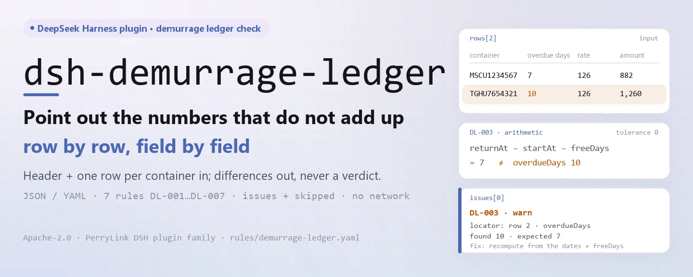
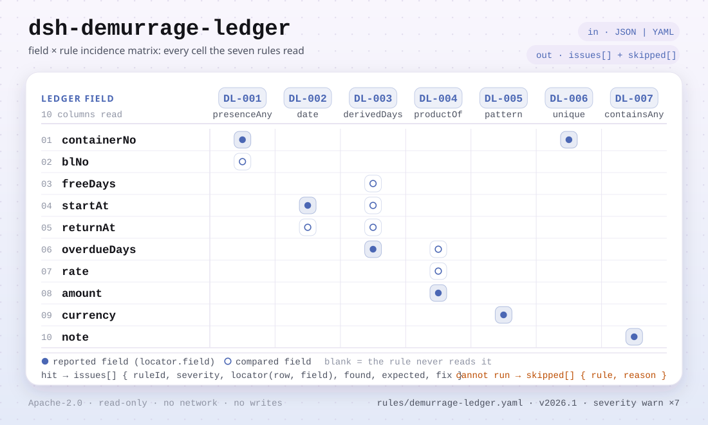

<div align="center">

<picture>
  <source media="(prefers-color-scheme: dark)" srcset="docs/assets/dsh-demurrage-ledger-hero-en-dark.webp">
  
</picture>

# dsh-demurrage-ledger

**विलंब शुल्क बही में जो आँकड़े नहीं मिलते, उन्हें पंक्ति-दर-पंक्ति इंगित करें — बिना कोई निर्णय सुनाए।**

शिपिंग, सीमा शुल्क और निपटान डेस्क के लिए DeepSeek Harness जाँचक: हेडर और प्रत्येक कंटेनर की एक पंक्ति वाली बही पढ़ता है, पूर्णता और अंकगणित जाँचता है, और बताता है कि क्या असंगत है, कहाँ है और क्या सुधारना है।

[इंस्टॉल](#तीन-चरणों-में-शुरुआत) · [कॉन्फ़िगरेशन](#कॉन्फ़िगरेशन) · [FAQ](#faq) · [简体中文](README.md) · [English](README.en.md) · [Español](README.es.md) · [Português](README.pt.md) · [हिन्दी](README.hi.md)

[](LICENSE)
[](#संगतता)
[](https://www.npmjs.com/package/dsh-demurrage-ledger)
[](https://github.com/PerryLink/dsh-demurrage-ledger/actions/workflows/ci.yml)
[](#संगतता)

[](https://github.com/PerryLink/dsh-demurrage-ledger/stargazers)
[](https://www.npmjs.com/package/dsh-demurrage-ledger)
[](https://dshfind.com/plugins/PerryLink/dsh-demurrage-ledger?ref=badge)
[](https://securityscorecards.dev/viewer/?uri=github.com/PerryLink/dsh-demurrage-ledger)
[](https://dsh.market/)

```sh
dsh plugin --profile <name> add dsh-demurrage-ledger
```

</div>

<sub>सामुदायिक प्लगइन, DeepSeek से संबद्ध नहीं। आधिकारिक रेपो: <https://github.com/PerryLink/dsh-demurrage-ledger>।</sub>

## यह क्या है

`dsh-demurrage-ledger` एक कंटेनर विलंब शुल्क बही (हेडर और प्रत्येक कंटेनर की एक पंक्ति) पढ़ता है और उसी बही की पूर्णता तथा अंकगणित की जाँच करता है: क्या हर पंक्ति में कम से कम कंटेनर क्रमांक या बिल ऑफ़ लेडिंग दर्ज है, क्या मुफ़्त अवधि का प्रारंभ दिनांक और वापसी दिनांक पढ़े जा सकते हैं और क्रम में हैं, क्या विलंब दिवस उन दोनों दिनांकों के अंतर में से मुफ़्त दिन घटाकर आते हैं, क्या शुल्क विलंब दिवस × दर के बराबर है, क्या मुद्रा तीन अक्षरों के कोड में लिखी है, क्या कोई कंटेनर क्रमांक दोहराया नहीं गया, और क्या टिप्पणी में कोई अप्रतिस्थापित टेम्पलेट प्लेसहोल्डर शेष नहीं है। मुफ़्त दिन और दर स्वयं बही से लिए जाते हैं, जिसके कॉलम चीनी या अंग्रेज़ी नामों में हो सकते हैं।

यह केवल वे अंतर गिनाता है जिन्हें सामग्री स्वयं प्रमाणित कर सकती है: यह तय नहीं करता कि शुल्क कौन वहन करेगा, दर उचित है या नहीं, छूट संभव है या नहीं, या राशि वसूली योग्य है या नहीं — ये वाहक की दर-सूची, परिवहन अनुबंध और वाणिज्यिक बातचीत पर निर्भर हैं। सब कुछ मेमोरी में चलता है: कोई नेटवर्क नहीं, कोई मॉडल कॉल नहीं, और आपकी दी गई फ़ाइल कभी नहीं बदली जाती।

<picture>
  <source media="(prefers-color-scheme: dark)" srcset="docs/assets/dsh-demurrage-ledger-flow-v5-dark.svg">
  
</picture>

## तीन चरणों में शुरुआत

1. **इंस्टॉल करें** (कोई एक चैनल चुनें):

   ```sh
   # git चैनल (नवीनतम main; इंस्टॉल पर prepare स्क्रिप्ट lib/ बनाती है)
   dsh plugin --profile web add github:PerryLink/dsh-demurrage-ledger
   # npm चैनल (प्रकाशित संस्करण)
   dsh plugin --profile web add dsh-demurrage-ledger
   # tarball चैनल: इस रेपो में pnpm pack के बाद
   dsh plugin --profile web add ./dsh-demurrage-ledger-<version>.tgz
   ```

2. **न्यूनतम कॉन्फ़िगरेशन** (डिफ़ॉल्ट ही काम करते हैं; `cordis.patch.yml` केवल अपनी ही पंक्ति insert करता है):

   ```yaml
   - insert:
       - id: dsh-demurrage-ledger
         name: dsh-demurrage-ledger
   ```

   `config` ब्लॉक तभी जोड़ें जब नियम बंद करने, उपसमुच्चय चलाने या दूसरा नियम-पैक चुनने की ज़रूरत हो — देखें कॉन्फ़िगरेशन।

3. **जाँचें कि माउंट हुआ**:

   ```sh
   dsh --profile web --dump-config | grep 'dsh-demurrage-ledger'
   ```

   रेपो में ऑफ़लाइन क्विकस्टार्ट भी है (पहले बिल्ड करें):

   ```sh
   pnpm install && pnpm run build
   node samples/quickstart/run.mjs
   ```

   ```text
   $ node samples/quickstart/run.mjs
   demurrage_ledger: 1 issue(s) — error 0, warn 1, info 0
   skipped: 1
   ```

**अनइंस्टॉल**: `dsh plugin --profile web remove dsh-demurrage-ledger` (या profile patch से वह पंक्ति हटाएँ)।

## मुख्य क्षमताएँ

`dsh-demurrage-ledger` ठीक एक टूल, `demurrage_ledger`, पंजीकृत करता है: बही पढ़ता है, संस्करणबद्ध नियम-पैक लागू करता है, और स्थान व सुधार सहित रिपोर्ट लौटाता है।

- **चीनी और अंग्रेज़ी कॉलम दोनों चलते हैं** — कंटेनर क्रमांक / `containerNo`, बिल ऑफ़ लेडिंग / `blNo`, मुफ़्त दिन / `freeDays`, प्रारंभ दिनांक / `startAt`, वापसी दिनांक / `returnAt`, विलंब दिवस / `overdueDays`, दर / `rate`, राशि / `amount`, मुद्रा / `currency`, टिप्पणी / `note` के उपनाम एक बार घोषित होते हैं; मिलान में केस, रिक्त स्थान, अंडरस्कोर और हाइफ़न नज़रअंदाज़ होते हैं, और हर निष्कर्ष उसी कॉलम का नाम लेता है जो बही से पढ़ा गया।
- **सातों नियम डेटा में रहते हैं** — `rules/demurrage-ledger.yaml` हर जाँच, सीमा और स्रोत घोषित करता है; वह फ़ाइल बदलने से TypeScript छुए बिना नियम-समुच्चय बदल जाता है। पैक लोड पर सत्यापित होता है, कभी भरोसे पर नहीं लिया जाता।
- **हर निष्कर्ष समीक्षा योग्य** — रिपोर्ट `ruleId`, `severity`, `locator` (पंक्ति + फ़ील्ड), `found`, `expected` और `fix` देती है, और हमेशा अस्वीकरण लेकर चलती है; शब्द-रक्षक अनुपालन, दायित्व या सत्यता पर निर्णय रोकता है।
- **छोड़ा गया कभी चुपचाप नहीं** — जो जाँच नहीं चल सकती (कॉलम अनुपस्थित, नियम बंद, चारों मान अपूर्ण) वह कारण के साथ `skipped` में दर्ज होती है; खाली `issues` सूची को कभी «कुछ ग़लत नहीं» नहीं पढ़ा जा सकता।
- **केवल पढ़ने योग्य और हॉट-रीलोड** — टूल पंजीकरण Cordis effect है जो रोकने या रीलोड पर हट जाता है; न डिस्क पर लिखता है, न नेटवर्क कॉल, न मॉडल कॉल।

| नियम | क्या जाँचता है | गंभीरता | आधार |
|---|---|---|---|
| `DL-001` | कंटेनर या बिल ऑफ़ लेडिंग दर्ज है | warn | बही की ट्रेसबिलिटी |
| `DL-002` | प्रारंभ और वापसी दिनांक पढ़े जाते हैं और क्रम में हैं | warn | दिनांक की संगति |
| `DL-003` | विलंब दिवस दिनांकों और मुफ़्त अवधि से मेल खाते हैं | warn | अंकगणित |
| `DL-004` | शुल्क = विलंब दिवस × दर | warn | अंकगणित |
| `DL-005` | मुद्रा तीन अक्षरों का कोड है | warn | GB/T 12406 |
| `DL-006` | बही में कंटेनर क्रमांक अद्वितीय हैं | warn | बही की अद्वितीयता |
| `DL-007` | टिप्पणी कॉलम में अप्रतिस्थापित प्लेसहोल्डर नहीं | warn | बही की अखंडता |

### सामग्री का प्रारूप

टूल JSON या YAML स्वीकार करता है; सामग्री `file` पैरामीटर से या `material` में इनलाइन आ सकती है:

```yaml
carrier: 某某船务
blNo: MSCUAA123456
rows:
  - { 箱号: MSCU1234567, 提单号: MSCUAA123456, 免箱期: '7', 起算日期: 2026-03-01,
      还箱日期: 2026-03-15, 超期天数: '7', 费率: '120', 滞箱费金额: '840', 币制: USD,
      备注: 按运价本分段计费，此为平均费率 }
```

दिनांक `2026-03-01` या `2026-03-01 14:00` हो सकते हैं, और संख्यात्मक सेल में इकाई व हज़ार विभाजक हो सकते हैं। पढ़ने की परत में फ़ील्ड वैकल्पिक हैं और जाँच इंजन उन्हें सत्यापित करता है, इसलिए आंशिक निर्यात पर क्रैश के बजाय «अनुपस्थित मान» श्रेणी के निष्कर्ष मिलते हैं। Excel को पहले JSON/YAML में बदला जा सकता है; फ़ाइल इनपुट वाले चैट में रूपांतरण आपके लिए किया जा सकता है।

### वास्तविक आउटपुट (उदाहरण)

`DL-001` टेस्ट फ़िक्स्चर के लिए, **इनपुट**:

~~~json
{"rows":[{"箱号":"","提单号":"","箱型":"40HQ", ...}]}
~~~

**आउटपुट**:

~~~json
{
  "id": "dsh-demurrage-ledger.DL-001.de09b5a6",
  "ruleId": "DL-001",
  "severity": "warn",
  "locator": {
    "row": 1,
    "field": "containerNo"
  },
  "found": "第 1 行 containerNo、blNo 都为空",
  "expected": "containerNo、blNo 至少应填写一项",
  "fix": "补填箱号与提单号；本条只核对是否填写，不判断费用是否应当发生"
}
~~~

*स्रोत `dsh-demurrage-ledger/tests/fixtures/DL-001/DL-001-unsafe.json; dsh-demurrage-ledger/tests/fixtures/DL-001/cases.json; dsh-demurrage-ledger/rules/demurrage-ledger.yaml; dsh-demurrage-ledger/tests/index.test.ts`*

### नियमों पर प्रश्न

| आपका सवाल | इसका जवाब |
|---|---|
| एक पंक्ति में कंटेनर क्रमांक और बिल ऑफ़ लेडिंग दोनों खाली हैं। क्या कुछ बताया जाएगा? | हाँ। `DL-001` उन हर पंक्ति में, जिसे बही इन दो कॉलमों में से कम से कम एक देती है, `containerNo` या `blNo` में से एक भरा होने की अपेक्षा करता है, और दोनों खाली होने पर उस पंक्ति को दर्ज करता है। यह केवल देखता है कि इनमें से एक भरा है, यह नहीं कि शुल्क बनना ही चाहिए था। बही में ये दोनों कॉलम ही न हों तो नियम चुपचाप पास होने के बजाय `skipped` में स्वयं को दर्ज करता है। |
| प्रारंभ दिनांक `15/03/2026` लिखा गया है और वापसी दिनांक उससे पहले का है। नियम क्या करता है? | `DL-002` `startAt` को पढ़ता है और `returnAt` से तुलना करता है: जिस मान को वह दिनांक के रूप में नहीं पढ़ सकता वह उस पंक्ति में दर्ज होता है, छोड़ा नहीं जाता; और वापसी दिनांक से बाद का प्रारंभ दिनांक भी दर्ज होता है — वही दिन बाद का नहीं माना जाता। यह केवल उन दोनों दिनांकों की तुलना करता है: कौन-सी प्रारंभ परिपाटी लागू है (बिल ऑफ़ लेडिंग, रिलीज़ या आगमन) यह वाहक की दर-सूची और अनुबंध का विषय है। |
| विलंब दिवस कॉलम में 10 लिखा है, पर दोनों दिनांक और मुफ़्त अवधि मिलाकर 7 बनते हैं। क्या यह पकड़ में आता है? | हाँ। `DL-003` `returnAt` − `startAt` − `freeDays` से पुनर्गणना करता है और दर्ज `overdueDays` में तय `tolerance` (डिफ़ॉल्ट 0) से अधिक अंतर होने पर उस पंक्ति को दर्ज करता है। यह केवल उन पंक्तियों पर चलता है जिनमें चारों मान मौजूद और पढ़ने योग्य हों; ऐसी कोई पंक्ति न हो तो नियम `skipped` में स्वयं को दर्ज करता है। प्रारंभ परिपाटी और मुफ़्त अवधि में अवकाश-दिवस गिने जाएँ या नहीं, यह अनुबंध पर रहता है — कार्यदिवस या घंटे के आधार पर tolerance बढ़ाएँ या नियम बंद करें। |
| शुल्क विलंब दिवस × दर के बराबर नहीं है, और मेरी दर सीढ़ीनुमा है। क्या यह दर्ज होता है? | `DL-004` `overdueDays` × `rate` की गणना करता है और `amount` में `tolerance` (डिफ़ॉल्ट 0.01) से अधिक अंतर होने पर उस पंक्ति को दर्ज करता है। यह नहीं आँकता कि दर उचित है या वाहक की दर-सूची से मेल खाती है। सीढ़ीनुमा दर एक ही `rate` कॉलम में नहीं समाती, इसलिए ऐसी बही अंतर दर्ज कराएगी: नियम बंद करें, या औसत दर लिखें और टिप्पणी में यह बताएँ। |
| मुद्रा कॉलम में `美元` लिखा है, या `usd`। क्या यह दर्ज होता है? | हाँ। `DL-005` `currency` के हर उस मान को दर्ज करता है जो पैक के पैटर्न `^[A-Z]{3}$` (डिफ़ॉल्ट) से मेल नहीं खाता — `USD` जैसे तीन बड़े अक्षर। यह केवल रूप की जाँच है और यह नहीं आँकती कि निपटान के लिए यही मुद्रा सही है। इसका आधार पैक का एकमात्र उद्धृत सार्वजनिक मानक है, और उसका excerpt दर्ज करता है कि अनुच्छेद का पाठ प्राप्त नहीं हुआ, इसलिए नियम warn पर रहता है। मुद्रा कॉलम न हो तो नियम `skipped` में स्वयं को दर्ज करता है। |
| एक ही कंटेनर क्रमांक दो पंक्तियों में आया है। क्या यह दोहरा दर्ज है? | `DL-006` `containerNo` का मान दोहराने पर उस पंक्ति को दर्ज करता है, तुलना में रिक्त स्थान छोड़ देता है, और बताता है कि वह किस पिछली पंक्ति से मेल खाती है। यह केवल अद्वितीयता देखता है, और परिणाम की पुष्टि मनुष्य को करनी होती है: चरणों में लौटाया गया, या रिलीज़ के बाद फिर रोका गया कंटेनर वैध रूप से दो पंक्तियाँ ले सकता है — पंक्ति हटाने के बजाय टिप्पणी में यह लिखें। `containerNo` कॉलम न हो तो नियम चुपचाप पास होने के बजाय बताता है कि वह चल नहीं सका। |

## कॉन्फ़िगरेशन

सभी समायोज्य पैरामीटर `src/config.ts` की Schemastery स्कीमा में हैं, इसलिए कोड बदले बिना `cordis.yml` से बदले जा सकते हैं; प्रति-नियम सीमाएँ `rules/` के नियम-पैक में हैं।

| कुंजी | प्रकार | डिफ़ॉल्ट | विवरण |
|---|---|---|---|
| `rulesFile` | string | `rules/demurrage-ledger.yaml` | नियम-पैक का पथ, पैकेज रूट के सापेक्ष |
| `disabledRules` | string[] | `[]` | बंद करने वाले नियम id; प्रत्येक `skipped` में दिखता है |
| `onlyRules` | string[] | `[]` | केवल ये नियम चलाएँ; खाली होने पर सभी नियम चलते हैं |
| `skipNotes` | string | `""` | हर `skipped` कारण के आगे जोड़ी जाने वाली टिप्पणी |
| `timeoutMs` | number | `120000` | उपकरण का सहकारी समय-सीमा बजट |

प्रति-नियम पैरामीटर (नियम-पैक में बदलें, कोड में नहीं):

- `DL-003` `daysField` / `fromField` / `toField` / `subtractField` / `tolerance` — दिनों का अंकगणित। बही गोल करती हो तो `tolerance` बढ़ाएँ, या कार्यदिवस/घंटे के आधार पर नियम बंद करें।
- `DL-004` `resultField` / `factorFields` / `tolerance` — शुल्क का अंकगणित, डिफ़ॉल्ट tolerance `0.01`।
- `DL-005` `pattern` — मुद्रा का रूप; डिफ़ॉल्ट तीन बड़े अक्षर।
- `DL-007` `terms` — खोजे जाने वाले प्लेसहोल्डर।

profile patch में ओवरराइड का उदाहरण:

```yaml
- insert:
    - id: dsh-demurrage-ledger
      name: dsh-demurrage-ledger
      config:
        onlyRules: [DL-001, DL-002, DL-003, DL-004]
        skipNotes: हमारी आंतरिक प्रक्रिया के अनुसार समीक्षित
```

## FAQ

<details>
<summary>बही का डेटा कहाँ जाता है? कहीं भेजा जाता है क्या?</summary>

नहीं। प्लगइन केवल वह फ़ाइल पढ़ता है जो आप `file` से देते हैं, या `material` का इनलाइन पाठ; कोई नेटवर्क अनुरोध नहीं, कोई मॉडल कॉल नहीं, डिस्क पर कुछ नहीं लिखा जाता, कोई डेटाबेस या कैश नहीं। रिपोर्ट सत्र में लौटती है; प्लगइन स्वयं कुछ भी संग्रहीत नहीं करता। `package.json#dsh.demo` भी इसी सतह को `network: false` और `writes: []` घोषित करता है।

</details>

<details>
<summary>कोई नियम नहीं चला — क्या इसका मतलब बही साफ़ है?</summary>

नहीं। जो जाँच नहीं चल सकती (कॉलम अनुपस्थित, `disabledRules` से नियम बंद, चारों मान अपूर्ण) वह नियम id और कारण के साथ `skipped` में दर्ज होती है; `skipNotes` की टिप्पणी हर कारण के आगे जुड़ती है। खाली `issues` का अर्थ केवल यह है कि जो जाँचें चल सकीं उन्हें कोई अंतर नहीं मिला — यह कभी नहीं कि बही दोषरहित है।

</details>

<details>
<summary>क्या यह अन्य प्लगइनों से टूल नाम, सेवा कुंजियों या स्लॉट के लिए टकराता है?</summary>

नहीं। प्लगइन `ctx.tools.register` के ज़रिए केवल एक टूल, `demurrage_ledger`, पंजीकृत करता है; कोई कमांड नहीं, कोई सेवा कुंजी नहीं, कोई क्लाइंट स्लॉट नहीं, कोई `webServer` रूट नहीं, और कोई ग्लोबल वस्तु नहीं बदलता। इसका बंडल patch केवल अपनी ही पंक्ति `insert` करता है और किसी अंतर्निहित पंक्ति का `config` कभी नहीं लिखता। प्रमाण «अन्य DSH प्लगइनों के साथ इंटरऑपरेबिलिटी» में विस्तार से हैं।

</details>

<details>
<summary>प्रदर्शन लागत कितनी है?</summary>

पूरी तरह मेमोरी में तालिका पार्सिंग और नियम मूल्यांकन: कोई नेटवर्क अनुरोध नहीं, कोई मॉडल कॉल नहीं, कोई नेटिव निर्भरता नहीं। `timeoutMs` सहकारी समय-सीमा बजट है, डिफ़ॉल्ट `120000` मि.से.; पूरे महीने की बहियों के लिए `ptc` टूल मोड चुनें, जिससे स्कीमा लागत एक ही बार लगे।

</details>

## सुरक्षा सीमाएँ

- **केवल पढ़ने की सामग्री।** टूल `file` की फ़ाइल या `material` का इनलाइन पाठ पढ़ता है; मूल को नहीं बदलता, डिस्क पर नहीं लिखता, और कोई छिपा भंडार नहीं रखता।
- **केवल अंतर, कोई निर्णय नहीं।** रिपोर्ट अनुपालन, दायित्व या सत्यता तय नहीं करती, न ही यह कि शुल्क बनना चाहिए था; हर निष्कर्ष के साथ अस्वीकरण रहता है और शब्द-रक्षक रेंडरिंग समय पर निर्णायक वाक्यांश रोकता है।
- **खाली परिणाम स्वीकृति नहीं।** जो जाँच नहीं चल सकती वह हमेशा नियम id और कारण के साथ `skipped` में दर्ज होती है; जब नियम को ज़रूरी कॉलम न हों, नियम चुपचाप पास होने के बजाय स्वयं को दर्ज करता है।
- **उद्धरण रक्षक।** हर नियम में `document` / `number` / `clause` / `excerpt` / `kind` / `source` होना चाहिए, और उद्धरण कम से कम आठ अक्षरों का वास्तविक उद्धरण होना चाहिए; `derived-from-principle` अधिकतम `warn`, `institutional-configuration` अधिकतम `info`, और अपना आधार बढ़ा-चढ़ाकर बताने वाला पैक लोड पर विफल होता है।
- **पंजीकरण एक effect है।** टूल पंजीकरण disposer लौटाता है, इसलिए रोकने या हॉट-रीलोड पर वह हट जाता है और कोई पृष्ठभूमि listener नहीं बचता।

## ज्ञात सीमाएँ

- **उद्धृत करने योग्य कोई राष्ट्रीय मानक नहीं।** विलंब शुल्क और डिटेंशन हर वाहक की दर-सूची और परिवहन अनुबंध से तय होते हैं — मुफ़्त अवधि और दरें वाहक, मार्ग और कंटेनर प्रकार के अनुसार बदलती हैं; पैक का `excerpt` स्पष्ट कहता है कि उसका आधार अंकगणितीय संगति या बही की ट्रेसबिलिटी है, और मानक संख्या नहीं गढ़ता। एकमात्र अपवाद मुद्रा प्रारूप (GB/T 12406) है, जिसका excerpt भी दर्ज करता है कि अनुच्छेद का पाठ इस बार प्राप्त नहीं हुआ, इसलिए वह `warn` पर सीमित रहता है।
- **सीढ़ीनुमा दरें `DL-004` को तोड़ती हैं।** दर-सूचियाँ आम तौर पर सीढ़ीनुमा होती हैं (दिन 1–7 के लिए एक दर, दिन 8 से ऊँची दर)। एक ही `rate` कॉलम इसे नहीं दर्शा सकता, इसलिए सीढ़ीनुमा मूल्य वाली बही अंतर दर्ज कराएगी; नियम बंद करें, या औसत दर लिखें और टिप्पणी में बताएँ।
- **`DL-003` प्रारंभ परिपाटी नहीं चुनता।** घड़ी बिल ऑफ़ लेडिंग, रिलीज़ या आगमन से शुरू होती है — और मुफ़्त अवधि में अवकाश-दिवस गिने जाते हैं या नहीं — यह अनुबंध का विषय है। बही के `start date` और `free days` कॉलम माने जाते हैं कि वे पहले से इसका पालन करते हैं।
- **केवल रूप, औचित्य नहीं।** `DL-005` केवल यह देखता है कि मुद्रा तीन बड़े अक्षरों की है, यह नहीं कि निपटान के लिए वही मुद्रा सही है; `DL-004` यह नहीं आँकता कि दर उचित है या वाहक की दर-सूची से मेल खाती है।
- **वॉल-क्लॉक अंकगणित।** हर दिनांक और संख्या इनपुट स्ट्रिंग पर ही गिनी जाती है, कोई समय-क्षेत्र रूपांतरण नहीं; अलग-अलग समय-क्षेत्रों में भरी बही के लिए पहले स्रोत प्रणाली को संरेखित करें।
- **प्लगइन किसी वाहक की मुफ़्त अवधि या दर नहीं देता।** दोनों बही से आते हैं; अनुपस्थित हों तो संबंधित नियम डिफ़ॉल्ट अनुमान लगाने के बजाय `skipped` में चला जाता है।

## अन्य DSH प्लगइनों के साथ इंटरऑपरेबिलिटी

यह प्लगइन अन्य DSH प्लगइनों के साथ कोई परिवर्तनशील स्थिति साझा नहीं करता। प्रमाण इस रेपो के मैनिफ़ेस्ट और स्रोत का स्थिर पाठ है:

- **केवल एक टूल।** `src/index.ts` में एकमात्र पंजीकरण सतह `ctx.tools.register(defineTool({ name: 'demurrage_ledger', … }))` है; कोई कमांड नहीं, कोई सत्र-इवेंट listener नहीं।
- **सेवा कुंजी का कोई टकराव नहीं।** `package.json#dsh.capabilities` केवल `tools:register` है, `inject` केवल `['tools']` है, और प्लगइन कोई सेवा कुंजी नहीं देता।
- **स्लॉट का कोई टकराव नहीं।** रेपो में `client/` निर्देशिका नहीं है, कोई क्लाइंट स्लॉट पंजीकृत नहीं होता, और UI सीटों के लिए कोई प्रतिस्पर्धा नहीं।
- **HTTP मार्ग का कोई टकराव नहीं।** कोई `webServer` उपसर्ग पंजीकृत नहीं होता।
- **patch परत का कोई टकराव नहीं।** बंडल patch केवल अपनी ही पंक्ति `insert` करता है और किसी अंतर्निहित पंक्ति का `config` कभी नहीं लिखता।
- **कोई ग्लोबल परिवर्तन नहीं।** प्रोटोटाइप नहीं बदलता, `process.env` नहीं पढ़ता/लिखता, और ग्लोबल वस्तुएँ प्रतिस्थापित नहीं करता; सामग्री केवल `file` / `material` से आती है और अन्य प्लगइनों के साथ स्थिति साझा नहीं होती।

## संगतता

| सतह | स्थिति |
|---|---|
| Harness | peer रेंज `>=0.1.2-rc.1 <0.2.0 \|\| >=0.2.0-0 <0.3.0` — `0.2.0-rc.2` और `0.2.1-rc.2` दोनों को स्वीकार करने के लिए सत्यापित। `engines.dsh` `>=0.2.1-0 <0.3.0` के रूप में घोषित है और 0.2.1 से होस्ट इसे लागू करता है |
| Node | `^22.19.0 \|\| >=24.0.0` |
| प्लेटफ़ॉर्म | सभी (शुद्ध ESM; कोई नेटिव कोड नहीं, कोई नेटवर्क नहीं, कोई मॉडल कॉल नहीं) |
| टूल मोड | `native` और `ptc` में काम करता है; पूरे महीने की बहियों के लिए `ptc` चुनें, जिससे स्कीमा लागत एक ही बार लगे |

## इकोसिस्टम और गुणवत्ता

- [dshfind प्लगइन पृष्ठ](https://dshfind.com/plugins/PerryLink/dsh-demurrage-ledger) (इंस्टॉल और रैंकिंग)
- [OpenSSF Scorecard रिपोर्ट](https://securityscorecards.dev/viewer/?uri=github.com/PerryLink/dsh-demurrage-ledger) ([.github/workflows/scorecard.yml](.github/workflows/scorecard.yml) द्वारा संचालित)
- [DSH Market](https://dsh.market/) (सूचीबद्ध)
- [सामग्री के अनुसार जाँचक चुनें](https://perrylink.github.io/zh/checkers/choose/) (परिवार सूचकांक: 62 जाँचक और सामान्य प्लगइन)
- [नियम सत्यापन रिकॉर्ड](rules/evidence/) (प्रत्येक उद्धरण के सत्यापन नोट्स रेपो में सुरक्षित)

## नियम स्रोत और सत्यापन

नियम-डेटा कोड से अलग है और `rules/demurrage-ledger.yaml` में रहता है। विलंब शुल्क के लिए उद्धृत करने योग्य कोई राष्ट्रीय मानक नहीं है, इसलिए पैक की `basis` प्रविष्टियाँ ठीक यही कहती हैं, संख्या गढ़ती नहीं; एकमात्र बाहरी संदर्भ मुद्रा-कोड मानक है, जिसका excerpt स्वीकार करता है कि अनुच्छेद का पाठ प्राप्त नहीं हुआ। लोड-टाइम रक्षक अब भी हर नियम से दस्तावेज़, धारा, उद्धरण और स्रोत माँगता है, और अब भी `derived-from-principle` या स्थानीय रूप से कॉन्फ़िगर की गई जाँच को `error` बनाने से रोकता है।

| दस्तावेज़ | संख्यांक | इन्हें उद्धृत करने वाले नियम |
|---|---|---|
| वाहक की दर-सूची और परिवहन अनुबंध (कोई राष्ट्रीय मानक नहीं) | कोई एकीकृत मानक नहीं (यह नियम बही की ट्रेसबिलिटी पर टिका है) | DL-001 |
| वाहक की दर-सूची और परिवहन अनुबंध (कोई राष्ट्रीय मानक नहीं) | कोई एकीकृत मानक नहीं (यह नियम दिनांक की संगति पर टिका है) | DL-002 |
| वाहक की दर-सूची और परिवहन अनुबंध (कोई राष्ट्रीय मानक नहीं) | कोई एकीकृत मानक नहीं (यह नियम अंकगणित पर टिका है) | DL-003, DL-004 |
| मुद्राओं के निरूपण के कोड | GB/T 12406—2022 (2022-12-30 को प्रकाशित और लागू; GB/T 12406—2008 का पूर्ण प्रतिस्थापन, जिसका शीर्षक «मुद्राओं और निधियों के निरूपण के कोड» था; ISO 4217:2015 का संशोधित अंगीकरण, समरूप नहीं; धारा संख्या प्राप्त नहीं) | DL-005 |
| वाहक की दर-सूची और परिवहन अनुबंध (कोई राष्ट्रीय मानक नहीं) | कोई एकीकृत मानक नहीं (यह नियम बही की अद्वितीयता पर टिका है) | DL-006 |
| वाहक की दर-सूची और परिवहन अनुबंध (कोई राष्ट्रीय मानक नहीं) | कोई एकीकृत मानक नहीं (यह नियम बही की अखंडता पर टिका है) | DL-007 |

**सीमा:** यह प्लगइन एक **विलंब शुल्क बही** की अंकगणित और पूर्णता जाँचता है — कि कंटेनर या बिल ऑफ़ लेडिंग दर्ज है, कि मुफ़्त अवधि का प्रारंभ दिनांक और वापसी दिनांक पढ़े जाते हैं और क्रम में हैं, कि विलंब दिवस उन दिनांकों के अंतर में से मुफ़्त दिन घटाकर आते हैं, कि शुल्क दिन × दर है, कि मुद्रा अपने प्रारूप का पालन करती है, और कि कंटेनर क्रमांक नहीं दोहराते। यह **नहीं** तय करता कि शुल्क कौन वहन करेगा, दर उचित है या नहीं, छूट संभव है या नहीं, या राशि वसूली योग्य है। **ये अनुबंध, दायित्व के विभाजन और वाणिज्यिक बातचीत पर निर्भर हैं।**

> ### ⚠️ इसके लिए कोई राष्ट्रीय मानक नहीं है, और पैक ऐसा दिखावा नहीं करता
>
> विलंब शुल्क और डिटेंशन **हर वाहक की दर-सूची और परिवहन अनुबंध** से तय होते हैं — मुफ़्त अवधि और दरें वाहक, मार्ग और कंटेनर प्रकार के अनुसार बदलती हैं, और **कोई एकीकृत राष्ट्रीय मानक नहीं है**। इसलिए यह पैक **कोई** मानक संख्या नहीं गढ़ता: हर नियम का `excerpt` स्पष्ट कहता है कि उसका आधार अंकगणितीय संगति या बही की ट्रेसबिलिटी है और **कोई उद्धरण योग्य धारा नहीं है**। एकमात्र अपवाद मुद्रा प्रारूप है, जिसका घर GB/T 12406 है (ISO 4217:2015 का संशोधित अंगीकरण, समरूप नहीं), और वह excerpt कहता है कि अनुच्छेद का पाठ प्राप्त नहीं हुआ। एक टेस्ट सुनिश्चित करता है कि हर excerpt में ऐसी कोई एक स्वीकारोक्ति हो।
>
> **प्लगइन किसी वाहक की मुफ़्त अवधि और कोई दर नहीं देता।** दोनों बही से आते हैं। किसी निष्कर्ष पर भरोसा करने से पहले दो परिणाम जानने योग्य हैं:
>
> - **सीढ़ीनुमा दरें `DL-004` को तोड़ती हैं।** दर-सूचियाँ आम तौर पर सीढ़ीनुमा होती हैं (दिन 1–7 के लिए एक दर, दिन 8 से ऊँची दर)। एक ही `rate` कॉलम इसे नहीं दर्शा सकता, इसलिए सीढ़ीनुमा मूल्य वाली बही अंतर दर्ज कराएगी। नियम बंद करें, या औसत दर लिखें और टिप्पणी में बताएँ।
> - **`DL-003` प्रारंभ परिपाटी नहीं चुनता।** घड़ी बिल ऑफ़ लेडिंग, रिलीज़ या आगमन से शुरू होती है — और मुफ़्त अवधि में अवकाश-दिवस गिने जाते हैं या नहीं — यह अनुबंध का विषय है। बही के `start date` और `free days` कॉलम माने जाते हैं कि वे पहले से इसका पालन करते हैं।

## समस्या निवारण

- **प्लगइन इंस्टॉल हो गया पर टूल दिखता नहीं।** जाँचें कि `main` `lib/index.mjs` पर जाता है और `pnpm run build` ने उसे बनाया है; ग़लत `main` पर लोडर प्रविष्टि चुपचाप छोड़ देता है।
- **`dsh plugin add` असंगत बताकर मना करता है।** peer रेंज `0.1.x` और `0.2.x` को कवर करती है; रनटाइम उससे बाहर हो तो स्पष्ट छूट दें: `dsh plugin --profile <name> allow-version <pkg@ver> --dsh-version <runtime> --accept-risk`।
- **कोई नियम नहीं चला।** `skipped` सरणी देखें; वहाँ नियम id और कारण हैं।
- **`check` में `manifest-peers` विफल दिखता है।** स्थिर जाँचक 0.2 पंक्ति से पहले की कठोर-कोडित peer रेंज से तुलना करता है; रनटाइम इंस्टॉल के समय अनुकूलता लागू करता है। यह `dsh-plugin-dev` की ज्ञात अपस्ट्रीम समस्या है।
- **समय खिसका हुआ लगता है।** सारी गणना दिए गए स्ट्रिंग पर वॉल-क्लॉक है, कोई समय-क्षेत्र रूपांतरण नहीं।
- **`DL-003` उस बही पर भी चलता है जिसे मैंने हाथ से गिना था।** प्रारंभ परिपाटी और मुफ़्त अवधि में अवकाश-दिवस जाँचें; निष्कर्ष में प्रयुक्त दोनों दिनांक और मुफ़्त दिन दिखते हैं, इसलिए योग दोबारा किया जा सकता है।
- **`DL-004` सीढ़ीनुमा दर वाली बही पर अंतर दर्ज करता है।** एक ही दर सीढ़ीनुमा मूल्य नहीं दर्शा सकती। नियम बंद करें, या औसत दर लिखें और टिप्पणी में बताएँ।
- **`DL-005` `USD ` (पीछे रिक्त स्थान) पर भी दर्ज करता है।** डिफ़ॉल्ट पैटर्न ठीक तीन बड़े अक्षर स्वीकार करता है; पीछे का रिक्त स्थान या छोटे अक्षरों वाला कोड विफल होता है। निर्यात से पहले सामान्यीकृत करें।
- **`DL-006` एक ही कंटेनर को दो बार दर्ज करता है।** यह वैध हो सकता है — चरणों में लौटाया गया कंटेनर, या डिलीवरी के बाद फिर रोका गया। पंक्ति हटाने के बजाय टिप्पणी में यह लिखें।

## डेवलपमेंट

```sh
pnpm install
pnpm run typecheck   # tsc --noEmit
pnpm test            # vitest, साझा टेबल-प्लगइन सूट और युग्मित फ़िक्स्चर
pnpm run build       # tsdown -> lib/index.mjs + lib/index.d.mts
pnpm run check:readmes   # पाँच भाषाओं के README की संगति
node ../scripts/sync-shared.mjs dsh-demurrage-ledger   # src/shared ताज़ा करें
```

प्लगइन **केवल डेटा** है: `src/model.ts` तालिका का आकार घोषित करता है, साझा किट पाठक और जाँच इंजन देता है, और नियम-पैक हर जाँच घोषित करता है। `prepublishOnly` गेट दोबारा चलाता है, इसलिए बिना बिल्ड या ड्रिफ़्ट वाला ट्री प्रकाशित नहीं हो सकता।

चित्र [`scripts/gen-readme-assets.py`](scripts/gen-readme-assets.py) से बनते हैं (Pillow zh/en के चार हल्के/गहरे हीरो बैनर बनाता है; फ़ील्ड × नियम मैट्रिक्स हाथ से लिखा हल्का/गहरा SVG है); दोबारा चलाने के लिए `python scripts/gen-readme-assets.py`।

Topics: `dsh`, `dsh-plugin`, `deepseek-harness`, `deepseek`, `cordis`, `demurrage`, `ledger`

## परिवार और आभार

यह परियोजना [PerryLink](https://github.com/PerryLink) द्वारा संचालित DeepSeek Harness प्लगइन परिवार की सदस्य है (सभी Apache-2.0)। अगर यह प्लगइन आपके काम आए, तो **एक स्टार दें** — इससे कोई सुविधा नहीं खुलती, पर अगला व्यक्ति इसे आसानी से ढूँढ पाता है।

- [@PerryLink](https://github.com/PerryLink) — निर्माता और अनुरक्षक: नियम-पैक, साझा जाँच इंजन और पाँच-भाषा दस्तावेज़।

<details>
<summary>सभी प्लगइन खोलें</summary>

| प्लगइन | स्थिति |
|---|---|
| **[dsh-aqua-input-check](https://github.com/PerryLink/dsh-aqua-input-check)** |  |
| **[dsh-archive-check](https://github.com/PerryLink/dsh-archive-check)** |  |
| **[dsh-auto-review](https://github.com/PerryLink/dsh-auto-review)** |  |
| **[dsh-autotier](https://github.com/PerryLink/dsh-autotier)** | 🧊 फ़्रोज़न — रेपो README देखें |
| **[dsh-bid-ca-precheck](https://github.com/PerryLink/dsh-bid-ca-precheck)** |  |
| **[dsh-bid-qual-check](https://github.com/PerryLink/dsh-bid-qual-check)** |  |
| **[dsh-cert-mcp](https://github.com/PerryLink/dsh-cert-mcp)** | 🧊 फ़्रोज़न — रेपो README देखें |
| **[dsh-checkpoint-rewind](https://github.com/PerryLink/dsh-checkpoint-rewind)** |  |
| **[dsh-click](https://github.com/PerryLink/dsh-click)** |  |
| **[dsh-composer-history](https://github.com/PerryLink/dsh-composer-history)** |  |
| **[dsh-contract-stance](https://github.com/PerryLink/dsh-contract-stance)** |  |
| **[dsh-customs-doc-check](https://github.com/PerryLink/dsh-customs-doc-check)** |  |
| **[dsh-data-quality](https://github.com/PerryLink/dsh-data-quality)** |  |
| **[dsh-demurrage-ledger](https://github.com/PerryLink/dsh-demurrage-ledger)** |  |
| **[dsh-doublecheck](https://github.com/PerryLink/dsh-doublecheck)** |  |
| **[dsh-drill-script-check](https://github.com/PerryLink/dsh-drill-script-check)** |  |
| **[dsh-eia-guide-check](https://github.com/PerryLink/dsh-eia-guide-check)** |  |
| **[dsh-emergency-plan](https://github.com/PerryLink/dsh-emergency-plan)** |  |
| **[dsh-essay-rubric-check](https://github.com/PerryLink/dsh-essay-rubric-check)** |  |
| **[dsh-evidence-check](https://github.com/PerryLink/dsh-evidence-check)** |  |
| **[dsh-export-ctl-check](https://github.com/PerryLink/dsh-export-ctl-check)** |  |
| **[dsh-fast](https://github.com/PerryLink/dsh-fast)** |  |
| **[dsh-fmea-table-check](https://github.com/PerryLink/dsh-fmea-table-check)** |  |
| **[dsh-forecast-penalty](https://github.com/PerryLink/dsh-forecast-penalty)** |  |
| **[dsh-fund-research](https://github.com/PerryLink/dsh-fund-research)** |  |
| **[dsh-github](https://github.com/PerryLink/dsh-github)** |  |
| **[dsh-gongwen-flow-check](https://github.com/PerryLink/dsh-gongwen-flow-check)** |  |
| **[dsh-gongwen-word-check](https://github.com/PerryLink/dsh-gongwen-word-check)** |  |
| **[dsh-guard-plan-qc](https://github.com/PerryLink/dsh-guard-plan-qc)** |  |
| **[dsh-hazchem-check](https://github.com/PerryLink/dsh-hazchem-check)** |  |
| **[dsh-hazplan-check](https://github.com/PerryLink/dsh-hazplan-check)** |  |
| **[dsh-hidden-risk-map](https://github.com/PerryLink/dsh-hidden-risk-map)** |  |
| **[dsh-hs-classify](https://github.com/PerryLink/dsh-hs-classify)** |  |
| **[dsh-icd-rule-check](https://github.com/PerryLink/dsh-icd-rule-check)** |  |
| **[dsh-industry-research](https://github.com/PerryLink/dsh-industry-research)** |  |
| **[dsh-lawcite-adapter](https://github.com/PerryLink/dsh-lawcite-adapter)** |  |
| **[dsh-laya](https://github.com/PerryLink/dsh-laya)** |  |
| **[dsh-lc-doc-check](https://github.com/PerryLink/dsh-lc-doc-check)** |  |
| **[dsh-learning-gap-check](https://github.com/PerryLink/dsh-learning-gap-check)** |  |
| **[dsh-library](https://github.com/PerryLink/dsh-library)** |  |
| **[dsh-local-ai](https://github.com/PerryLink/dsh-local-ai)** |  |
| **[dsh-lsp-actions](https://github.com/PerryLink/dsh-lsp-actions)** |  |
| **[dsh-mask](https://github.com/PerryLink/dsh-mask)** |  |
| **[dsh-mcp-panel](https://github.com/PerryLink/dsh-mcp-panel)** |  |
| **[dsh-medrec-qc](https://github.com/PerryLink/dsh-medrec-qc)** |  |
| **[dsh-memento](https://github.com/PerryLink/dsh-memento)** |  |
| **[dsh-nsfc-form-check](https://github.com/PerryLink/dsh-nsfc-form-check)** |  |
| **[dsh-nurse-record-check](https://github.com/PerryLink/dsh-nurse-record-check)** |  |
| **[dsh-observe](https://github.com/PerryLink/dsh-observe)** |  |
| **[dsh-origin-rvc-check](https://github.com/PerryLink/dsh-origin-rvc-check)** |  |
| **[dsh-ota-review-check](https://github.com/PerryLink/dsh-ota-review-check)** |  |
| **[dsh-output-styles](https://github.com/PerryLink/dsh-output-styles)** |  |
| **[dsh-paper-doc-adapter](https://github.com/PerryLink/dsh-paper-doc-adapter)** |  |
| **[dsh-permission-rules](https://github.com/PerryLink/dsh-permission-rules)** |  |
| **[dsh-permit-report-check](https://github.com/PerryLink/dsh-permit-report-check)** |  |
| **[dsh-pipeline-check](https://github.com/PerryLink/dsh-pipeline-check)** |  |
| **[dsh-pleading-draft](https://github.com/PerryLink/dsh-pleading-draft)** |  |
| **[dsh-plugin-doctor](https://github.com/PerryLink/dsh-plugin-doctor)** | 🚫 रिटायर्ड (रेपो संग्रहीत) |
| **[dsh-plugin-guide](https://github.com/PerryLink/dsh-plugin-guide)** |  |
| **[dsh-plugin-kit](https://github.com/PerryLink/dsh-plugin-kit)** | 🚫 रिटायर्ड (रेपो संग्रहीत) |
| **[dsh-plugin-upgrade](https://github.com/PerryLink/dsh-plugin-upgrade)** | 🚫 रिटायर्ड (रेपो संग्रहीत) |
| **[dsh-policy-brief-draft](https://github.com/PerryLink/dsh-policy-brief-draft)** |  |
| **[dsh-power-loss-split](https://github.com/PerryLink/dsh-power-loss-split)** |  |
| **[dsh-power-ticket-check](https://github.com/PerryLink/dsh-power-ticket-check)** |  |
| **[dsh-ppap-check](https://github.com/PerryLink/dsh-ppap-check)** |  |
| **[dsh-protest-deadline](https://github.com/PerryLink/dsh-protest-deadline)** |  |
| **[dsh-railway-window](https://github.com/PerryLink/dsh-railway-window)** |  |
| **[dsh-repair-order-qc](https://github.com/PerryLink/dsh-repair-order-qc)** |  |
| **[dsh-research-report](https://github.com/PerryLink/dsh-research-report)** |  |
| **[dsh-review-reply-check](https://github.com/PerryLink/dsh-review-reply-check)** |  |
| **[dsh-rulefile-check](https://github.com/PerryLink/dsh-rulefile-check)** |  |
| **[dsh-safety-brief-check](https://github.com/PerryLink/dsh-safety-brief-check)** |  |
| **[dsh-score](https://github.com/PerryLink/dsh-score)** |  |
| **[dsh-session-sync](https://github.com/PerryLink/dsh-session-sync)** |  |
| **[dsh-site-log-check](https://github.com/PerryLink/dsh-site-log-check)** |  |
| **[dsh-skill-pack-security](https://github.com/PerryLink/dsh-skill-pack-security)** |  |
| **[dsh-soe-decision-check](https://github.com/PerryLink/dsh-soe-decision-check)** |  |
| **[dsh-soilwater-check](https://github.com/PerryLink/dsh-soilwater-check)** |  |
| **[dsh-sop-sync-check](https://github.com/PerryLink/dsh-sop-sync-check)** |  |
| **[dsh-spc-gbt-adapter](https://github.com/PerryLink/dsh-spc-gbt-adapter)** |  |
| **[dsh-talk](https://github.com/PerryLink/dsh-talk)** |  |
| **[dsh-tender-extract](https://github.com/PerryLink/dsh-tender-extract)** |  |
| **[dsh-tender-matrix](https://github.com/PerryLink/dsh-tender-matrix)** |  |
| **[dsh-test-drive](https://github.com/PerryLink/dsh-test-drive)** |  |
| **[dsh-ticktick](https://github.com/PerryLink/dsh-ticktick)** | 🚫 रिटायर्ड (रेपो संग्रहीत) |
| **[dsh-translate](https://github.com/PerryLink/dsh-translate)** |  |
| **[dsh-warranty-calc](https://github.com/PerryLink/dsh-warranty-calc)** |  |
| **[dsh-budget](https://github.com/PerryLink/dsh-budget)** | 🧊 फ़्रोज़न — रेपो README देखें |
| **[dsh-claude-move](https://github.com/PerryLink/dsh-claude-move)** | 🧊 फ़्रोज़न — रेपो README देखें |
| **[dsh-defend](https://github.com/PerryLink/dsh-defend)** | 🧊 फ़्रोज़न — रेपो README देखें |
| **[dsh-draw](https://github.com/PerryLink/dsh-draw)** | 🧊 फ़्रोज़न — रेपो README देखें |
| **[dsh-reach](https://github.com/PerryLink/dsh-reach)** | 🧊 फ़्रोज़न — रेपो README देखें |
| **[dsh-background-agents](https://github.com/PerryLink/dsh-background-agents)** | 🚫 रिटायर्ड (रेपो संग्रहीत) |
| **[dsh-session-pin](https://github.com/PerryLink/dsh-session-pin)** | 🚫 रिटायर्ड (रेपो संग्रहीत) |
| **[dsh-team-rooms](https://github.com/PerryLink/dsh-team-rooms)** | 🚫 रिटायर्ड (रेपो संग्रहीत) |

</details>

## लाइसेंस

[LICENSE](LICENSE) (Apache License 2.0) © 2026 dsh-demurrage-ledger contributors

<p align="center"><sub>Apache-2.0 · सामुदायिक प्लगइन, DeepSeek से संबद्ध नहीं।</sub></p>
