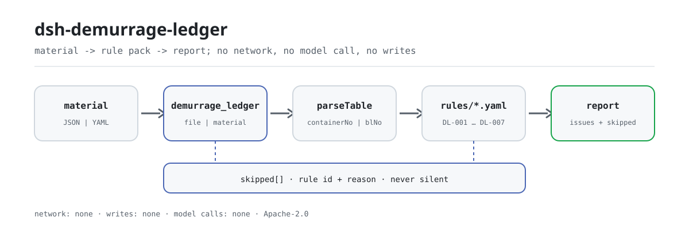

<div align="center">

<picture>
  <source media="(prefers-color-scheme: dark)" srcset="docs/assets/dsh-demurrage-ledger-flow-dark.svg">
  
</picture>

# dsh-demurrage-ledger

**把一份滞箱费台账里说不通的数字逐行指出来——只列差异，不替你定性。**

面向船务、报关与供应链结算岗的 DeepSeek Harness 核查插件：读一份「表头 + 每箱一行」的滞箱费台账，核对齐备性与算术，输出「哪一行、哪一栏、差什么」的清单。

[安装](#三步上手) · [配置](#配置) · [FAQ](#faq) · [简体中文](README.md) · [English](README.en.md) · [Español](README.es.md) · [Português](README.pt.md) · [हिन्दी](README.hi.md)

[](LICENSE)
[](#兼容性)
[](https://www.npmjs.com/package/dsh-demurrage-ledger)
[](https://github.com/PerryLink/dsh-demurrage-ledger/actions/workflows/ci.yml)
[](#兼容性)

[](https://github.com/PerryLink/dsh-demurrage-ledger/stargazers)
[](https://www.npmjs.com/package/dsh-demurrage-ledger)
[](https://dshfind.com/plugins/PerryLink/dsh-demurrage-ledger?ref=badge)
[](https://securityscorecards.dev/viewer/?uri=github.com/PerryLink/dsh-demurrage-ledger)
[](https://dsh.market/)

```sh
dsh plugin --profile <name> add dsh-demurrage-ledger
```

</div>

<sub>社区插件，与 DeepSeek 官方无关。唯一仓库：<https://github.com/PerryLink/dsh-demurrage-ledger>。</sub>

## 它是什么

`dsh-demurrage-ledger` 读取一份滞箱费台账（表头加每个集装箱一行），核对这份台账自身的齐备与算术：每行是否至少填写了箱号或提单号、免箱期起算日与还箱日期是否可解析且先后成立、超期天数是否等于两个日期之差减去免箱期、金额是否等于超期天数乘以费率、币制是否写成三位字母代码、箱号是否重复、备注栏是否残留未替换的模板占位符。免箱期与费率一律取自台账本身，台账的列名可以是中文，也可以是英文。

它只列「材料内部能逐条指认的差异」：不判定费用由谁承担、费率是否合理、能否减免，也不判定金额是否可追偿——这些取决于承运人运价本、运输合同与商业谈判。全程纯内存计算：不联网、不调用模型、不改动你交进来的原件。

## 三步上手

1. **安装**（三选一）：

   ```sh
   # git 通道（最新 main；安装时由 prepare 脚本构建 lib/）
   dsh plugin --profile web add github:PerryLink/dsh-demurrage-ledger
   # npm 通道（已发布版本）
   dsh plugin --profile web add dsh-demurrage-ledger
   # tarball 通道：本仓库 pnpm pack 后
   dsh plugin --profile web add ./dsh-demurrage-ledger-<version>.tgz
   ```

2. **最小配置**（默认即可用；`cordis.patch.yml` 只 insert 自己一行）：

   ```yaml
   - insert:
       - id: dsh-demurrage-ledger
         name: dsh-demurrage-ledger
   ```

   需要停用规则、只跑部分规则或换规则库时，再按「配置」一节追加 `config`。

3. **验证已生效**：

   ```sh
   dsh --profile web --dump-config | grep 'dsh-demurrage-ledger'
   ```

   仓内另有一份可离线跑通的样例（先构建）：

   ```sh
   pnpm install && pnpm run build
   node samples/quickstart/run.mjs
   ```

   ```text
   $ node samples/quickstart/run.mjs
   demurrage_ledger: 1 issue(s) — error 0, warn 1, info 0
   skipped: 1
   ```

**卸载**：`dsh plugin --profile web remove dsh-demurrage-ledger`（或从 profile patch 删掉该行）。

## 核心能力

`dsh-demurrage-ledger` 注册且只注册一个工具 `demurrage_ledger`：读一份台账，套用版本化规则库，返回一份带定位与修法的报告。

- **中英列名都认** —— 箱号 / `containerNo`、提单号 / `blNo`、免箱期 / `freeDays`、起算日期 / `startAt`、还箱日期 / `returnAt`、超期天数 / `overdueDays`、费率 / `rate`、金额 / `amount`、币制 / `currency`、备注 / `note` 等别名一次声明；匹配时忽略大小写、空格、下划线与连字符，发现里用台账自己的列名。
- **七条规则全部在数据里** —— 规则库 `rules/demurrage-ledger.yaml` 声明每项检查、阈值与出处；替换该文件即可切换规则集，无需改 TypeScript。规则库在加载期校验，不信任输入。
- **每条发现可复核** —— 报告逐条给出 `ruleId`、`severity`、`locator`（行 + 字段）、`found`、`expected`、`fix`，并始终带免责声明；措辞守卫禁止对合规、责任或正确性下结论。
- **未执行不静默** —— 缺列、被停用、四个值凑不齐的检查都会写进 `skipped` 并说明原因；空的 `issues` 永远不能读成「没有问题」。
- **只读、可热插拔** —— 工具注册是 Cordis effect，停止或热重载即撤销；不写盘、不联网、不调用模型。

| 规则 | 核对什么 | 级别 | 依据 |
|---|---|---|---|
| `DL-001` | 每行记录了箱号或提单号 | warn | 台账可追溯性 |
| `DL-002` | 起算日与还箱日可解析且先后成立 | warn | 日期自洽 |
| `DL-003` | 超期天数与两个日期、免箱期相符 | warn | 算术自洽 |
| `DL-004` | 金额等于超期天数 × 费率 | warn | 算术自洽 |
| `DL-005` | 币制是三位字母代码 | warn | GB/T 12406 |
| `DL-006` | 箱号在台账内唯一 | warn | 台账唯一性 |
| `DL-007` | 备注栏无未替换的占位符 | warn | 台账完整性 |

### 材料格式

工具接受 JSON 或 YAML；材料既可走 `file` 参数，也可走 `material` 内联：

```yaml
carrier: 某某船务
blNo: MSCUAA123456
rows:
  - { 箱号: MSCU1234567, 提单号: MSCUAA123456, 免箱期: '7', 起算日期: 2026-03-01,
      还箱日期: 2026-03-15, 超期天数: '7', 费率: '120', 滞箱费金额: '840', 币制: USD,
      备注: 按运价本分段计费，此为平均费率 }
```

日期可写 `2026-03-01` 或 `2026-03-01 14:00`；数值单元格可带单位与千分位。字段在读取层是可选的，由检查引擎校验，因此部分导出的材料会产生「缺项」类差异，而不是让程序崩溃。Excel 可先转成 JSON/YAML 再交进来；在支持文件输入的对话里，也可以直接让它代转。

### 真实输出（示例）

以 `DL-001` 的测试夹具为例，**输入**：

~~~json
{"rows":[{"箱号":"","提单号":"","箱型":"40HQ", ...}]}
~~~

**输出**：

~~~json
{
  "id": "dsh-demurrage-ledger.DL-001.de09b5a6",
  "ruleId": "DL-001",
  "severity": "warn",
  "locator": {
    "row": 1,
    "field": "containerNo"
  },
  "found": "第 1 行 containerNo、blNo 都为空",
  "expected": "containerNo、blNo 至少应填写一项",
  "fix": "补填箱号与提单号；本条只核对是否填写，不判断费用是否应当发生"
}
~~~

*Observed from `dsh-demurrage-ledger/tests/fixtures/DL-001/DL-001-unsafe.json; dsh-demurrage-ledger/tests/fixtures/DL-001/cases.json; dsh-demurrage-ledger/rules/demurrage-ledger.yaml; dsh-demurrage-ledger/tests/index.test.ts`*

### 规则问答

| 你会问 | 它怎么答 |
|---|---|
| 某行的箱号与提单号都是空的，会被报出来吗？ | 会。`DL-001` 对台账给了 `containerNo`、`blNo` 这两栏之一的每一行，要求至少填写其中一项，两项都空即报出该行。它只核对是否填写，不判断这笔费用是否应当发生。台账两栏都没有时，本条会在 `skipped` 中列出自己，而不是静默通过。 |
| 起算日期写成了 `15/03/2026`，而还箱日期比它还早，会怎么处理？ | `DL-002` 解析 `startAt` 并与 `returnAt` 比较：读不出日期的值会逐行报出，而不是略过；起算日期晚于还箱日期也会报出，同一天视为不晚于。它只比较这两个日期，起算日按提单日、放箱日还是到港日，取决于承运人运价本与合同，不由它选定。 |
| 超期天数栏写着 10，但两个日期与免箱期算出来是 7，能查出来吗？ | 能。`DL-003` 按 `returnAt` − `startAt` − `freeDays` 重算，与填报的 `overdueDays` 之差超过配置的 `tolerance`（出厂为 0）即报出该行。只有四个值都填写且可解析的行才执行；没有这样的行时，本条在 `skipped` 中说明自己未执行。起算口径与免箱期是否含节假日仍由合同决定——按工作日或按小时计费时，请调大容差或停用本条。 |
| 金额不等于超期天数乘以费率，而且我的费率是分段递增的。 | `DL-004` 按 `overdueDays` × `rate` 重算，与 `amount` 之差超过 `tolerance`（出厂为 0.01）即报出该行。它不判断费率是否合理、是否与运价本一致。分段费率无法用一个 `rate` 栏表达，这类台账会被报出差异：请停用本条，或改为填写平均费率并在备注中说明。 |
| 币制栏写的是 `美元`，或者 `usd`。 | 会报出。`DL-005` 对不符合规则库 pattern 的 `currency` 值逐行报出，出厂 pattern 为 `^[A-Z]{3}$`，即 `USD` 这样的三位大写字母。它只是形式核对，不判断该币制选择是否正确。本条依据的是规则库唯一引用的公开标准，其 excerpt 如实写明条文本次未取得，故封顶 warn。台账没有币制栏时，本条会在 `skipped` 中列出自己。 |
| 同一个箱号在两行里各出现一次，算重复登记吗？ | `DL-006` 会对重复的 `containerNo` 报出该行，并指出它与哪一行重复，比较时忽略空白字符。它只核对唯一性，命中需人工确认：同一箱分批还箱、或先滞箱后退箱再滞箱，确实可能产生两行——请在备注栏说明，而不是简单删除。台账没有 `containerNo` 栏时，本条报告无法执行，而不是静默通过。 |

## 配置

全部可调参数都在 `src/config.ts` 的 Schemastery schema 中，改 `cordis.yml` 即可生效，无需改代码；逐条阈值在 `rules/` 下的规则库文件里。

| 键 | 类型 | 默认值 | 说明 |
|---|---|---|---|
| `rulesFile` | string | `rules/demurrage-ledger.yaml` | 规则库文件路径，相对插件包根目录 |
| `disabledRules` | string[] | `[]` | 要停用的规则 id 列表；每条都会出现在 `skipped` 中 |
| `onlyRules` | string[] | `[]` | 只执行这些规则 id；留空表示执行全部规则 |
| `skipNotes` | string | `""` | 附加到每条 `skipped` 说明后的备注 |
| `timeoutMs` | number | `120000` | 工具协作式超时预算（毫秒） |

规则级参数（改规则库文件，不改代码）：

- `DL-003` 的 `daysField` / `fromField` / `toField` / `subtractField` / `tolerance` —— 天数算术。台账会四舍五入时调大 `tolerance`；按工作日或按小时计费时停用本条。
- `DL-004` 的 `resultField` / `factorFields` / `tolerance` —— 金额算术，`tolerance` 默认 `0.01`。
- `DL-005` 的 `pattern` —— 币制形式，默认三位大写字母。
- `DL-007` 的 `terms` —— 要查找的占位符表。

profile patch 覆盖示例：

```yaml
- insert:
    - id: dsh-demurrage-ledger
      name: dsh-demurrage-ledger
      config:
        onlyRules: [DL-001, DL-002, DL-003, DL-004]
        skipNotes: 按本机构实施细则复核
```

## FAQ

<details>
<summary>台账数据会被发到别处吗？存在哪？</summary>

不会。插件只读你通过 `file` 参数交进来的文件，或 `material` 里的内联文本；不联网、不调用模型、不写盘，也没有数据库或缓存。报告在会话里返回，插件自身不落盘。`package.json#dsh.demo` 也把这份能力声明为 `network: false`、`writes: []`。

</details>

<details>
<summary>某条规则没执行，是不是就等于没问题？</summary>

不是。缺列、规则被 `disabledRules` 停用、四个值凑不齐的检查都会逐条写进 `skipped`，并说明规则 id 与原因；`skipNotes` 的备注会附在每个原因后面。空的 `issues` 只能读成「本次能执行的检查没有发现差异」，不能读成「台账没有问题」。

</details>

<details>
<summary>会和其他插件抢工具名、服务键或 slot 吗？</summary>

不会。本插件只通过 `ctx.tools.register` 注册一个工具 `demurrage_ledger`，不注册命令、不提供任何服务键、不注册客户端 slot、不注册 `webServer` 路由、不改全局对象；组合包 patch 只 `insert` 自己那一行，不覆写内置行的 `config`。逐条依据见「与其他 DSH 插件的互操作性」。

</details>

<details>
<summary>性能开销多大？</summary>

纯内存的表格解析加规则求值：无网络请求、无模型调用、无原生依赖。`timeoutMs` 是协作式超时预算，默认 `120000` 毫秒；整月的台账建议用 `ptc` 工具模式，schema 成本只付一次。

</details>

## 安全边界

- **只读材料。** 工具只读取 `file` 指向的文件或 `material` 内联文本；不修改原件，不写盘，也没有隐式落库。
- **只列差异，不作定性。** 报告不判定合规、责任、正确性，也不判定费用是否应当发生；每条发现都带免责声明，措辞守卫在渲染层拦截「合规/违法/应当」这类裁定性表述。
- **空结果不等于通过。** 无法执行的检查一律进 `skipped`，并写明规则 id 与原因；规则所需列缺失时，规则报告自己，而不是静默通过。
- **引文护栏。** 每条规则必须带 `document` / `number` / `clause` / `excerpt` / `kind` / `source`，摘录必须是不少于八个字符的真实引文；`derived-from-principle` 封顶 `warn`，`institutional-configuration` 封顶 `info`，夸大依据的规则库在加载期失败。
- **注册即 effect。** 工具注册返回 disposer，停止或热重载即撤销，不留后台监听。

## 已知限制

- **没有国家标准可援引。** 滞期费与滞箱费由各承运人的运价表与运输合同确定，免用期与费率因承运人、航线与箱型而异；规则包的 `excerpt` 如实写明依据是算术自洽性或台账可追溯性，不编造标准编号。唯一例外是币制格式（GB/T 12406），其 excerpt 也写明条文本次未取得，因此封顶 `warn`。
- **分段费率会使 `DL-004` 失效。** 运价表通常分段递增（第 1–7 天一个费率，从第 8 天起更高）。单一的 `rate` 栏无法表达，按分段计价的台账会报出差额；请停用该规则，或记录平均费率并附注说明。
- **`DL-003` 不选择起算惯例。** 计时钟从提单、放货还是到港起算，以及免用期是否包含节假日，属于合同约定事项；台账的 `起算日期` 与 `免箱期` 被假定已遵循该约定。
- **只核形式，不核合理性。** `DL-005` 只检查币制是否三位大写字母，不判断该币制选择是否正确；`DL-004` 不判断费率是否合理或是否与运价本一致。
- **时间按墙上时钟处理。** 全部日期与数值计算都针对输入字符串本身，不做时区换算；跨时区录入的台账请先在源系统对齐。
- **本插件不提供任何承运人的免用期，也不提供任何费率。** 两者都来自台账；缺失时对应规则进 `skipped`，而不是猜一个默认值。

## 与其他 DSH 插件的互操作性

本插件与其它 DSH 插件无共享可变状态。依据本仓清单与源码静态核对：

- **只注册一个工具。** `src/index.ts` 的唯一注册面是 `ctx.tools.register(defineTool({ name: 'demurrage_ledger', … }))`，不注册命令、不监听会话事件。
- **无服务键冲突。** `package.json#dsh.capabilities` 只有 `tools:register`，`inject` 只有 `['tools']`，不提供任何 service key。
- **无 slot 冲突。** 本仓没有 `client/` 目录，不注册客户端 slot，不参与 UI 座位争抢。
- **无 HTTP 路由冲突。** 不注册任何 `webServer` 前缀。
- **无 patch 层冲突。** 组合包 patch 只 `insert` 自己那一行，从不覆写内置行的 `config`。
- **无全局改写。** 不修改原型、不读写 `process.env`、不替换全局对象；材料只从 `file` / `material` 进来，不与其他插件交换状态。

## 兼容性

| 项目 | 状态 |
|---|---|
| Harness | 对等版本范围 `>=0.1.2-rc.1 <0.2.0 \|\| >=0.2.0-0 <0.3.0` —— 已实测同时接受 `0.2.0-rc.2` 与 `0.2.1-rc.2`。**已声明 `engines.dsh`**：0.2.1 起由宿主单独裁决，范围为 `>=0.2.1-0 <0.3.0` |
| Node | `^22.19.0 \|\| >=24.0.0` |
| 平台 | 全平台（纯 ESM；无原生代码、无联网、不调用模型） |
| 工具模式 | `native` / `ptc` 均可；批量核对整月台账时建议 `ptc`，schema 成本只付一次 |

## 生态与质量

- [dshfind 插件页](https://dshfind.com/plugins/PerryLink/dsh-demurrage-ledger)（安装量与排名）
- [OpenSSF Scorecard 报告](https://securityscorecards.dev/viewer/?uri=github.com/PerryLink/dsh-demurrage-ledger)（由 [.github/workflows/scorecard.yml](.github/workflows/scorecard.yml) 驱动）
- [DSH Market](https://dsh.market/)（已上架）
- [按材料选核查器](https://perrylink.github.io/zh/checkers/choose/)（家族索引：62 个核查器 + 通用插件）
- [规则核验记录](rules/evidence/)（每条引用标准逐条核对留存）

## 规则依据与核验

规则数据与代码分离，规则库在 `rules/demurrage-ledger.yaml`。滞期费没有国家标准可援引，因此规则包的 `basis` 条目直接写明这一点，而不是编造一个编号；唯一的外部引用是币制代码标准，其 excerpt 承认条文本次未取得。加载期护栏要求每条规则都带文件、条款、摘录与来源，并禁止 `derived-from-principle` 或本机构配置的检查标为 `error`。

| 文件 | 文号 | 引用它的规则 |
|---|---|---|
| 承运人运价本与运输合同（无国家标准） | 无统一标准（本条依据为台账可追溯性） | DL-001 |
| 承运人运价本与运输合同（无国家标准） | 无统一标准（本条依据为日期自洽） | DL-002 |
| 承运人运价本与运输合同（无国家标准） | 无统一标准（本条依据为算术自洽） | DL-003, DL-004 |
| 《表示货币的代码》 | GB/T 12406—2022（表示货币的代码；2022-12-30 发布并实施；全部代替 GB/T 12406—2008（该版名称为「表示货币和资金的代码」）——注意旧版名称含「资金」；修改采用 ISO 4217:2015，非等同采用；条号本次未取得） | DL-005 |
| 承运人运价本与运输合同（无国家标准） | 无统一标准（本条依据为台账唯一性） | DL-006 |
| 承运人运价本与运输合同（无国家标准） | 无统一标准（本条依据为台账真实性） | DL-007 |

**边界：** 本插件核对一份 **滞箱费台账** 的算术与齐备性——是否记录了箱号或提单号，免箱期起算日与还箱日期是否可解析且先后成立，超期天数是否等于两个日期之差减去免箱期，金额是否等于超期天数 × 费率，币制是否符合其形式，以及箱号是否不重复。它**不**决定费用由谁承担、费率是否合理、是否可以减免，也不决定该金额是否可追偿。**这些取决于合同、责任划分与商业谈判。**

> ### ⚠️ 此事没有国家标准，规则包也不假装有
>
> 滞期费与滞箱费由**各承运人的运价表与运输合同**确定——免用期与费率因承运人、航线与箱型而异，**不存在统一的国家标准**。因此，本规则包**不**编造标准编号：每条规则的 `excerpt` 都直白写明，其依据是算术自洽性或台账可追溯性，且**不存在可援引的条款**。唯一的例外是币制格式，其依据为 GB/T 12406（修改采用 ISO 4217:2015，非等同采用），该条 excerpt 写明本次未取得条款原文。有测试断言每条 excerpt 都带有上述某一种承认。
>
> **本插件不提供任何承运人的免用期，也不提供任何费率。** 两者都来自台账。在采信一条发现之前，有两个后果值得知道：
>
> - **分段费率会使 `DL-004` 失效。** 运价表通常分段递增（第 1–7 天一个费率，从第 8 天起一个更高的费率）。单一的 `rate` 栏无法表达这一点，因此按分段计价的台账会报出差额。请停用该规则，或记录一个平均费率并附注说明。
> - **`DL-003` 不选择起算惯例。** 计时钟是从提单、放货还是到港起算——以及免用期是否包含节假日——属于合同约定事项。台账的 `起算日期` 与 `免箱期` 被假定已遵循该约定。

## 排错

- **插件装上了但工具不出现**：确认 `main` 指向 `lib/index.mjs` 且 `pnpm run build` 已生成该文件；`main` 写错会让加载器静默跳过该条目。
- **`dsh plugin add` 报版本不兼容**：peer 范围覆盖 `0.1.x` 与 `0.2.x`；若运行时在其之外，可显式豁免：`dsh plugin --profile <name> allow-version <包名@版本> --dsh-version <runtime> --accept-risk`。
- **某条规则没有执行**：查看 `skipped` 数组，其中写明了规则 id 与原因。
- **`check` 报 `manifest-peers` 失败**：静态检查器比对的是一份早于 0.2 世代的硬编码 peer 范围；安装期的 peer 校验以运行时为准。这是 `dsh-plugin-dev` 的已知上游问题。
- **时间看起来偏移**：全部计算都是对输入字符串做墙上时钟运算，不做时区换算。
- **`DL-003` 报出我手算过的台账**：先确认起算口径与免箱期是否含节假日；发现里会给出它用到的两个日期与免箱期，可以照着复算。
- **`DL-004` 在分段费率台账上报差异**：单一 `rate` 栏无法表达阶梯价；请停用该规则，或填写平均费率并在备注中说明。
- **`DL-005` 对 `USD `（带尾随空格）也报出**：默认 pattern 只接受恰好三位大写字母；导出前先规范化。
- **`DL-006` 对同一箱号报两次**：同一箱分批还箱、或放箱后再次滞箱，确实可能产生两行；请在备注说明，而不是删行。

## 开发

```sh
pnpm install
pnpm run typecheck   # tsc --noEmit
pnpm test            # vitest，共享表格插件套件 + 成对夹具
pnpm run build       # tsdown -> lib/index.mjs + lib/index.d.mts
pnpm run check:readmes   # 五语 README 一致性
node ../scripts/sync-shared.mjs dsh-demurrage-ledger   # 刷新 src/shared
```

插件是 **data-only** 的：`src/model.ts` 声明表格形状，共享件提供读取器与检查引擎，规则库声明每一项检查。发布前 `prepublishOnly` 会重跑门禁，未构建或漂移的树无法出包。

配图由 [`scripts/gen-readme-assets.py`](scripts/gen-readme-assets.py) 程序化生成（手写 SVG 深浅双版，图内只放命令与配置 token），可重复执行：`python scripts/gen-readme-assets.py`。

Topics：`dsh`, `dsh-plugin`, `deepseek-harness`, `deepseek`, `cordis`, `demurrage`, `ledger`

## 家族与致谢

本项目是 [PerryLink](https://github.com/PerryLink) 维护的 DeepSeek Harness 插件家族成员（全部 Apache-2.0）。如果这个插件帮到了你，**给个 star**——它不解锁任何功能，但会让下一个人更容易找到它。

- [@PerryLink](https://github.com/PerryLink) —— 创建者与维护者：规则库、共享核查引擎与五语文档。

<details>
<summary>展开全部插件</summary>

| 插件 | 状态 |
|---|---|
| **[dsh-aqua-input-check](https://github.com/PerryLink/dsh-aqua-input-check)** |  |
| **[dsh-archive-check](https://github.com/PerryLink/dsh-archive-check)** |  |
| **[dsh-auto-review](https://github.com/PerryLink/dsh-auto-review)** |  |
| **[dsh-autotier](https://github.com/PerryLink/dsh-autotier)** | 🧊 已冻结 — 见仓库 README |
| **[dsh-bid-ca-precheck](https://github.com/PerryLink/dsh-bid-ca-precheck)** |  |
| **[dsh-bid-qual-check](https://github.com/PerryLink/dsh-bid-qual-check)** |  |
| **[dsh-cert-mcp](https://github.com/PerryLink/dsh-cert-mcp)** | 🧊 已冻结 — 见仓库 README |
| **[dsh-checkpoint-rewind](https://github.com/PerryLink/dsh-checkpoint-rewind)** |  |
| **[dsh-click](https://github.com/PerryLink/dsh-click)** |  |
| **[dsh-composer-history](https://github.com/PerryLink/dsh-composer-history)** |  |
| **[dsh-contract-stance](https://github.com/PerryLink/dsh-contract-stance)** |  |
| **[dsh-customs-doc-check](https://github.com/PerryLink/dsh-customs-doc-check)** |  |
| **[dsh-data-quality](https://github.com/PerryLink/dsh-data-quality)** |  |
| **[dsh-demurrage-ledger](https://github.com/PerryLink/dsh-demurrage-ledger)** |  |
| **[dsh-doublecheck](https://github.com/PerryLink/dsh-doublecheck)** |  |
| **[dsh-drill-script-check](https://github.com/PerryLink/dsh-drill-script-check)** |  |
| **[dsh-eia-guide-check](https://github.com/PerryLink/dsh-eia-guide-check)** |  |
| **[dsh-emergency-plan](https://github.com/PerryLink/dsh-emergency-plan)** |  |
| **[dsh-essay-rubric-check](https://github.com/PerryLink/dsh-essay-rubric-check)** |  |
| **[dsh-evidence-check](https://github.com/PerryLink/dsh-evidence-check)** |  |
| **[dsh-export-ctl-check](https://github.com/PerryLink/dsh-export-ctl-check)** |  |
| **[dsh-fast](https://github.com/PerryLink/dsh-fast)** |  |
| **[dsh-fmea-table-check](https://github.com/PerryLink/dsh-fmea-table-check)** |  |
| **[dsh-forecast-penalty](https://github.com/PerryLink/dsh-forecast-penalty)** |  |
| **[dsh-fund-research](https://github.com/PerryLink/dsh-fund-research)** |  |
| **[dsh-github](https://github.com/PerryLink/dsh-github)** |  |
| **[dsh-gongwen-flow-check](https://github.com/PerryLink/dsh-gongwen-flow-check)** |  |
| **[dsh-gongwen-word-check](https://github.com/PerryLink/dsh-gongwen-word-check)** |  |
| **[dsh-guard-plan-qc](https://github.com/PerryLink/dsh-guard-plan-qc)** |  |
| **[dsh-hazchem-check](https://github.com/PerryLink/dsh-hazchem-check)** |  |
| **[dsh-hazplan-check](https://github.com/PerryLink/dsh-hazplan-check)** |  |
| **[dsh-hidden-risk-map](https://github.com/PerryLink/dsh-hidden-risk-map)** |  |
| **[dsh-hs-classify](https://github.com/PerryLink/dsh-hs-classify)** |  |
| **[dsh-icd-rule-check](https://github.com/PerryLink/dsh-icd-rule-check)** |  |
| **[dsh-industry-research](https://github.com/PerryLink/dsh-industry-research)** |  |
| **[dsh-lawcite-adapter](https://github.com/PerryLink/dsh-lawcite-adapter)** |  |
| **[dsh-laya](https://github.com/PerryLink/dsh-laya)** |  |
| **[dsh-lc-doc-check](https://github.com/PerryLink/dsh-lc-doc-check)** |  |
| **[dsh-learning-gap-check](https://github.com/PerryLink/dsh-learning-gap-check)** |  |
| **[dsh-library](https://github.com/PerryLink/dsh-library)** |  |
| **[dsh-local-ai](https://github.com/PerryLink/dsh-local-ai)** |  |
| **[dsh-lsp-actions](https://github.com/PerryLink/dsh-lsp-actions)** |  |
| **[dsh-mask](https://github.com/PerryLink/dsh-mask)** |  |
| **[dsh-mcp-panel](https://github.com/PerryLink/dsh-mcp-panel)** |  |
| **[dsh-medrec-qc](https://github.com/PerryLink/dsh-medrec-qc)** |  |
| **[dsh-memento](https://github.com/PerryLink/dsh-memento)** |  |
| **[dsh-nsfc-form-check](https://github.com/PerryLink/dsh-nsfc-form-check)** |  |
| **[dsh-nurse-record-check](https://github.com/PerryLink/dsh-nurse-record-check)** |  |
| **[dsh-observe](https://github.com/PerryLink/dsh-observe)** |  |
| **[dsh-origin-rvc-check](https://github.com/PerryLink/dsh-origin-rvc-check)** |  |
| **[dsh-ota-review-check](https://github.com/PerryLink/dsh-ota-review-check)** |  |
| **[dsh-output-styles](https://github.com/PerryLink/dsh-output-styles)** |  |
| **[dsh-paper-doc-adapter](https://github.com/PerryLink/dsh-paper-doc-adapter)** |  |
| **[dsh-permission-rules](https://github.com/PerryLink/dsh-permission-rules)** |  |
| **[dsh-permit-report-check](https://github.com/PerryLink/dsh-permit-report-check)** |  |
| **[dsh-pipeline-check](https://github.com/PerryLink/dsh-pipeline-check)** |  |
| **[dsh-pleading-draft](https://github.com/PerryLink/dsh-pleading-draft)** |  |
| **[dsh-plugin-doctor](https://github.com/PerryLink/dsh-plugin-doctor)** | 🚫 已退役（仓库已归档） |
| **[dsh-plugin-guide](https://github.com/PerryLink/dsh-plugin-guide)** |  |
| **[dsh-plugin-kit](https://github.com/PerryLink/dsh-plugin-kit)** | 🚫 已退役（仓库已归档） |
| **[dsh-plugin-upgrade](https://github.com/PerryLink/dsh-plugin-upgrade)** | 🚫 已退役（仓库已归档） |
| **[dsh-policy-brief-draft](https://github.com/PerryLink/dsh-policy-brief-draft)** |  |
| **[dsh-power-loss-split](https://github.com/PerryLink/dsh-power-loss-split)** |  |
| **[dsh-power-ticket-check](https://github.com/PerryLink/dsh-power-ticket-check)** |  |
| **[dsh-ppap-check](https://github.com/PerryLink/dsh-ppap-check)** |  |
| **[dsh-protest-deadline](https://github.com/PerryLink/dsh-protest-deadline)** |  |
| **[dsh-railway-window](https://github.com/PerryLink/dsh-railway-window)** |  |
| **[dsh-repair-order-qc](https://github.com/PerryLink/dsh-repair-order-qc)** |  |
| **[dsh-research-report](https://github.com/PerryLink/dsh-research-report)** |  |
| **[dsh-review-reply-check](https://github.com/PerryLink/dsh-review-reply-check)** |  |
| **[dsh-rulefile-check](https://github.com/PerryLink/dsh-rulefile-check)** |  |
| **[dsh-safety-brief-check](https://github.com/PerryLink/dsh-safety-brief-check)** |  |
| **[dsh-score](https://github.com/PerryLink/dsh-score)** |  |
| **[dsh-session-sync](https://github.com/PerryLink/dsh-session-sync)** |  |
| **[dsh-site-log-check](https://github.com/PerryLink/dsh-site-log-check)** |  |
| **[dsh-skill-pack-security](https://github.com/PerryLink/dsh-skill-pack-security)** |  |
| **[dsh-soe-decision-check](https://github.com/PerryLink/dsh-soe-decision-check)** |  |
| **[dsh-soilwater-check](https://github.com/PerryLink/dsh-soilwater-check)** |  |
| **[dsh-sop-sync-check](https://github.com/PerryLink/dsh-sop-sync-check)** |  |
| **[dsh-spc-gbt-adapter](https://github.com/PerryLink/dsh-spc-gbt-adapter)** |  |
| **[dsh-talk](https://github.com/PerryLink/dsh-talk)** |  |
| **[dsh-tender-extract](https://github.com/PerryLink/dsh-tender-extract)** |  |
| **[dsh-tender-matrix](https://github.com/PerryLink/dsh-tender-matrix)** |  |
| **[dsh-test-drive](https://github.com/PerryLink/dsh-test-drive)** |  |
| **[dsh-ticktick](https://github.com/PerryLink/dsh-ticktick)** | 🚫 已退役（仓库已归档） |
| **[dsh-translate](https://github.com/PerryLink/dsh-translate)** |  |
| **[dsh-warranty-calc](https://github.com/PerryLink/dsh-warranty-calc)** |  |
| **[dsh-budget](https://github.com/PerryLink/dsh-budget)** | 🧊 已冻结 — 见仓库 README |
| **[dsh-claude-move](https://github.com/PerryLink/dsh-claude-move)** | 🧊 已冻结 — 见仓库 README |
| **[dsh-defend](https://github.com/PerryLink/dsh-defend)** | 🧊 已冻结 — 见仓库 README |
| **[dsh-draw](https://github.com/PerryLink/dsh-draw)** | 🧊 已冻结 — 见仓库 README |
| **[dsh-reach](https://github.com/PerryLink/dsh-reach)** | 🧊 已冻结 — 见仓库 README |
| **[dsh-background-agents](https://github.com/PerryLink/dsh-background-agents)** | 🚫 已退役（仓库已归档） |
| **[dsh-session-pin](https://github.com/PerryLink/dsh-session-pin)** | 🚫 已退役（仓库已归档） |
| **[dsh-team-rooms](https://github.com/PerryLink/dsh-team-rooms)** | 🚫 已退役（仓库已归档） |

</details>

## License

[LICENSE](LICENSE)（Apache License 2.0）© 2026 dsh-demurrage-ledger contributors

<p align="center"><sub>Apache-2.0 · 社区插件，与 DeepSeek 无关。</sub></p>
