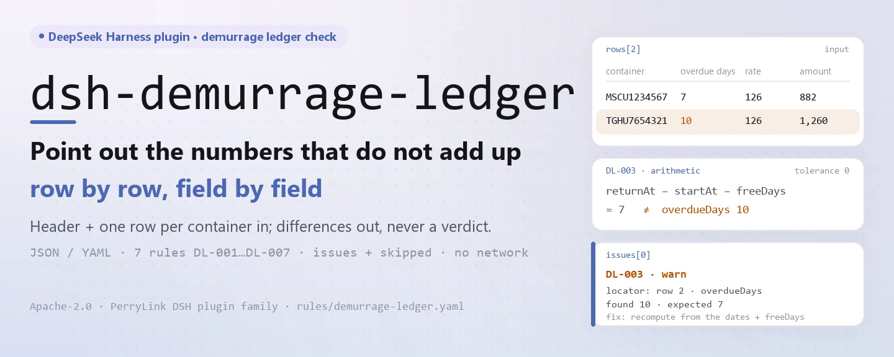
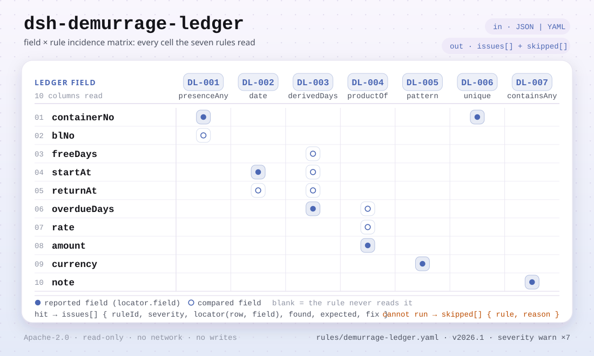

<div align="center">

<picture>
  <source media="(prefers-color-scheme: dark)" srcset="docs/assets/dsh-demurrage-ledger-hero-en-dark.webp">
  
</picture>

# dsh-demurrage-ledger

**Aponte linha a linha os números de um registo de demoras e detenções que não fecham — sem dar um veredicto.**

Um verificador do DeepSeek Harness para os postos de tráfego marítimo, alfândega e liquidação: lê um registo formado por um cabeçalho e uma linha por contentor, verifica integridade e aritmética e devolve uma lista do que está incoerente, onde e o que corrigir.

[Instalar](#instalação-em-três-passos) · [Configuração](#configuração) · [FAQ](#faq) · [简体中文](README.md) · [English](README.en.md) · [Español](README.es.md) · [Português](README.pt.md) · [हिन्दी](README.hi.md)

[](LICENSE)
[](#compatibilidade)
[](https://www.npmjs.com/package/dsh-demurrage-ledger)
[](https://github.com/PerryLink/dsh-demurrage-ledger/actions/workflows/ci.yml)
[](#compatibilidade)

[](https://github.com/PerryLink/dsh-demurrage-ledger/stargazers)
[](https://www.npmjs.com/package/dsh-demurrage-ledger)
[](https://dshfind.com/plugins/PerryLink/dsh-demurrage-ledger?ref=badge)
[](https://securityscorecards.dev/viewer/?uri=github.com/PerryLink/dsh-demurrage-ledger)
[](https://dsh.market/)

```sh
dsh plugin --profile <name> add dsh-demurrage-ledger
```

</div>

<sub>Plugin da comunidade, sem afiliação com a DeepSeek. Repositório canónico: <https://github.com/PerryLink/dsh-demurrage-ledger>.</sub>

## O que é

`dsh-demurrage-ledger` lê um registo de demoras e detenções de contentores (o cabeçalho mais uma linha por contentor) e verifica a integridade e a aritmética desse mesmo registo: se cada linha regista pelo menos um número de contentor ou um conhecimento de embarque, se a data de início do período livre e a data de devolução são analisáveis e coerentes entre si, se os dias de excesso são iguais à diferença entre essas duas datas menos os dias livres, se o montante é igual aos dias de excesso × a tarifa, se a moeda está escrita como código de três letras, se não há números de contentor repetidos e se não resta nenhum marcador de modelo por substituir na observação. Os dias livres e a tarifa são lidos do próprio registo, cujas colunas podem ter nomes em chinês ou em inglês.

Enumera apenas as diferenças que o próprio material consegue provar: não decide quem suporta o encargo, se a tarifa é razoável, se cabe isenção nem se o montante é recuperável — isso depende da tarifa do transportador, do contrato de transporte e da negociação comercial. Tudo corre em memória: sem rede, sem chamada ao modelo e sem alterar o ficheiro que entrega.

<picture>
  <source media="(prefers-color-scheme: dark)" srcset="docs/assets/dsh-demurrage-ledger-flow-v5-dark.svg">
  
</picture>

## Instalação em três passos

1. **Instalar** (escolha um canal):

   ```sh
   # canal git (última main; o script prepare constrói lib/ na instalação)
   dsh plugin --profile web add github:PerryLink/dsh-demurrage-ledger
   # canal npm (versões publicadas)
   dsh plugin --profile web add dsh-demurrage-ledger
   # canal tarball: após pnpm pack neste repositório
   dsh plugin --profile web add ./dsh-demurrage-ledger-<version>.tgz
   ```

2. **Configuração mínima** (os valores por omissão já servem; `cordis.patch.yml` só insere a sua própria linha):

   ```yaml
   - insert:
       - id: dsh-demurrage-ledger
         name: dsh-demurrage-ledger
   ```

   Acrescente um bloco `config` só quando precisar de desativar regras, executar um subconjunto ou apontar para outro pacote de regras — ver Configuração.

3. **Verificar que monta**:

   ```sh
   dsh --profile web --dump-config | grep 'dsh-demurrage-ledger'
   ```

   O repositório inclui ainda um arranque rápido offline (compile primeiro):

   ```sh
   pnpm install && pnpm run build
   node samples/quickstart/run.mjs
   ```

   ```text
   $ node samples/quickstart/run.mjs
   demurrage_ledger: 1 issue(s) — error 0, warn 1, info 0
   skipped: 1
   ```

**Desinstalar**: `dsh plugin --profile web remove dsh-demurrage-ledger` (ou remova a linha do profile patch).

## Capacidades principais

O `dsh-demurrage-ledger` registra exatamente uma ferramenta, `demurrage_ledger`: lê um registo, aplica um pacote de regras versionado e devolve um relatório com localização e correção.

- **Colunas em chinês e em inglês** — os aliases de número de contentor / `containerNo`, conhecimento de embarque / `blNo`, dias livres / `freeDays`, data de início / `startAt`, data de devolução / `returnAt`, dias de excesso / `overdueDays`, tarifa / `rate`, montante / `amount`, moeda / `currency`, observação / `note` são declarados uma vez; a correspondência ignora maiúsculas, espaços, sublinhados e hífenes, e cada achado nomeia a coluna que leu do registo.
- **As sete regras vivem nos dados** — `rules/demurrage-ledger.yaml` declara cada verificação, limite e fonte; trocar esse ficheiro troca o conjunto de regras sem tocar em TypeScript. O pacote é validado ao carregar, nunca é aceite por confiança.
- **Cada achado é revisível** — o relatório dá `ruleId`, `severity`, `locator` (linha + campo), `found`, `expected` e `fix`, e leva sempre o aviso legal; um guardião de redação impede veredictos sobre conformidade, responsabilidade ou correção.
- **O omitido nunca é silencioso** — uma verificação que não pode correr (coluna ausente, regra desativada, quatro valores incompletos) é listada em `skipped` com o motivo; uma lista `issues` vazia nunca pode ser lida como «não há nada de errado».
- **Só leitura e recarregável a quente** — o registo da ferramenta é um efeito Cordis desfeito ao parar ou recarregar; não escreve em disco, não faz pedidos de rede nem chamadas ao modelo.

| Regra | Verifica | Gravidade | Base |
|---|---|---|---|
| `DL-001` | regista-se um contentor ou um conhecimento de embarque | warn | rastreabilidade do registo |
| `DL-002` | as datas de início e devolução são analisáveis e coerentes | warn | coerência de datas |
| `DL-003` | os dias de excesso batem com as datas e o período livre | warn | aritmética |
| `DL-004` | o montante é igual a dias de excesso × tarifa | warn | aritmética |
| `DL-005` | a moeda é um código de três letras | warn | GB/T 12406 |
| `DL-006` | os números de contentor são únicos no registo | warn | unicidade do registo |
| `DL-007` | a coluna de observação não conserva marcadores por substituir | warn | integridade do registo |

### Formato do material

A ferramenta aceita JSON ou YAML; o material pode chegar pelo parâmetro `file` ou em linha por `material`:

```yaml
carrier: 某某船务
blNo: MSCUAA123456
rows:
  - { 箱号: MSCU1234567, 提单号: MSCUAA123456, 免箱期: '7', 起算日期: 2026-03-01,
      还箱日期: 2026-03-15, 超期天数: '7', 费率: '120', 滞箱费金额: '840', 币制: USD,
      备注: 按运价本分段计费，此为平均费率 }
```

As datas podem ser `2026-03-01` ou `2026-03-01 14:00`, e as células numéricas podem levar unidades e separadores de milhares. Os campos são opcionais na camada de leitura e validados pelo motor, pelo que uma exportação parcial gera achados de «valor ausente» em vez de falhar. O Excel pode ser convertido antes para JSON/YAML; num chat com entrada de ficheiros, a conversão pode ser feita por ti.

### Saída real (exemplo)

Com o fixture de teste `DL-001`, **entrada**:

~~~json
{"rows":[{"箱号":"","提单号":"","箱型":"40HQ", ...}]}
~~~

**Saída**:

~~~json
{
  "id": "dsh-demurrage-ledger.DL-001.de09b5a6",
  "ruleId": "DL-001",
  "severity": "warn",
  "locator": {
    "row": 1,
    "field": "containerNo"
  },
  "found": "第 1 行 containerNo、blNo 都为空",
  "expected": "containerNo、blNo 至少应填写一项",
  "fix": "补填箱号与提单号；本条只核对是否填写，不判断费用是否应当发生"
}
~~~

*Observado em `dsh-demurrage-ledger/tests/fixtures/DL-001/DL-001-unsafe.json; dsh-demurrage-ledger/tests/fixtures/DL-001/cases.json; dsh-demurrage-ledger/rules/demurrage-ledger.yaml; dsh-demurrage-ledger/tests/index.test.ts`*

### Perguntas sobre regras

| Você pergunta | O que ele responde |
|---|---|
| Uma linha tem vazios tanto o número do contentor como o conhecimento de embarque. Isso é reportado? | Sim. `DL-001` exige que, em cada linha a que o registo dá pelo menos uma dessas duas colunas, esteja preenchido `containerNo` ou `blNo`, e reporta a linha quando ambos estão vazios. Verifica apenas que um dos dois está preenchido, não se o encargo deveria ter ocorrido. Se o registo não trouxer nenhuma das duas colunas, a regra indica-se a si própria em `skipped` em vez de passar em silêncio. |
| A data de início foi escrita como `15/03/2026` e a data de devolução é anterior. O que faz a regra? | `DL-002` analisa `startAt` e compara-o com `returnAt`: um valor que não consegue ler como data é reportado nessa linha em vez de ser omitido, e uma data de início posterior à de devolução também é reportada; o mesmo dia conta como não posterior. Compara apenas essas duas datas: qual a convenção de início aplicável (conhecimento de embarque, entrega ou chegada) fica para a tarifa do transportador e o contrato. |
| A coluna dos dias de excesso diz 10, mas as duas datas e o período livre dão 7. Isso é detetado? | Sim. `DL-003` recalcula os dias como `returnAt` − `startAt` − `freeDays` e reporta a linha quando o `overdueDays` declarado difere mais do que a `tolerance` configurada, 0 por omissão. Só corre em linhas com os quatro valores presentes e analisáveis; quando nenhuma linha os reúne, a regra reporta-se em `skipped`. A convenção de início e a inclusão de feriados no período livre continuam a ser do contrato: para uma base de dias úteis ou de horas, aumente a tolerância ou desative a regra. |
| O montante não é igual aos dias de excesso vezes a tarifa, e a minha tarifa é escalonada. Isso é reportado? | `DL-004` multiplica `overdueDays` × `rate` e reporta a linha quando `amount` difere mais do que a `tolerance`, 0,01 por omissão. Não julga se a tarifa é razoável nem se corresponde à do transportador. Uma tarifa escalonada não cabe numa única célula `rate`, pelo que esse registo reportará uma diferença: desative a regra, ou registe uma tarifa média e diga-o na observação. |
| A célula da moeda diz `美元`, ou `usd`. Isso é reportado? | Sim. `DL-005` reporta qualquer valor de `currency` que não corresponda ao padrão do pacote, `^[A-Z]{3}$` por omissão: três letras maiúsculas como `USD`. É apenas uma verificação de forma e não julga se essa moeda é a correta para a liquidação. A sua base é a única norma pública citada pelo pacote, e o seu excerpt regista que o texto do artigo não foi obtido, pelo que a regra fica em warn. Sem coluna de moeda, a regra indica-se em `skipped`. |
| O mesmo número de contentor aparece em duas linhas. É um registo duplicado? | `DL-006` reporta a linha quando um valor de `containerNo` se repete, comparando sem espaços, e indica a linha anterior com que coincide. Verifica apenas a unicidade, e um resultado exige confirmação humana: um contentor devolvido por etapas, ou liberto e novamente retido, pode legitimamente ocupar duas linhas — diga-o na observação em vez de apagar uma linha. Sem coluna `containerNo`, a regra reporta que não pôde ser executada em vez de passar em silêncio. |

## Configuração

Todos os parâmetros ajustáveis ficam no esquema Schemastery de `src/config.ts`, portanto mudam pelo `cordis.yml` sem editar código; os limites por regra ficam no pacote de regras sob `rules/`.

| Chave | Tipo | Padrão | Descrição |
|---|---|---|---|
| `rulesFile` | string | `rules/demurrage-ledger.yaml` | Caminho do pacote de regras, relativo à raiz do pacote |
| `disabledRules` | string[] | `[]` | Ids de regras a desativar; cada uma aparece em `skipped` |
| `onlyRules` | string[] | `[]` | Executar apenas estas regras; vazio executa todas |
| `skipNotes` | string | `""` | Nota acrescentada a cada motivo de `skipped` |
| `timeoutMs` | number | `120000` | Orçamento de tempo limite cooperativo da ferramenta |

Parâmetros por regra (editam-se no pacote de regras, não no código):

- `DL-003` `daysField` / `fromField` / `toField` / `subtractField` / `tolerance` — a aritmética de dias. Aumente `tolerance` se o registo arredondar, ou desative a regra para uma base de dias úteis ou de horas.
- `DL-004` `resultField` / `factorFields` / `tolerance` — a aritmética do montante, tolerância `0,01` por omissão.
- `DL-005` `pattern` — a forma da moeda; três letras maiúsculas por omissão.
- `DL-007` `terms` — os marcadores a procurar.

Exemplo de substituição no profile patch:

```yaml
- insert:
    - id: dsh-demurrage-ledger
      name: dsh-demurrage-ledger
      config:
        onlyRules: [DL-001, DL-002, DL-003, DL-004]
        skipNotes: revisto com o nosso procedimento interno
```

## FAQ

<details>
<summary>Para onde vão os dados do registo? São enviados para algum lado?</summary>

Não. O plugin só lê o ficheiro que passa por `file`, ou o texto em linha de `material`; não faz pedidos de rede, não chama um modelo, não escreve em disco e não mantém base de dados nem cache. O relatório é devolvido na sessão; o plugin não persiste nada por si. O `package.json#dsh.demo` declara exatamente essa superfície como `network: false` e `writes: []`.

</details>

<details>
<summary>Uma regra não correu — isso significa que o registo está limpo?</summary>

Não. Uma verificação que não pode correr (coluna ausente, regra desativada por `disabledRules`, quatro valores incompletos) é listada em `skipped` com o id e o motivo; a nota `skipNotes` é acrescentada a cada motivo. Uma lista `issues` vazia significa apenas que as verificações que puderam correr não encontraram diferenças, nunca que o registo esteja correto.

</details>

<details>
<summary>Briga com outros plugins por nomes de ferramenta, chaves de serviço ou slots?</summary>

Não. O plugin registra uma só ferramenta, `demurrage_ledger`, por `ctx.tools.register`; não registra comandos, não fornece nenhuma chave de serviço, não registra slots de cliente, não registra rotas `webServer` e não altera objetos globais. O patch do bundle só faz `insert` da sua própria linha e nunca sobrescreve o `config` de uma linha integrada. A evidência está detalhada em Interoperabilidade com outros plugins DSH.

</details>

<details>
<summary>Qual é o tamanho do custo de desempenho?</summary>

Análise de tabela e avaliação de regras puramente em memória: sem pedidos de rede, sem chamadas ao modelo, sem dependências nativas. `timeoutMs` é um orçamento de tempo limite cooperativo, `120000` ms por omissão; para um mês inteiro de registos use o modo de ferramenta `ptc`, assim o custo do esquema é pago uma vez.

</details>

## Limites de segurança

- **Material só de leitura.** A ferramenta lê o ficheiro de `file` ou o texto em linha de `material`; não altera o original, não escreve em disco e não guarda nada de forma oculta.
- **Só diferenças, sem veredicto.** O relatório não decide conformidade, responsabilidade nem correção, nem se o encargo deveria ter ocorrido; cada achado leva o aviso legal e um guardião de redação bloqueia fórmulas que sentenciam.
- **Um resultado vazio não é uma aprovação.** Uma verificação que não pode correr é sempre listada em `skipped` com o id e o motivo; se faltam as colunas de que uma regra precisa, a regra reporta-se a si própria em vez de passar em silêncio.
- **Guardião de citações.** Cada regra tem de levar `document` / `number` / `clause` / `excerpt` / `kind` / `source`, e o trecho tem de ser citação real de pelo menos oito caracteres; `derived-from-principle` fica limitado a `warn`, `institutional-configuration` a `info`, e um pacote que exagera a sua base falha ao carregar.
- **O registo é um efeito.** O registo da ferramenta devolve um disposer, pelo que parar ou recarregar a remove e não fica nenhum listener em segundo plano.

## Limitações conhecidas

- **Não há norma nacional a citar.** As demoras e detenções são fixadas pela tarifa de cada transportador e pelo contrato de transporte — os períodos livres e as tarifas variam entre transportadores, rotas e tipos de contentor; o `excerpt` do pacote diz com clareza que a sua base é a coerência aritmética ou a rastreabilidade do registo, e não inventa um número de norma. A única exceção é o formato da moeda (GB/T 12406), cujo excerpt também regista que o texto do artigo não foi obtido, pelo que fica em `warn`.
- **As tarifas escalonadas quebram o `DL-004`.** As tarifas costumam escalonar-se (uma tarifa para os dias 1–7 e outra maior a partir do dia 8). Uma única coluna `rate` não consegue exprimir isso, pelo que um registo com preço escalonado reportará uma diferença; desative a regra, ou registe uma tarifa média com uma nota que o diga.
- **O `DL-003` não escolhe a convenção de início.** Se o relógio começa no conhecimento de embarque, na entrega ou na chegada — e se o período livre inclui feriados — é matéria do contrato. Assume-se que as colunas `start date` e `free days` do registo já o seguem.
- **Só forma, não razoabilidade.** O `DL-005` só verifica que a moeda tem três letras maiúsculas, não se essa moeda é a adequada para a liquidação; o `DL-004` não julga se a tarifa é razoável nem se corresponde à do transportador.
- **Aritmética de hora local.** Todas as datas e números são calculados sobre as cadeias de entrada, sem conversão de fuso horário; alinhe primeiro o sistema de origem se o registo foi introduzido entre fusos.
- **O plugin não inclui o período livre nem a tarifa de nenhum transportador.** Ambos vêm do registo; se faltarem, a regra correspondente passa a `skipped` em vez de supor um valor por omissão.

## Interoperabilidade com outros plugins DSH

Este plugin não partilha estado mutável com outros plugins DSH. A evidência é uma leitura estática do manifesto e do código deste repositório:

- **Uma só ferramenta.** A única superfície de registo em `src/index.ts` é `ctx.tools.register(defineTool({ name: 'demurrage_ledger', … }))`; não há comandos nem listeners de eventos de sessão.
- **Sem conflito de chaves de serviço.** `package.json#dsh.capabilities` é apenas `tools:register`, `inject` é apenas `['tools']` e o plugin não fornece nenhuma chave de serviço.
- **Sem conflito de slots.** O repositório não tem diretório `client/`, não registra slots de cliente e não compete por lugares de UI.
- **Sem conflito de rotas HTTP.** Não registra qualquer prefixo `webServer`.
- **Sem conflito de camadas de patch.** O patch do bundle só faz `insert` da sua própria linha e nunca sobrescreve o `config` de uma linha integrada.
- **Sem alteração global.** Não altera protótipos, não lê nem escreve `process.env` e não substitui objetos globais; o material entra só por `file` / `material` e não se troca estado com outros plugins.

## Compatibilidade

| Superfície | Estado |
|---|---|
| Harness | Faixa de peers `>=0.1.2-rc.1 <0.2.0 \|\| >=0.2.0-0 <0.3.0` — verificada para aceitar tanto `0.2.0-rc.2` quanto `0.2.1-rc.2`. O `engines.dsh` é declarado como `>=0.2.1-0 <0.3.0` e o host aplica-o desde 0.2.1 |
| Node | `^22.19.0 \|\| >=24.0.0` |
| Plataformas | Todas (ESM puro; sem código nativo, sem rede, sem chamada ao modelo) |
| Modo de ferramenta | Funciona em `native` e `ptc`; para um mês inteiro de registos use `ptc`, assim o custo do esquema é pago uma vez |

## Ecossistema e qualidade

- [Página do plugin no dshfind](https://dshfind.com/plugins/PerryLink/dsh-demurrage-ledger) (instalações e ranking)
- [Relatório OpenSSF Scorecard](https://securityscorecards.dev/viewer/?uri=github.com/PerryLink/dsh-demurrage-ledger) (impulsionado por [.github/workflows/scorecard.yml](.github/workflows/scorecard.yml))
- [DSH Market](https://dsh.market/) (publicado)
- [Escolher um verificador por material](https://perrylink.github.io/zh/checkers/choose/) (índice da família: 62 verificadores mais plugins gerais)
- [Registos de verificação de regras](rules/evidence/) (notas de verificação por citação guardadas no repositório)

## Fontes das regras e verificação

Os dados das regras estão separados do código e ficam em `rules/demurrage-ledger.yaml`. As demoras não têm norma nacional a citar, por isso as entradas `basis` do pacote dizem exatamente isso, em vez de inventar um número; a única referência externa é a norma de códigos de moeda, cujo excerpt admite que o texto do artigo não foi obtido. O guardião de carregamento continua a exigir que cada regra leve documento, cláusula, trecho e fonte, e continua a proibir que uma verificação `derived-from-principle` ou configurada localmente seja `error`.

| Documento | Número | Regras que o citam |
|---|---|---|
| Tarifa do transportador e contrato de transporte (sem norma nacional) | Sem norma unificada (esta regra assenta na rastreabilidade do registo) | DL-001 |
| Tarifa do transportador e contrato de transporte (sem norma nacional) | Sem norma unificada (esta regra assenta na coerência de datas) | DL-002 |
| Tarifa do transportador e contrato de transporte (sem norma nacional) | Sem norma unificada (esta regra assenta na aritmética) | DL-003, DL-004 |
| Códigos para a representação de moedas | GB/T 12406—2022 (publicada e aplicada em 2022-12-30; substitui integralmente a GB/T 12406—2008, cujo título era «Códigos para a representação de moedas e fundos»; adoção modificada da ISO 4217:2015, não idêntica; número de cláusula não obtido) | DL-005 |
| Tarifa do transportador e contrato de transporte (sem norma nacional) | Sem norma unificada (esta regra assenta na unicidade do registo) | DL-006 |
| Tarifa do transportador e contrato de transporte (sem norma nacional) | Sem norma unificada (esta regra assenta na integridade do registo) | DL-007 |

**Fronteira:** este plugin verifica um **registo de demoras e detenções** quanto a aritmética e integridade — que se registe um contentor ou um conhecimento de embarque, que a data de início do período livre e a de devolução sejam analisáveis e coerentes, que os dias de excesso sejam a diferença entre essas datas menos os dias livres, que o montante seja dias × tarifa, que a moeda siga o seu formato e que os números de contentor não se repitam. **Não** decide quem suporta o encargo, se uma tarifa é razoável, se cabe isenção nem se o montante é recuperável. **Isso depende do contrato, da repartição de responsabilidades e da negociação comercial.**

> ### ⚠️ Não existe norma nacional para isto, e o pacote não finge o contrário
>
> As demoras e detenções são fixadas **pela tarifa de cada transportador e pelo contrato de transporte** — os períodos livres e as tarifas variam entre transportadores, rotas e tipos de contentor, e **não existe norma nacional unificada**. Por isso o pacote **não** fabrica um número de norma: o `excerpt` de cada regra diz com clareza que a sua base é a coerência aritmética ou a rastreabilidade do registo e que **não existe cláusula citável**. A única exceção é o formato da moeda, cuja sede é a GB/T 12406 (adoção modificada da ISO 4217:2015, não idêntica), e esse excerpt diz que o texto do artigo não foi obtido. Um teste garante que cada excerpt leva uma dessas admissões.
>
> **O plugin não inclui o período livre nem a tarifa de nenhum transportador.** Ambos vêm do registo. Antes de confiar num achado, vale a pena conhecer duas consequências:
>
> - **As tarifas escalonadas quebram o `DL-004`.** As tarifas costumam escalonar-se (uma tarifa para os dias 1–7 e outra maior a partir do dia 8). Uma única coluna `rate` não consegue exprimi-lo, pelo que um registo com preço escalonado reportará uma diferença. Desative a regra, ou registe uma tarifa média com uma nota que o diga.
> - **O `DL-003` não escolhe a convenção de início.** Se o relógio começa no conhecimento de embarque, na entrega ou na chegada — e se o período livre inclui feriados — é matéria do contrato. Assume-se que as colunas `start date` e `free days` do registo já o seguem.

## Solução de problemas

- **O plugin instala mas a ferramenta não aparece.** Confirme que `main` resolve para `lib/index.mjs` e que `pnpm run build` o gerou; um `main` errado faz o carregador saltar a entrada em silêncio.
- **`dsh plugin add` recusa o pacote como incompatível.** A faixa de peers cobre `0.1.x` e `0.2.x`; se o seu runtime ficar fora dela, conceda uma isenção explícita: `dsh plugin --profile <name> allow-version <pkg@ver> --dsh-version <runtime> --accept-risk`.
- **Uma regra não executou.** Leia o arranjo `skipped`; lá estão o id e o motivo.
- **`check` informa `manifest-peers` como falha.** O verificador estático compara com uma faixa de peers fixa anterior à linha 0.2; o runtime aplica a compatibilidade na instalação. É um problema conhecido do `dsh-plugin-dev`.
- **Os horários parecem deslocados.** Toda a aritmética é de hora local sobre as cadeias fornecidas, sem conversão de fuso horário.
- **O `DL-003` salta num registo que calculei à mão.** Confirme a convenção de início e se o período livre inclui feriados; o achado mostra as duas datas e os dias livres usados, pelo que a soma pode ser refeita.
- **O `DL-004` reporta uma diferença num registo com tarifa escalonada.** Uma única tarifa não consegue exprimir um preço escalonado. Desative a regra, ou registe uma tarifa média e diga-o na observação.
- **O `DL-005` também reporta `USD `.** O padrão por omissão aceita exatamente três letras maiúsculas; um espaço final ou um código em minúsculas falha. Normalize a exportação.
- **O `DL-006` reporta duas vezes o mesmo contentor.** Pode ser legítimo — um contentor devolvido por etapas, ou retido de novo após a entrega. Diga-o na observação em vez de apagar uma linha.

## Desenvolvimento

```sh
pnpm install
pnpm run typecheck   # tsc --noEmit
pnpm test            # vitest, a suite partilhada de plugins de tabela mais fixtures emparelhados
pnpm run build       # tsdown -> lib/index.mjs + lib/index.d.mts
pnpm run check:readmes   # consistência dos README em cinco idiomas
node ../scripts/sync-shared.mjs dsh-demurrage-ledger   # atualizar src/shared
```

O plugin é **só dados**: `src/model.ts` declara a forma da tabela, o kit partilhado fornece o leitor e o motor de verificação, e o pacote de regras declara cada verificação. O `prepublishOnly` volta a executar a porta, pelo que uma publicação não pode sair com uma árvore por compilar ou desviada.

As imagens são geradas por [`scripts/gen-readme-assets.py`](scripts/gen-readme-assets.py) (o Pillow desenha os quatro banners hero zh/en claro/escuro; a matriz de campos × regras é um SVG claro/escuro escrito à mão); volte a executá-lo com `python scripts/gen-readme-assets.py`.

Topics: `dsh`, `dsh-plugin`, `deepseek-harness`, `deepseek`, `cordis`, `demurrage`, `ledger`

## Família e agradecimentos

Este projeto é membro da família de plugins do DeepSeek Harness mantida pela [PerryLink](https://github.com/PerryLink) (todos Apache-2.0). Se este plugin te ajudar, **dá-lhe uma estrela**: não desbloqueia nada, mas ajuda a próxima pessoa a encontrá-lo.

- [@PerryLink](https://github.com/PerryLink) — criador e mantenedor: o pacote de regras, o motor de verificação partilhado e a documentação em cinco idiomas.

<details>
<summary>Expandir todos os plugins</summary>

| Plugin | Status |
|---|---|
| **[dsh-aqua-input-check](https://github.com/PerryLink/dsh-aqua-input-check)** |  |
| **[dsh-archive-check](https://github.com/PerryLink/dsh-archive-check)** |  |
| **[dsh-auto-review](https://github.com/PerryLink/dsh-auto-review)** |  |
| **[dsh-autotier](https://github.com/PerryLink/dsh-autotier)** | 🧊 CONGELADO — ver o README do repo |
| **[dsh-bid-ca-precheck](https://github.com/PerryLink/dsh-bid-ca-precheck)** |  |
| **[dsh-bid-qual-check](https://github.com/PerryLink/dsh-bid-qual-check)** |  |
| **[dsh-cert-mcp](https://github.com/PerryLink/dsh-cert-mcp)** | 🧊 CONGELADO — ver o README do repo |
| **[dsh-checkpoint-rewind](https://github.com/PerryLink/dsh-checkpoint-rewind)** |  |
| **[dsh-click](https://github.com/PerryLink/dsh-click)** |  |
| **[dsh-composer-history](https://github.com/PerryLink/dsh-composer-history)** |  |
| **[dsh-contract-stance](https://github.com/PerryLink/dsh-contract-stance)** |  |
| **[dsh-customs-doc-check](https://github.com/PerryLink/dsh-customs-doc-check)** |  |
| **[dsh-data-quality](https://github.com/PerryLink/dsh-data-quality)** |  |
| **[dsh-demurrage-ledger](https://github.com/PerryLink/dsh-demurrage-ledger)** |  |
| **[dsh-doublecheck](https://github.com/PerryLink/dsh-doublecheck)** |  |
| **[dsh-drill-script-check](https://github.com/PerryLink/dsh-drill-script-check)** |  |
| **[dsh-eia-guide-check](https://github.com/PerryLink/dsh-eia-guide-check)** |  |
| **[dsh-emergency-plan](https://github.com/PerryLink/dsh-emergency-plan)** |  |
| **[dsh-essay-rubric-check](https://github.com/PerryLink/dsh-essay-rubric-check)** |  |
| **[dsh-evidence-check](https://github.com/PerryLink/dsh-evidence-check)** |  |
| **[dsh-export-ctl-check](https://github.com/PerryLink/dsh-export-ctl-check)** |  |
| **[dsh-fast](https://github.com/PerryLink/dsh-fast)** |  |
| **[dsh-fmea-table-check](https://github.com/PerryLink/dsh-fmea-table-check)** |  |
| **[dsh-forecast-penalty](https://github.com/PerryLink/dsh-forecast-penalty)** |  |
| **[dsh-fund-research](https://github.com/PerryLink/dsh-fund-research)** |  |
| **[dsh-github](https://github.com/PerryLink/dsh-github)** |  |
| **[dsh-gongwen-flow-check](https://github.com/PerryLink/dsh-gongwen-flow-check)** |  |
| **[dsh-gongwen-word-check](https://github.com/PerryLink/dsh-gongwen-word-check)** |  |
| **[dsh-guard-plan-qc](https://github.com/PerryLink/dsh-guard-plan-qc)** |  |
| **[dsh-hazchem-check](https://github.com/PerryLink/dsh-hazchem-check)** |  |
| **[dsh-hazplan-check](https://github.com/PerryLink/dsh-hazplan-check)** |  |
| **[dsh-hidden-risk-map](https://github.com/PerryLink/dsh-hidden-risk-map)** |  |
| **[dsh-hs-classify](https://github.com/PerryLink/dsh-hs-classify)** |  |
| **[dsh-icd-rule-check](https://github.com/PerryLink/dsh-icd-rule-check)** |  |
| **[dsh-industry-research](https://github.com/PerryLink/dsh-industry-research)** |  |
| **[dsh-lawcite-adapter](https://github.com/PerryLink/dsh-lawcite-adapter)** |  |
| **[dsh-laya](https://github.com/PerryLink/dsh-laya)** |  |
| **[dsh-lc-doc-check](https://github.com/PerryLink/dsh-lc-doc-check)** |  |
| **[dsh-learning-gap-check](https://github.com/PerryLink/dsh-learning-gap-check)** |  |
| **[dsh-library](https://github.com/PerryLink/dsh-library)** |  |
| **[dsh-local-ai](https://github.com/PerryLink/dsh-local-ai)** |  |
| **[dsh-lsp-actions](https://github.com/PerryLink/dsh-lsp-actions)** |  |
| **[dsh-mask](https://github.com/PerryLink/dsh-mask)** |  |
| **[dsh-mcp-panel](https://github.com/PerryLink/dsh-mcp-panel)** |  |
| **[dsh-medrec-qc](https://github.com/PerryLink/dsh-medrec-qc)** |  |
| **[dsh-memento](https://github.com/PerryLink/dsh-memento)** |  |
| **[dsh-nsfc-form-check](https://github.com/PerryLink/dsh-nsfc-form-check)** |  |
| **[dsh-nurse-record-check](https://github.com/PerryLink/dsh-nurse-record-check)** |  |
| **[dsh-observe](https://github.com/PerryLink/dsh-observe)** |  |
| **[dsh-origin-rvc-check](https://github.com/PerryLink/dsh-origin-rvc-check)** |  |
| **[dsh-ota-review-check](https://github.com/PerryLink/dsh-ota-review-check)** |  |
| **[dsh-output-styles](https://github.com/PerryLink/dsh-output-styles)** |  |
| **[dsh-paper-doc-adapter](https://github.com/PerryLink/dsh-paper-doc-adapter)** |  |
| **[dsh-permission-rules](https://github.com/PerryLink/dsh-permission-rules)** |  |
| **[dsh-permit-report-check](https://github.com/PerryLink/dsh-permit-report-check)** |  |
| **[dsh-pipeline-check](https://github.com/PerryLink/dsh-pipeline-check)** |  |
| **[dsh-pleading-draft](https://github.com/PerryLink/dsh-pleading-draft)** |  |
| **[dsh-plugin-doctor](https://github.com/PerryLink/dsh-plugin-doctor)** | 🚫 APOSENTADO (repo arquivado) |
| **[dsh-plugin-guide](https://github.com/PerryLink/dsh-plugin-guide)** |  |
| **[dsh-plugin-kit](https://github.com/PerryLink/dsh-plugin-kit)** | 🚫 APOSENTADO (repo arquivado) |
| **[dsh-plugin-upgrade](https://github.com/PerryLink/dsh-plugin-upgrade)** | 🚫 APOSENTADO (repo arquivado) |
| **[dsh-policy-brief-draft](https://github.com/PerryLink/dsh-policy-brief-draft)** |  |
| **[dsh-power-loss-split](https://github.com/PerryLink/dsh-power-loss-split)** |  |
| **[dsh-power-ticket-check](https://github.com/PerryLink/dsh-power-ticket-check)** |  |
| **[dsh-ppap-check](https://github.com/PerryLink/dsh-ppap-check)** |  |
| **[dsh-protest-deadline](https://github.com/PerryLink/dsh-protest-deadline)** |  |
| **[dsh-railway-window](https://github.com/PerryLink/dsh-railway-window)** |  |
| **[dsh-repair-order-qc](https://github.com/PerryLink/dsh-repair-order-qc)** |  |
| **[dsh-research-report](https://github.com/PerryLink/dsh-research-report)** |  |
| **[dsh-review-reply-check](https://github.com/PerryLink/dsh-review-reply-check)** |  |
| **[dsh-rulefile-check](https://github.com/PerryLink/dsh-rulefile-check)** |  |
| **[dsh-safety-brief-check](https://github.com/PerryLink/dsh-safety-brief-check)** |  |
| **[dsh-score](https://github.com/PerryLink/dsh-score)** |  |
| **[dsh-session-sync](https://github.com/PerryLink/dsh-session-sync)** |  |
| **[dsh-site-log-check](https://github.com/PerryLink/dsh-site-log-check)** |  |
| **[dsh-skill-pack-security](https://github.com/PerryLink/dsh-skill-pack-security)** |  |
| **[dsh-soe-decision-check](https://github.com/PerryLink/dsh-soe-decision-check)** |  |
| **[dsh-soilwater-check](https://github.com/PerryLink/dsh-soilwater-check)** |  |
| **[dsh-sop-sync-check](https://github.com/PerryLink/dsh-sop-sync-check)** |  |
| **[dsh-spc-gbt-adapter](https://github.com/PerryLink/dsh-spc-gbt-adapter)** |  |
| **[dsh-talk](https://github.com/PerryLink/dsh-talk)** |  |
| **[dsh-tender-extract](https://github.com/PerryLink/dsh-tender-extract)** |  |
| **[dsh-tender-matrix](https://github.com/PerryLink/dsh-tender-matrix)** |  |
| **[dsh-test-drive](https://github.com/PerryLink/dsh-test-drive)** |  |
| **[dsh-ticktick](https://github.com/PerryLink/dsh-ticktick)** | 🚫 APOSENTADO (repo arquivado) |
| **[dsh-translate](https://github.com/PerryLink/dsh-translate)** |  |
| **[dsh-warranty-calc](https://github.com/PerryLink/dsh-warranty-calc)** |  |
| **[dsh-budget](https://github.com/PerryLink/dsh-budget)** | 🧊 CONGELADO — ver o README do repo |
| **[dsh-claude-move](https://github.com/PerryLink/dsh-claude-move)** | 🧊 CONGELADO — ver o README do repo |
| **[dsh-defend](https://github.com/PerryLink/dsh-defend)** | 🧊 CONGELADO — ver o README do repo |
| **[dsh-draw](https://github.com/PerryLink/dsh-draw)** | 🧊 CONGELADO — ver o README do repo |
| **[dsh-reach](https://github.com/PerryLink/dsh-reach)** | 🧊 CONGELADO — ver o README do repo |
| **[dsh-background-agents](https://github.com/PerryLink/dsh-background-agents)** | 🚫 APOSENTADO (repo arquivado) |
| **[dsh-session-pin](https://github.com/PerryLink/dsh-session-pin)** | 🚫 APOSENTADO (repo arquivado) |
| **[dsh-team-rooms](https://github.com/PerryLink/dsh-team-rooms)** | 🚫 APOSENTADO (repo arquivado) |

</details>

## Licença

[LICENSE](LICENSE) (Apache License 2.0) © 2026 dsh-demurrage-ledger contributors

<p align="center"><sub>Apache-2.0 · Plugin da comunidade, sem afiliação com a DeepSeek.</sub></p>
